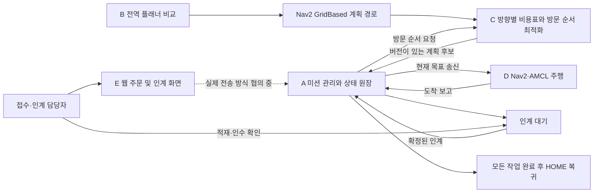

# MOVEIT 공항 수하물 운반 서비스 기획

**교통약자 이동지원을 위한 지능형 수하물 운반 로봇 시스템**
*Intelligent Baggage Transport Robot System for Airport Passenger Assistance*

**사람은 사람을 지원하고, 로봇은 짐을 운반한다.**

## 사용자와 해결할 문제

직접 가방을 운반하기 어려운 승객이 이동지원을 받는 동안, 직원에게 가방 운반 업무도 생길 수 있다. 여러 거점의 요청이 겹치면 같은 복도를 반복해서 오가는 공차 구간이 늘어난다. 팀은 승객 지원과 짐 운반을 분리할 수 있는지, 여러 수하물 요청을 한 대로 처리할 때 방문 순서가 이동 비용을 얼마나 바꾸는지 검증한다.

| 구분 | 업무 흐름 |
|---|---|
| AS-IS 가설 | 직원이 승객의 이동을 보조한다. 수하물 도움도 필요한 경우 운반 업무가 추가되고, 여러 요청이 겹치면 지원 업무가 밀릴 수 있다. |
| TO-BE 시연 | 접수 직원이 지정 거점에서 작은 시연용 가방을 받고 웹에 요청을 등록한다. 승객은 직원의 이동지원을 계속 받는다. 공유 AMR이 가방을 수거해 지정 탑승구 역할 지점으로 이동하고, 그곳의 담당자가 인수 확인을 한다. |

인천공항은 교통약자 출국객에게 전동차·휠체어 이동서비스를 안내한다. 공항의 공식 게이트 구분은 제1여객터미널 1~50번, 별도 탑승동 101~132번이다. 첨부 그림의 곡선형 통로, 중앙 공간과 좌우 분기는 가상 월드의 모티프로 사용한다. [이동서비스 안내](https://www.airport.kr/ap_ko/950/subview.do) · [출국 절차와 게이트 번호](https://www.airport.kr/ap_ko/886/subview.do)

별도 운반 인력 수와 빈도, 수하물 분리 운반 허용 범위, 인수자와 보관 책임, 보안구역 접근, 요청량, 탑승 마감과 로봇 운용 제한은 현장 확인이 필요하다. 시연은 같은 허용 구역 안의 소형 모형 가방과 운영자 역할을 전제로 한다. 실제 공항 운영 승인, 인력 절감 효과 및 보안 적합성은 검증 대상 밖이다.

## 시스템 흐름

B는 두 지점 사이의 길을 비교하고, C는 여러 지점을 어떤 순서로 들를지 계산하며, D는 주어진 목표까지 로봇을 움직인다. A는 상태와 실행 계획의 최종 권한을 갖고 E는 요청과 인계 입력을 맡는다. 승인된 패키지와 팀원 책임은 [아키텍처](ARCHITECTURE.md)를 따른다.

새 주문이 들어오면 C는 완료 단계와 현재 단계 조건을 반영해 남은 순서를 계산한다. A가 요청 ID, 출발점, 계획 버전과 비용표 버전을 검증한 뒤, 현재 **TaskStep의 인계**가 끝났을 때 유효한 후보를 적용한다. Nav2 도착은 인계 대기의 시작이다. 실패나 통신 불확실성이 남으면 현재 목표를 붙들고 복구를 확인한다. 작업 완료 후 A가 HOME 복귀를 별도로 실행하고, HOME 자체가 하역 TaskStep인 흐름에서는 사람의 확인을 보존한다.

## 두 시연 환경

| | 공항 SIM | 강의실 REAL |
|---|---|---|
| 목적 | 여러 요청의 순서·공차 비용 및 재계획을 비교 | 실제 로봇과 사람의 인계로 같은 흐름 확인 |
| 지점 | 중앙 HOME, 접수 S1–S4, 탑승구 역할 G1–G8, 총 13개 | HOME, 접수 S1·S2, 전달 G1·G2, 총 5개 |
| 지도 | 첨부 그림에서 착안한 가상 공항 | 강의실 현장 지도와 검증된 Pose 확보 후 확정 |
| 인계 | A 호출 경계에 시연 이벤트 주입. E 웹은 별도 MOCK | 직원 역할의 사람이 물품 적재·인수 후 확인 |
| 권장 주문 | 초기 S1→G5, S3→G1, S2→G6, S4→G8. 첫 전달 주행 중 S2→G7 추가 | 초기 S1→G2, S1→G1. 첫 전달 주행 중 S2→G1 추가 |

두 환경은 같은 A·C·D 구조와 공통 인터페이스를 사용한다. 지도, Pose, 비용표와 센서·주행 설정은 환경별로 고정한다. 실차 주문은 지도와 비용표 확인 후 확정한다. 가방 한 개 제한으로 시연하려면 실제 순서에서 모든 수거·전달을 따라가며 동시 적재 수가 1 이하인지 사전에 확인한다. 현재 최적화기는 적재용량 제약을 지원하지 않으므로, 검증을 통과하는 주문을 쓰거나 가상 수하물로 검증한다.

## 핵심과 후속 기능

- 핵심은 지도·AMCL·Nav2 주행, 방향별 계획 비용과 다중 주문 최적화, 신규 주문 재계획, 미션 상태 영속화·중복 방지, 도착과 사람의 인계 확인, HOME 복귀다. 웹을 통한 전체 흐름은 A↔E 전송 계약과 통합 뒤 검증한다.
- 확장 후보는 RFID·QR/바코드 식별, 로드셀, 전자 잠금, ArUco 정렬, LED·화면·음성 및 자동 도킹·충전이다. 추가 장비와 적재용량, 마감시간, 다중 로봇 최적화는 이번 범위 밖이다. HOME은 시연에서 대기·복귀 지점이다.

## 연구 검증

하나의 주문은 Nav2로 두 지점을 이동하면 된다. 여러 주문에서는 한 배달의 종료점이 다음 수거의 출발점이 되므로, 순서에 따라 공차 이동과 총 이동 비용이 달라진다. C의 현재 목적함수는 출발지에서 남은 TaskStep까지의 **합산 계획 경로 거리**다. 공차 구간도 총합에 포함되지만 공차 거리만을 별도로 최소화하지 않는다. 실행 중 C의 서비스 비용은 마지막 작업까지만 계산한다. A가 별도 수행하는 HOME 복귀는 비교표에서 양쪽 모두에 더하거나 별도 열로 구분한다.

| 비교 | 같은 조건에서 기록할 값 |
|---|---|
| FIFO와 기존 최적화 | 방향별 비용표, 초기 HOME, 동일 주문과 인계 조건, 총 계획 거리·공차 계획 거리, 순서·선행 관계 |
| 신규 주문 순서 유지와 재계획 | 같은 주행 단계에서 추가 주문, 현재 UUID와 계획 버전, 기존 순서 보존 후 신규 작업 추가 대비 후보 비용·연산 시간 |
| 반복 실행 | 미션 완료율, 단계 누락·중복, 목표 유지, 실행 시간, 실제 누적 주행 거리 및 공차 주행 거리 |

계획 거리에는 `ComputePathToPose`로 계산한 비용표를 사용한다. 공차 분류는 인계 결과에 따라 로봇이 보유한 물품이 0개인 구간으로 계산한다. 실제 주행 거리·공차 거리·소요 시간에는 SIM odom 또는 실차 주행 로그, 타임스탬프, 인계 시작·끝 표식이 추가로 필요하다. 알고리즘 계산 시간과 서비스 왕복 시간도 따로 기록한다.

먼저 1건 기본 시험, 강의실 초기 2건+신규 1건, 공항 초기 4건+신규 1건 순으로 진행한다. 공항 10건과 20~30건은 부하 평가 후 확대한다. 현재 완전탐색은 단계 수에 따라 경우의 수가 급증하므로 큰 입력의 실시간 처리 가능성을 가정하지 않는다.

## 전환 시점의 구현 근거

전환 기준 커밋은 [a760ce6](https://github.com/waterhyunsu/SMART-LOGISTICS-AMR/commit/a760ce6f04819505a668c3ac23acdf3767c7afcf)이다.

| 범위 | 기준점에서 확인한 내용 |
|---|---|
| A·C·D | 공용 PC 샌드박스에서 실제 ROS 2 서비스와 Nav2로 주문 1건의 수거·전달·HOME 복귀를 검증했다. 인계는 A 테스트 호출로 주입했다. D의 빠른 재시작 뒤 A가 기존 UUID를 유지하고 추가 송신을 보류하는 SIM도 검증했다. [주문 SIM #21](https://github.com/waterhyunsu/SMART-LOGISTICS-AMR/pull/21) · [재시작 SIM #19](https://github.com/waterhyunsu/SMART-LOGISTICS-AMR/pull/19) |
| E | 웹 주문·인계·같은 이벤트 재전송은 MOCK 경계에서 확인했다. 실제 A 전송·상태 연동 결정은 P-003에 남아 있다. [웹 #18](https://github.com/waterhyunsu/SMART-LOGISTICS-AMR/pull/18) |
| REAL | 센서·오도메트리 수신 근거를 확인했다. 강의실 지도, 외부 PC↔로봇 DDS, 실차 단일·복수 목표 및 물리 인계는 별도 Gate에서 검증한다. [실차 Bringup](TURTLEBOT3_BRINGUP.md) |

기존 기획의 A–D 업무 지점·샘플 주문은 초기 기술 검증용이다. 새 시연의 S·G 이름과 역할 분담 A–E는 독립적이다. 전환 결정은 [DECISIONS](DECISIONS.md)에 기록한다.
