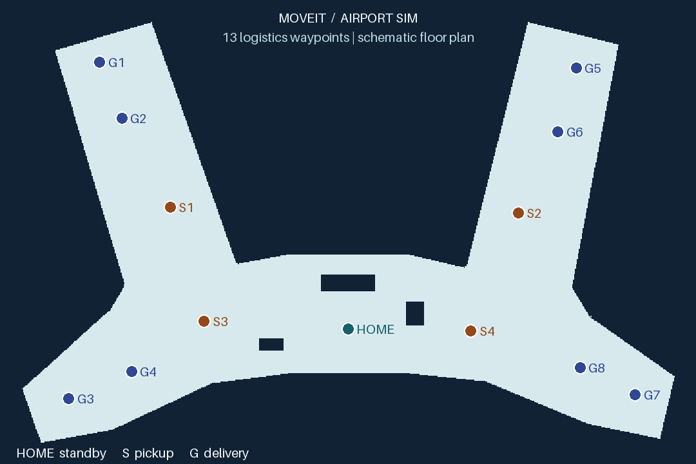

# MOVEIT 공항 시뮬레이션



[초기 4건과 주행 중 추가 1건의 계획 거리·실제 주행 거리 및 원본 궤적](results/README.md)

첨부 도안의 중앙 홀과 좌우 분기·끝단에서 착안한 가상 공항이다. 실제 시설 도면·축척 대신 TurtleBot3의 통로 여유와 경로 비용 비교를 기준으로 배치했다. 중앙 HOME, 수거 거점 S1~S4, 탑승구 역할 G1~G8이 모두 `map` 좌표계를 쓴다. 긴 팔 사이의 이동은 중앙 통로를 경유한다. 안내 데스크와 키오스크를 벽체·충돌 모델과 지도에 함께 반영했다.

| 파일 | 역할 |
|---|---|
| [SDF 월드](assets/airport.sdf.xacro) | Gazebo 벽·장애물, 물리·센서 플러그인 |
| [PGM 지도](assets/airport.pgm) · [지도 설정](assets/airport.yaml) | SDF와 같은 좌표·형상의 0.05 m 점유 격자 |
| [Waypoint](assets/waypoints.yaml) | A와 C가 사용하는 작업 지점 ID, D가 읽는 x·y·yaw |
| [실행 파일](airport.launch.py) | Jazzy 패키지의 TurtleBot3 Waffle과 Nav2 재사용 |
| [검증 스크립트](verify_airport.py) · [비용 비교](compare_orders.py) | AMCL·센서·TF 확인, 방향별 계획 경로, DDS 미션 검증, FIFO 비교 |

공항 SIM은 20 m LiDAR 범위와 모의 바퀴 주행 특성에 맞춘 AMCL 설정을 사용한다. Jazzy 기본 GridBased NavFn Dijkstra, MPPI, 로봇 반경과 costmap을 사용하며 정차 허용 반경은 0.15 m로 설정했다. 거리 검증은 별도 Gazebo 월드 좌표를 기록하고, 이를 위치 추정이나 주행 제어 입력으로 전달하지 않는다. SIM의 AMCL 설정과 Pose를 강의실 또는 실차로 복사하지 않는다.

## 1. 공통 준비

Ubuntu 24.04, ROS 2 Jazzy, Gazebo Harmonic, `nav2_bringup`, `nav2_minimal_tb3_sim`, `ros_gz_sim`, `ros_gz_bridge`, `xacro`가 필요하다. 워크스페이스가 처음이면 다음 명령을 실행한다.

```bash
source /opt/ros/jazzy/setup.bash
(cd ros2_ws && rosdep check --from-paths src --ignore-src && colcon build --symlink-install)
```

아래 준비는 새 터미널마다 저장소 루트에서 실행한다. 사용 중인 실차·다른 SIM의 도메인과 다른 번호를 선택한다.

```bash
source /opt/ros/jazzy/setup.bash
source ros2_ws/install/setup.bash
export ROS_DOMAIN_ID=113 ROS_AUTOMATIC_DISCOVERY_RANGE=LOCALHOST
export GZ_PARTITION="moveit_airport_${ROS_DOMAIN_ID}"
airport="$PWD/experiments/airport_sim"
evidence="/tmp/moveit-airport-${ROS_DOMAIN_ID}"
mkdir -p "$evidence"
```

## 2. 월드 실행과 비용표 생성

터미널 1에서 Gazebo 서버와 Nav2를 띄운다. GUI가 있는 환경에서는 `headless:=False use_rviz:=True`로 화면을 열 수 있다.

```bash
ros2 launch "$airport/airport.launch.py"
```

터미널 2에서 시뮬레이션 시계, 스캔, Odometry, HOME의 AMCL과 map→base_link TF, Nav2 ACTIVE를 확인한다. 이어서 같은 플래너에서 방향별 13×12개를 계산한다. 로봇은 HOME에서 대기하므로 이 단계는 계획 경로를 측정한다.

```bash
python3 "$airport/verify_airport.py" init
python3 "$airport/verify_airport.py" costs "$evidence/cost_snapshot.json"
python3 "$airport/compare_orders.py" "$evidence/cost_snapshot.json" | tee "$evidence/plan_comparison.json"
```

스냅샷은 `route_optimizer`가 읽으며 `cost_snapshot.recordings.json`에는 Nav2가 반환한 XY 경로를 저장한다. 같은 기록에서 비용 버전을 다시 만들려면 `python3 -m route_optimizer.cost_snapshot "$evidence/cost_snapshot.recordings.json"`를 실행한다. 다른 Gazebo/Nav2 빌드나 라이브 Costmap 입력으로 다시 수집하면 비용과 버전이 달라질 수 있으므로, 비교에서는 한 스냅샷을 고정한다.

## 3. 수거·인계·전달·HOME 복귀 시험

터미널 2에서 확인이 끝난 뒤 C를 띄운다. 별도 터미널 3에서 D를 시작한다. 터미널 4에서 주문을 실행한다. 각각 위의 공통 준비를 먼저 실행한다.

```bash
# 터미널 2 · C
ros2 run route_optimizer route_optimizer --ros-args \
  -p cost_snapshot_path:="$evidence/cost_snapshot.json"

# 터미널 3 · D
python3 -m amr_navigation.gate1_mock d --ros-args \
  -p use_sim_time:=true -p wait_for_nav2_before_dispatch:=true \
  -p waypoints_file:="$airport/assets/waypoints.yaml" 2>&1 | tee "$evidence/d.log"

# 터미널 4 · A와 인계 주입
python3 "$airport/verify_airport.py" mission single "$evidence/cost_snapshot.json" "$evidence/single.json"
```

- `single`은 S4에서 수거해 G8에서 인계한 뒤 HOME에 복귀한다.
- `multi`는 S1→G5, S3→G1, S2→G6, S4→G8로 시작한다. 첫 전달 목표가 Nav2에서 실행 중이고 해당 구간에서 0.50 m 이상 움직인 후 S2→G7을 등록한다. 첫 전달 인계가 끝나기 전에 기존 UUID·단계·계획 버전이 유지되는지 확인하고, 인계 후에만 다음 계획을 적용한다.
- 각 시험 전 Gazebo·Nav2와 D를 새로 시작해 HOME 및 목표 이력을 초기화한다. 파일 메타데이터와 설정이 같으면 기존 비용표를 재사용할 수 있다. 한 도메인에서 두 시험을 동시에 실행하지 않는다.
- 실제 (C) OptimizeRoute, D의 기존 어댑터와 Gazebo Nav2를 DDS로 사용한다. 웹 대신 A의 인계 호출 경계로 확인 이벤트를 주입한다. A는 Nav2의 UUID별 SUCCEEDED와 인계 대기 상태를 각각 확인하며, HOME 복귀는 별도 목표로 검증한다. 옆의 `d.log`에서 `[SEND]`와 `[RESULT]`의 각 UUID가 한 번인지 대조한다.
- `compare_orders.py`의 거리는 고정 비용표로 계산한 **계획 경로**다. `mission`의 주행 거리는 Gazebo가 내보내는 모형의 월드 좌표를 시간순으로 기록한 뒤 연속한 두 점 사이의 평면 거리를 더한 값이다. 계측 대상은 **SIM 로봇**이다. 부하, 하역 시간, 반복 성공률 및 실차 거리는 별도 조건에서 측정한다.
- 초기 4건 최적화는 부분적으로 두 가방 이상을 동시에 적재하는 방문 순서를 만들 수 있다. 다중 SIM은 최대 4개의 가상 가방을 사용한다. 초기 계획과 신규 후보는 현재 적재 상태에서 남은 순서를 재생해 상한을 검사한 뒤 주행한다. 가방 1개 제한을 적용하는 강의실 시험에서는 실제 비용표와 실행 순서에서 동시 적재 수를 검증한 뒤 주문을 확정한다.

## 4. 지도 수정과 재검증

지도 변경이 필요한 경우 `make_airport.py`의 통로·장애물과 Waypoint YAML을 함께 확인한다. Ubuntu의 `python3-pil` 및 `python3-yaml`이 필요하다.

```bash
python3 "$airport/make_airport.py"
python3 -m pytest -q "$airport"
xacro "$airport/assets/airport.sdf.xacro" -o "$evidence/airport.sdf"
gz sdf -k "$evidence/airport.sdf"
```

지도·Waypoint·플래너·Costmap 중 하나라도 바뀌면 방향별 비용을 다시 측정한다. 기존 공식 TurtleBot3 샌드박스 및 강의실 구성은 각자의 경로에서 따로 실행한다.


## 5. 접수 순서와 최적화 순서의 실제 주행 비교

공통 준비를 마친 뒤 각각 새로운 HOME에서 한 번씩 실행한다. 두 실행은 동일한 지점, 방향별 비용표, 주행 설정과 인계 조건을 사용한다. 출력은 새 디렉터리를 지정한다. 첫 실행이 생성한 비용표를 두 번째 실행이 그대로 읽는다.

```bash
python3 "$airport/run_case.py" optimized "$evidence"
python3 "$airport/run_case.py" fifo "$evidence"
python3 "$airport/report_runs.py" "$evidence" > "$evidence/comparison.json"
```

접수 순서는 실험용 서비스가 주문 번호순으로 수거·전달을 한 건씩 수행하도록 답한다. 최적화는 실제 C 서비스를 사용한다. 두 경우 모두 A가 계획을 검증하고 D가 Gazebo의 Nav2에 목표를 보낸다. 다섯 번째 주문은 양쪽 모두 첫 전달을 수행하는 중에 들어온다. 인계 확인은 A의 호출 경계에서 주입한다. 사람이 웹으로 인계하거나 물품의 무게가 주행에 미치는 영향은 별도 검증 대상이다.

계획값은 실제로 승인된 구간의 방향별 Nav2 비용 합계다. 주행값은 `*.trajectory.csv`에 기록하는 Gazebo 월드 좌표의 이동 거리 합계다. 각 인계 경계에서 로봇이 정차한 뒤 좌표를 확인하며, 출발 시 적재량이 0인 구간만 공차에 포함한다. HOME 출발과 최종 복귀도 포함한다. 샘플 간격이 0.25초를 넘거나 도착 시 월드 위치 오차가 0.40 m를 넘으면 실행을 실패로 기록한다. 비교 보고서는 원본 궤적 및 비용표로 구간 거리를 독립적으로 재계산하고, 실제 UUID별 송신·도착, 10회 인계, 적재 상한, 재계획 적용 및 HOME 복귀를 대조한다.
