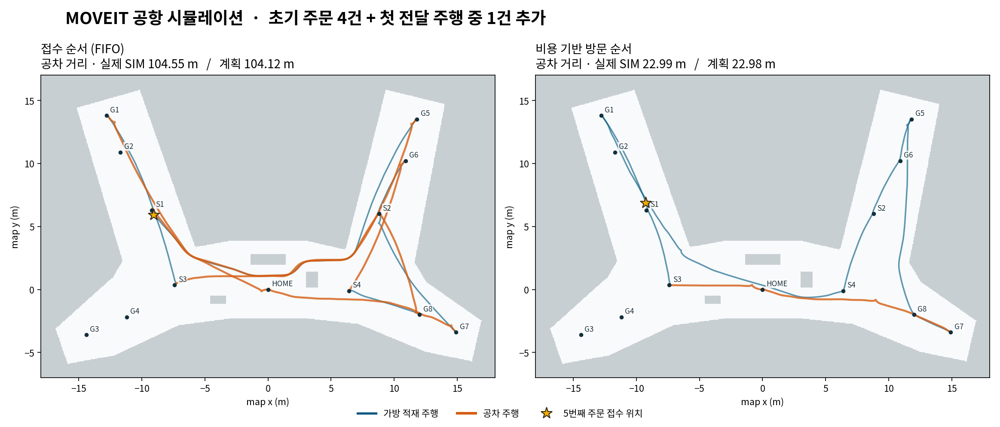

# MOVEIT 공항 SIM · 4건 접수 후 1건 추가

2026-11-24 · Ubuntu 24.04 ARM64 UTM · ROS 2 Jazzy · Gazebo Harmonic · TurtleBot3 Waffle

각 정책을 새로 시작한 동일 월드에서 한 번씩 실행했다. 양쪽 모두 수거·전달 인계 10회와 마지막 HOME 복귀를 완료했다. 두 방식의 빈 차 이동은 Gazebo 실측으로 81.56 m(78.0%) 차이가 났다.

| 방문 정책 | 계획 공차 | SIM 주행 공차 | 계획 총거리 | SIM 주행 총거리 | 최대 동시 적재 |
|---|---:|---:|---:|---:|---:|
| 접수 순서(FIFO) | 104.12 m | 104.55 m | 170.96 m | 171.31 m | 1개 |
| 비용 기반 최적화 | 22.98 m | 22.99 m | 97.51 m | 97.27 m | 4개 |

## 주문과 인계

초기 주문은 S1→G5, S3→G1, S2→G6, S4→G8이다. 첫 전달 목표가 실행 중이고 해당 구간에서 로봇이 0.50 m 이상 움직였을 때 S2→G7을 접수했다. FIFO는 G5, 최적화는 G1이 해당 목표였다. 현재 목표의 UUID와 계획 1판을 유지하고 인계 확인 이후 2판을 적용했다. 각 정책에서 D의 송신 기록과 Nav2 성공 UUID가 11개씩 일치했다. 인계는 A의 호출 경계에서 실험용으로 주입했다.

- **접수 순서** · HOME → S1 → G5 → S3 → G1 → S2 → G6 → S4 → G8 → S2 → G7 → HOME
- **최적화** · HOME → S3 → S1 → G1 → S4 → S2 → S2 → G6 → G5 → G8 → G7 → HOME

연속 S2 방문은 서로 다른 두 주문의 수거다. 같은 좌표에서도 주문별로 인계를 확인했다. 두 정책 모두 가상 가방 4개가 상한이다. 접수 순서 기준선은 한 주문씩 완결하고, 최적화는 여러 가방을 함께 운반하므로 두 효과를 합친 비교다.

## 거리 계측과 재현

비용표 `nav2-v1-9ffe790fa7217683b59c8f88b94765c11d7bfd22ca7a89361872f1811bf112b6`의 방향별 경로 156개가 모두 도달 가능했다. 계획 거리는 최종 실행한 각 구간의 NavFn Dijkstra 경로 길이를 합산했다. 주행 거리는 약 30 Hz로 기록한 Gazebo 월드 좌표에서 이웃한 두 점 사이의 평면 거리를 합산했다. 가방이 없는 구간만 공차에 더했고, HOME 출발과 최종 복귀를 포함했다.

FIFO는 11,970개, 최적화는 8,095개의 샘플을 기록했다. 가장 긴 샘플 간격은 각각 0.036초와 0.036초였다. HOME 도착 시 월드 좌표 오차는 각각 0.040 m와 0.039 m였다.

첫 최적화 시도에서는 G1 인계 후 S4로 이동하던 중 위치 추정이 어긋나 Nav2가 중단됐다. LiDAR 관측과 지도 형상을 대조한 뒤 공항 SIM에 한해 AMCL의 센서 모델과 모의 바퀴 오차 설정을 조정했다. 새 프로필로 두 방식을 HOME에서 다시 시작했다. 부팅 직후 위치 추정 노드가 준비되지 않아 주행 전에 끝난 시도도 있었다. 위 표는 같은 설정에서 완료된 두 미션만 집계했다.

이 결과의 적용 범위는 이 지도와 다섯 주문이다. 공차 감소율의 반복 재현성, 승객·실제 가방을 포함한 하중의 영향, 웹에서 사람이 직접 인계하는 과정과 강의실 실차 주행은 별도 검증 대상이다.

[구간별 거리와 목표 ID](legs.csv) · [검증 결과 JSON](comparison.json) · [실행 방법](../README.md) · [재계산용 계측 원본](measurement_inputs.zip)
