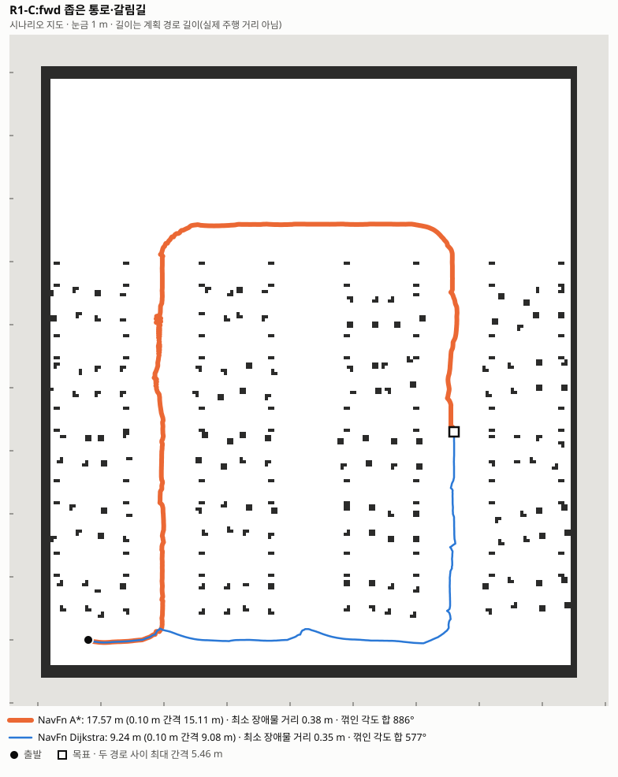
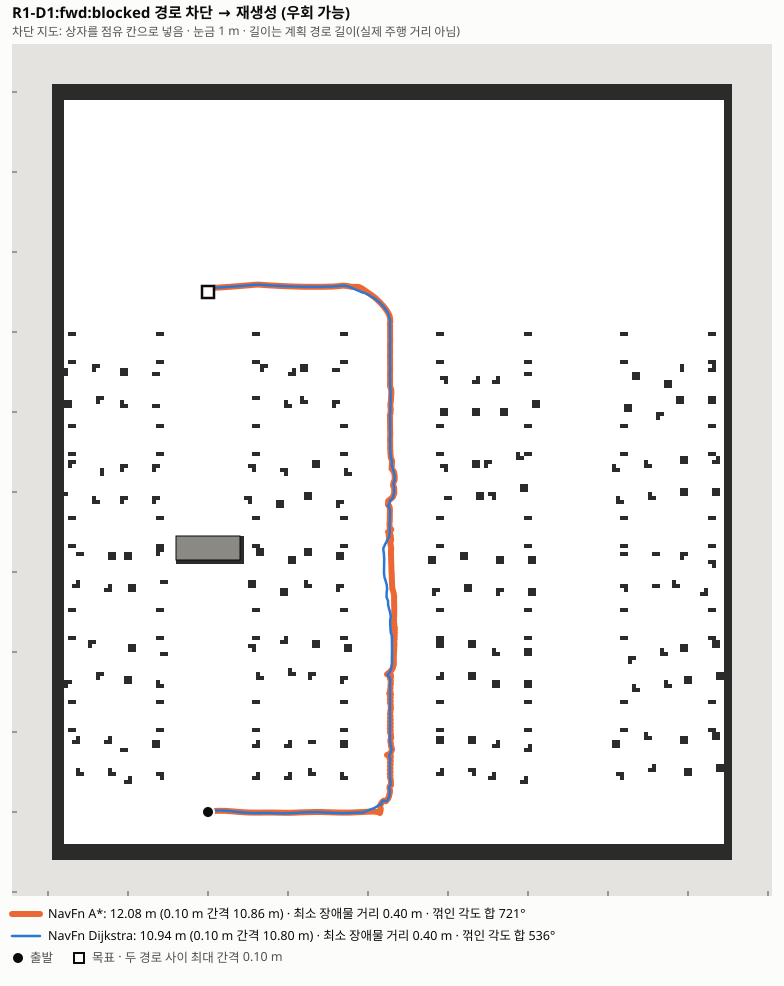
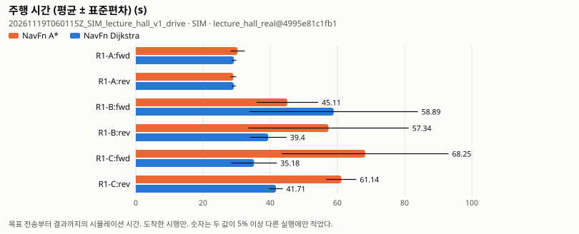
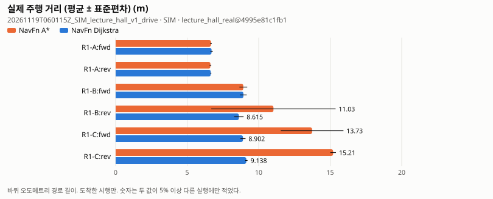

# experiments/path_planner — 전역 경로 탐색 비교 (B · 정지호)

> 연구 1: 동일한 지도·Costmap·출발/목표에서 Nav2 NavFn의 A*(`use_astar: true`)와 Dijkstra(`use_astar: false`)를 비교해 플래너 선정 근거를 제공한다.
> 위치 근거: ADR-015 ("B 실험은 `experiments/path_planner/`"). B 전용 ROS2 패키지는 만들지 않는다 (ADR-003, `docs/ARCHITECTURE.md` §5).

## 현재 상태

| 항목 | 상태 |
| --- | --- |
| B 가이드 첫 번째 기능: 재현 가능한 비교 조건 | 구현함. 고정 출발/목표 쌍, 실패 사례, 설정 쌍, 실행 스크립트, 결과 기록 |
| MOCK | `tests/` 62개 통과 (가짜 플래너, 경로 차단 20개·경로 품질 12개·주행 결과 처리 7개·그래프 2개 포함) |
| SIM (planner-only) | Jazzy Docker에서 측정: R1-A~C·도달 불가 [`results/20261118T061956Z_SIM_lecture_hall_v1`](results/20261118T061956Z_SIM_lecture_hall_v1/summary.md), R1-D 경로 차단 [`results/20261119T012513Z_SIM_lecture_hall_v1_r1d`](results/20261119T012513Z_SIM_lecture_hall_v1_r1d/summary.md), 경로 품질 지표와 경로 그림을 넣은 재측정 [`20261119T015445Z`](results/20261119T015445Z_SIM_lecture_hall_v1/summary.md)·[`20261119T015502Z`](results/20261119T015502Z_SIM_lecture_hall_v1_r1d/summary.md) |
| SIM (Gazebo Harmonic 주행) | **B의 임시 환경**에서 측정: R1-A~C [`20261119T060115Z`](results/20261119T060115Z_SIM_lecture_hall_v1_drive/summary.md), R1-D1 [`20261119T044830Z`](results/20261119T044830Z_SIM_lecture_hall_v1_r1d_drive/summary.md). D의 주행 설정·공식 지도에서는 미측정 |
| REAL (실차) | 미측정 |
| 지도 | **[초안-팀합의필요]** legacy 강의실 복제 맵을 임시로 사용. D의 공식 지도·HOME·A~D 지점(P-014) 확정 전 |
| 전역 플래너 최종 선정 (P-009) | VERIFY. B의 잠정 권고는 [`REPORT.md`](REPORT.md) §6에 있다. 확정은 D 검증과 A 승인 뒤다 |
| 이전 연구 (Humble) | [`legacy_r1/`](legacy_r1/README.md): 참고 자료, Jazzy에서는 [미확인] |

## 구성

| 경로 | 내용 |
| --- | --- |
| [`REPORT.md`](REPORT.md) | 기술 선정 보고서 (기획서 §12.4 양식, 작성 중) |
| [`EXPERIMENT_LOG.md`](EXPERIMENT_LOG.md) | 날짜순 실험 기록: 실험마다 목적, 바꾼 조건, 관찰, 문제와 원인 |
| [`config/navfn_compare.yaml`](config/navfn_compare.yaml) | planner_server 하나에 NavFn 두 개(`NavFnAStar`, `NavFnDijkstra`). `use_astar`만 다르고 같은 global costmap을 쓴다 |
| [`scenarios/lecture_hall_v1.yaml`](scenarios/lecture_hall_v1.yaml) | 고정 지점과 쌍: R1-A 개방, R1-B 장애물 우회, R1-C 좁은 통로(각각 정·역방향), FAIL-WALLED(벽으로 막힌 영역), FAIL-OFFMAP(지도 밖 목표) |
| [`scenarios/lecture_hall_v1_r1d.yaml`](scenarios/lecture_hall_v1_r1d.yaml) | R1-D 경로 차단: R1-D1 복도 하나를 막아 우회 경로 재생성, R1-D2 복도 셋을 모두 막아 실패 처리(각각 정·역방향, 차단 전·후) |
| [`launch/planner_bench.launch.py`](launch/planner_bench.launch.py) | planner-only 스택: map_server + planner_server + lifecycle_manager + 정적 TF `map → base_footprint` |
| [`scripts/run_compare.py`](scripts/run_compare.py) | `ComputePathToPose`(`start` + `use_start: true`, `planner_id`)로 같은 쌍을 두 설정에서 반복 실행하고 결과를 기록 |
| [`scripts/bench_core.py`](scripts/bench_core.py) | ROS 없는 핵심 로직: 시나리오·설정 검증, 버전 해시, 경로 길이, 시행 반복, CSV/JSON 기록 |
| [`scripts/plot_paths.py`](scripts/plot_paths.py) | 결과 폴더의 경로를 지도 위에 그린다. 실행마다 SVG 한 장에 두 플래너를 겹쳐 그리고, ROS와 그래프 라이브러리가 필요 없다 |
| [`scripts/plot_compare.py`](scripts/plot_compare.py) | 결과 폴더의 요약을 막대그래프(SVG)로 그린다. 계획 결과는 경로 길이·계획 시간, 주행 결과는 주행 시간·주행 거리 |
| [`scripts/run_drive.py`](scripts/run_drive.py), [`scripts/drive_core.py`](scripts/drive_core.py) | **주행 비교 [초안-팀합의필요]**: Gazebo에서 같은 쌍을 두 설정으로 주행시켜 주행 시간·실제 주행 거리·도착 여부·복구 횟수를 기록한다 |
| [`scripts/run_drive_sim.sh`](scripts/run_drive_sim.sh), [`launch/drive_bench.launch.py`](launch/drive_bench.launch.py) | 주행 비교용 스택(Gazebo Harmonic + TurtleBot3 Waffle Pi + Nav2)을 띄우고 측정한 뒤 종료한다 |
| [`config/nav2_drive.yaml`](config/nav2_drive.yaml) | 주행 비교용 Nav2 설정. ROBOTIS `turtlebot3_navigation2` 2.3.7의 Waffle Pi 설정에서 바꾼 곳을 파일 머리말에 적었다. D의 배포 설정이 아니다 |
| [`sim/worlds/lecture_hall_real.sdf`](sim/worlds/lecture_hall_real.sdf), [`scripts/make_sim_world.py`](scripts/make_sim_world.py) | legacy 강의실 월드(Gazebo Classic)를 Harmonic용으로 바꾼 월드와 변환 스크립트. 모델은 그대로이고 머리말만 바꿨다 |
| [`docker/Dockerfile.sim`](docker/Dockerfile.sim) | 주행 비교 실행 환경: 위 이미지에 Gazebo Harmonic(`ros_gz`)·Nav2 전체·`turtlebot3_gazebo`를 더한 것 |
| [`scripts/run_planner_only.sh`](scripts/run_planner_only.sh) | 런치 → 비교 → 종료를 한 번에 실행. DDS 탐색 범위 기본값은 `LOCALHOST` |
| [`docker/Dockerfile`](docker/Dockerfile) | ROS 2 Jazzy + Nav2 planner-only 실행 환경 |
| `tests/` | MOCK 테스트 |
| `results/` | 측정 결과 (실험마다 새 폴더) |

## 비교 조건

| 조건 | 적용 |
| --- | --- |
| 같은 지도·Costmap | 하나의 planner_server와 하나의 global costmap(static + inflation)을 두 플러그인이 공유한다. 측정 전 map_server가 올린 지도의 크기·해상도·원점·frame을 시나리오 지도와 대조한다 |
| 같은 Footprint | `robot_radius` 0.22 m, inflation 0.55 m / 3.0 (Nav2 기본값) |
| 같은 출발·목표 | 시나리오 파일의 고정 Pose. 모든 요청이 `use_start: true`이므로 로봇 현재 위치를 쓰지 않는다 |
| 설정 차이 | `use_astar` 하나만 다르다. 파일에서 검사하고(`check_comparison_pair`), 측정 전 planner_server의 실제 파라미터도 대조한다. 다르면 측정을 거부한다 |
| 방향 | `A → B`와 `B → A`를 별도 실행으로 둔다 (INTERFACES §8.4) |
| 순서 영향 | 반복마다 두 플래너의 실행 순서를 바꾼다 |
| 반복 | 예열 1회(요약에서 제외, `warmup=True`로 기록) + 측정 N회 |
| 기록 | 성공과 실패를 모두 기록한다. 실패는 Nav2 오류 이름(`NO_VALID_PATH` 등)으로 남기고 임의 거리로 대체하지 않는다 |
| 경로 차단 (R1-D) | 시나리오 쌍의 `obstacles` 상자를 점유 칸으로 그린 지도 사본을 `map_server/load_map`으로 넣는다. global costmap에 상자 칸이 모두 lethal로 나타난 것을 확인한 뒤에만 잰다(확인하지 못하면 측정을 거부한다). 같은 쌍을 차단 전 지도와 차단 지도에서 모두 재고, 차단 지도는 `map_version`이 따로 붙는다(`<지도>+<쌍 ID>@<해시>`). 플래너 설정 파일은 바꾸지 않는다 |

## 실행 방법

### Docker (검증한 방법: Windows 11 + WSL2 Ubuntu 24.04 + Docker Engine)

저장소 루트에서 실행한다.

```bash
docker build -t amr-path-planner-bench:jazzy experiments/path_planner/docker
docker run --rm --network none -v "$PWD":/repo amr-path-planner-bench:jazzy bash -c '
  source /opt/ros/jazzy/setup.bash &&
  bash experiments/path_planner/scripts/run_planner_only.sh experiments/path_planner/scenarios/lecture_hall_v1.yaml \
    --run-mode SIM --repeat 30 --warmup 1 --git-commit <측정한 코드 커밋> --note "planner-only"'
```

`--network none`을 쓰면 다른 PC나 로봇의 ROS 노드와 DDS가 섞이지 않는다.

### Ubuntu 24.04 + ROS 2 Jazzy (직접 설치) — [미확인: Docker에서만 실행함]

```bash
sudo apt install ros-jazzy-nav2-planner ros-jazzy-nav2-navfn-planner ros-jazzy-nav2-map-server ros-jazzy-nav2-lifecycle-manager
source /opt/ros/jazzy/setup.bash
bash experiments/path_planner/scripts/run_planner_only.sh experiments/path_planner/scenarios/lecture_hall_v1.yaml \
  --run-mode SIM --repeat 30 --warmup 1
```

런치와 비교를 따로 띄우려면 `ros2 launch experiments/path_planner/launch/planner_bench.launch.py map:=<map.yaml>`을 실행한 뒤,
다른 터미널에서 `python3 experiments/path_planner/scripts/run_compare.py --scenarios <yaml> --run-mode SIM`을 실행한다.

### 경로 그림

```bash
python3 experiments/path_planner/scripts/plot_paths.py experiments/path_planner/results/<실험 ID>    # PyYAML 필요
```

결과 폴더에 `paths_<실행>.svg`를 쓴다. `paths.json`이 있는 결과(2026-11-19 `39fba81` 이후 측정)에서만 쓸 수 있다.

### 비교 그래프

```bash
python3 experiments/path_planner/scripts/plot_compare.py experiments/path_planner/results/<실험 ID>
```

결과 폴더에 `compare_*.svg`를 쓴다. 계획 결과와 주행 결과 모두에 쓸 수 있다.

### 주행 비교 (Gazebo Harmonic) — [초안-팀합의필요] B의 임시 환경

D의 Nav2 실행 환경과 공식 지도가 나오기 전에 쓰는 임시 환경이다. controller(DWB)·AMCL·BT 설정은 ROBOTIS 기본값이며 D의 배포 설정이 아니다.
검증한 환경은 Windows 11 + WSL2(WSLg, GPU 가속) + Docker 하나뿐이다. LiDAR를 렌더링하므로 화면이나 GPU가 필요하다.

```bash
docker build -t amr-sim:jazzy -f experiments/path_planner/docker/Dockerfile.sim experiments/path_planner/docker
# WSLg 예: 화면과 GPU 를 컨테이너에 넘긴다
docker run --rm --network none -e DISPLAY -e WAYLAND_DISPLAY -e XDG_RUNTIME_DIR=/mnt/wslg/runtime-dir \
  -v /tmp/.X11-unix:/tmp/.X11-unix -v /mnt/wslg:/mnt/wslg --device /dev/dxg -v /usr/lib/wsl:/usr/lib/wsl:ro \
  -e LD_LIBRARY_PATH=/usr/lib/wsl/lib -e GALLIUM_DRIVER=d3d12 -v "$PWD":/repo amr-sim:jazzy bash -c '
  source /opt/ros/jazzy/setup.bash &&
  bash experiments/path_planner/scripts/run_drive_sim.sh experiments/path_planner/scenarios/lecture_hall_v1.yaml \
    --run-mode SIM --repeat 5 --only R1-A,R1-B,R1-C --git-commit <측정한 코드 커밋>'
```

- 시행마다 `GridBased.use_astar`를 바꾸고 다시 읽어 확인한다. 그다음 로봇을 출발 Pose에 놓고, AMCL을 그 자리로 다시 초기화하고, 두 costmap을 지운 뒤 `NavigateToPose`를 보낸다.
- 차단 실행(`:blocked`)은 상자를 **월드에만** 놓는다. 지도에는 없으므로 로봇이 가다가 LiDAR로 발견하고 재계획한다.
- `SIM_GUI=1`을 주면 Gazebo 창도 띄운다.

### MOCK 테스트

```bash
python3 -m pytest experiments/path_planner/tests -q      # PyYAML, pytest 필요. ROS 불필요
```

## 실행 환경 차이 — 다른 PC 결과와 비교할 때

팀 기준은 Ubuntu 24.04 + ROS 2 Jazzy + Python 3.12다. Docker 이미지도 같은 기준(`ros:jazzy-ros-base`, Ubuntu 24.04)이라 코드와 설정은 그대로 쓸 수 있다.
다만 환경에 따라 비교할 수 있는 값이 다르다.

| 값 | 환경 영향 | 다룰 방법 |
| --- | --- | --- |
| 경로 길이·성공 여부·오류 코드 | Nav2 버전·설정·지도가 같으면 플랫폼과 무관해야 한다. **[미확인]** 다른 환경에서는 아직 교차 실행하지 않았다. 같은 PC에서도 Nav2를 새로 띄운 실행끼리 R1-C가 최대 0.0026 m 달랐다 ([실험 기록](EXPERIMENT_LOG.md)) | 네이티브 Ubuntu나 Mac VM에서 같은 명령을 실행하고 `summary.csv`의 `planned_distance`를 비교한다. 수 mm는 허용 오차로 본다 |
| `planning_time`, `roundtrip_time` | CPU와 가상화 방식(WSL2·Docker, UTM VM, 로봇 PC)에 따라 달라진다 | 같은 실험(같은 세션) 안에서 A*와 Dijkstra만 비교한다. 다른 PC 결과와 절대값을 비교하지 않는다 |
| Nav2 버전 | Docker 이미지는 빌드 시점의 최신 apt 패키지를 받는다 (현재 1.3.14) | `meta.json`의 `env.nav2_planner`를 확인한다. 버전이 다르면 결과를 따로 본다 |
| Mac (ARM64) | macOS에서는 Jazzy를 직접 실행하지 않고 Ubuntu VM이나 Docker를 쓴다. `ros:jazzy-ros-base`에는 arm64 이미지가 있다. **[미확인]** 이 Dockerfile로 arm64 빌드는 해 보지 않았다 | VM 결과는 VM 환경 결과로 표시한다 (AGENTS.md §7) |
| 실차(REAL) | WSL2 기본 네트워크(NAT)의 Docker에서는 로봇과 DDS 탐색이 되지 않는다 | REAL 실험은 로봇과 같은 네트워크의 Ubuntu PC에서 C·D와 조율해 진행한다 **[초안-팀합의필요]** |
| Gazebo Harmonic 주행 | Docker에서 GUI·GPU 렌더링(LiDAR 센서)은 추가 설정이 필요하다. legacy 월드는 Gazebo Classic 형식이다 | 주행 비교는 D의 Nav2 실행 환경에서 함께 진행한다 **[초안-팀합의필요]** |

결과의 실행 환경은 `meta.json`의 `env`(ROS·Nav2 버전, `bench_env`, 플랫폼, CPU 수)에 남는다.

## 결과 형식

`results/<UTC 시각>_<run_mode>_<scenario_set>/` 폴더에 다음 파일을 쓴다. 기존 폴더는 덮어쓰지 않는다.

| 파일 | 내용 |
| --- | --- |
| `trials.csv` | 시행 1건당 1행. 앞쪽 열은 `docs/INTERFACES.md` §4.7 ExperimentResult 순서다. 주행 항목(`actual_distance`, `execution_time`, `goal_success`, `mission_success`, `controller_id`)은 이 실험에서 측정하지 않으므로 비워 둔다 |
| `summary.csv`, `summary.md` | 실행·플래너별 성공률, 경로 길이 평균·표준편차·범위, 계획 시간 중앙값·최대, 실패 사유. 예열은 제외 |
| `meta.json` | 버전, 측정 코드 커밋, 실행 환경(ROS·Nav2 버전, Docker 이미지), 실제 로드된 지도, planner_server 실제 파라미터 |
| `paths.json` | 실행·플래너마다 첫 측정 성공 경로의 Pose 목록(x, y)과, 같은 조건의 성공 시행 중 그 경로와 같았던 횟수 |
| `paths_<실행>.svg` | `plot_paths.py`가 그린 경로 그림 |

| 열 | 단위·의미 |
| --- | --- |
| `planned_distance` | m, 계획 경로 Pose 사이 거리 합. **실제 주행 거리가 아니다** |
| `planning_time` | ms, planner_server가 결과에 보고한 계산 시간. 보고하지 않으면 빈 값 |
| `roundtrip_time` | ms, 요청 전송부터 결과 수신까지 (DDS·액션 왕복 포함) |
| `path_end_error` | m, 경로 마지막 Pose와 요청 목표 사이 거리 (NavFn `tolerance`로 목표 근처에서 끝난 경우 확인용) |
| `plan_success` / `expectation_met` | 경로 생성 여부 / 시나리오 `expect`와 일치 여부 |
| `config_version`, `map_version`, `scenario_version` | `<파일 이름>@<내용 SHA-256 앞 12자리>`. 텍스트 파일은 줄바꿈(CRLF/LF)을 정규화해서 해시한다. 설정·지도·시나리오가 바뀌면 값이 달라지므로 결과를 버전별로 나눌 수 있다 |
| `map_variant` | 차단 지도에서 잰 행이면 쌍 ID(예: `R1-D1`), 시나리오 지도 그대로면 빈 값 |
| `obstacle_hits` | 경로 Pose 중 그 쌍의 상자 안에 든 개수. 상자가 있는 쌍의 성공 경로에만 쓴다. 차단 전 경로가 0보다 크면 원래 경로가 상자 자리를 지났다는 뜻이다 |
| `min_clearance`, `mean_clearance` | m, 경로 Pose(로봇 중심)에서 가장 가까운 점유 칸까지 거리의 최소·평균. 그 실행이 계획된 지도(차단 지도면 상자 포함) 기준이고 칸 단위(0.05 m) 정확도다. 로봇 반경 0.22 m를 빼면 여유 거리다 |
| `turn_sum_deg` | 도, 경로를 0.10 m 간격으로 다시 찍은 뒤 방향 변화의 절댓값을 더한 값. 직선은 0, 직각 모서리 하나는 약 90 |
| `resampled_distance` | m, 0.10 m 간격으로 다시 찍은 경로의 길이. `planned_distance`와의 차이는 0.10 m보다 잔 지그재그에서 나온 길이다. **계약상 계획 거리는 `planned_distance`다**(INTERFACES §8.3). 이 열은 분석용이다 |

R1-D와 경로 품질 열은 **맨 뒤에 추가한 열**이다. 앞쪽 열의 순서와 의미는 첫 측정 결과와 같다.
- `trials.csv`: `map_variant`, `obstacle_hits`, `min_clearance`, `mean_clearance`, `turn_sum_deg`, `resampled_distance`
- `summary.csv`: `map_variant`, `obstacle_crossings`, `min_clearance_min`, `mean_clearance_mean`, `turn_sum_deg_mean`, `resampled_distance_mean`

## 측정 결과 — SIM (planner-only)

실험 [`20261118T061956Z_SIM_lecture_hall_v1`](results/20261118T061956Z_SIM_lecture_hall_v1/summary.md).
측정 코드 `6084b6e`, `navfn_compare@b6b5e3a1039a`, `lecture_hall_real@4995e81c1fb1`, `lecture_hall_v1@81133c5442f3`.
환경: Docker `amr-path-planner-bench:jazzy` (ROS 2 Jazzy, Nav2 1.3.14, Python 3.12.3), WSL2, 8 스레드 CPU.
Gazebo·AMCL·LiDAR는 쓰지 않았다. 예열 1회와 측정 30회.

| 실행 | 기대 | 성공 A* / Dijkstra | 경로 길이 A* / Dijkstra (m) | 계획 시간 중앙값 A* / Dijkstra (ms) |
| --- | --- | --- | --- | --- |
| R1-A:fwd 개방 | success | 30/30 / 30/30 | 6.6 / 6.6 | 0.3435 / 0.5305 |
| R1-A:rev | success | 30/30 / 30/30 | 6.6 / 6.6 | 0.3345 / 0.543 |
| R1-B:fwd 장애물 우회 | success | 30/30 / 30/30 | 8.7573 / 8.6559 | 0.496 / 0.614 |
| R1-B:rev | success | 30/30 / 30/30 | 8.5323 / 8.5294 | 0.8665 / 0.767 |
| R1-C:fwd 좁은 통로 | success | 30/30 / 30/30 | **17.5687** / 9.239 | 1.0385 / 0.8485 |
| R1-C:rev | success | 30/30 / 30/30 | 8.9546 / 9.1211 | 0.9135 / 0.8245 |
| FAIL-WALLED 벽으로 막힘 | failure | 0/30 / 0/30 (`NO_VALID_PATH`) | - | 보고 안 됨 |
| FAIL-OFFMAP 지도 밖 | failure | 0/30 / 0/30 (`GOAL_OUTSIDE_MAP`) | - | 보고 안 됨 |

관찰한 사실 (이 지도·이 설정에 한함):

- 도달 가능한 6개 실행에서 두 설정 모두 30/30 성공했고, 경로 끝이 목표와 일치했다(`path_end_error` 0.0 m).
  도달 불가 2건은 두 설정 모두 실패로 남았다. 480개 측정 시행 모두 기대 결과와 일치했다.
- 같은 조건 30회의 경로 길이 표준편차는 모든 실행에서 0.0이었다. 정적 지도에서는 계획 결과가 반복마다 같았다.
- R1-C 정방향에서 NavFn A* 경로가 Dijkstra보다 8.33 m(약 1.9배) 길었고, 역방향에서는 A*가 0.17 m 짧았다.
  같은 쌍도 방향에 따라 결과가 달라지므로 방향별 계산(INTERFACES §8.4)이 필요하다.
- 계획 시간은 모든 실행에서 중앙값 1.04 ms 이하였다. A*는 R1-A 양방향과 R1-B 정방향에서 더 빨랐고, R1-B 역방향과 R1-C 양방향에서는 더 느렸다.
- 실패 응답에서는 planner_server가 `planning_time`을 0으로 보내 빈 값으로 기록했다. `error_msg`는 비어 있었다(Nav2 1.3.14).
- `roundtrip_time`(약 6~20 ms)은 통신 왕복이 대부분이라 알고리즘 비교에는 `planning_time`을 쓴다.

이 결과는 임시 지도 한 곳에서 계획만 비교한 것이다. 최종 플래너 선정(P-009)에는 공식 지도, Gazebo 주행 비교, 실차 검증(D 협업)이 더 필요하다.

## 측정 결과 — R1-D 경로 차단, SIM (planner-only)

실험 [`20261119T012513Z_SIM_lecture_hall_v1_r1d`](results/20261119T012513Z_SIM_lecture_hall_v1_r1d/summary.md).
측정 코드 `a3c9822`, 설정 `navfn_compare@b6b5e3a1039a`(첫 측정과 같음), 시나리오 `lecture_hall_v1_r1d@a663bec775cf`.
지도: 차단 전 `lecture_hall_real@4995e81c1fb1`, 차단 후 `lecture_hall_real+R1-D1@c254d94b7898`(복도 2 막음), `lecture_hall_real+R1-D2@07dc060afa8c`(복도 2·3·4 막음).
환경은 첫 측정과 같다. 예열 1회 + 30회.

| 실행 | 지도 | 기대 | 성공 A* / Dijkstra | 상자 자리 통과 A* / Dijkstra | 경로 길이 A* / Dijkstra (m) | 계획 시간 중앙값 A* / Dijkstra (ms) |
| --- | --- | --- | --- | --- | --- | --- |
| R1-D1:fwd 홈 → 복도 2 앞 | 차단 전 | success | 30/30 / 30/30 | 30/30 / 30/30 | 6.6997 / 6.6895 | 0.4375 / 0.481 |
| R1-D1:fwd | 차단 후 | success | 30/30 / 30/30 | 0/30 / 0/30 | **12.0787** / 10.935 | 0.6395 / 0.832 |
| R1-D1:rev | 차단 전 | success | 30/30 / 30/30 | 30/30 / 30/30 | 6.5818 / 6.5734 | 0.6455 / 0.87 |
| R1-D1:rev | 차단 후 | success | 30/30 / 30/30 | 0/30 / 0/30 | 10.8343 / 10.8513 | 1.1405 / 0.861 |
| R1-D2:fwd 홈 → 강단 오른쪽 | 차단 전 | success | 30/30 / 30/30 | 30/30 / 30/30 | 12.4477 / 12.4395 | 0.6875 / 1.263 |
| R1-D2:fwd | 차단 후 | failure | 0/30 / 0/30 (`NO_VALID_PATH`) | - | - | 보고 안 됨 |
| R1-D2:rev | 차단 전 | success | 30/30 / 30/30 | 30/30 / 30/30 | 12.2798 / 12.2415 | 1.2625 / 0.9985 |
| R1-D2:rev | 차단 후 | failure | 0/30 / 0/30 (`NO_VALID_PATH`) | - | - | 보고 안 됨 |

관찰한 사실 (이 지도·이 상자 배치에 한함):

- 측정 480회가 모두 기대와 일치했다. 차단 전 경로는 모든 실행에서 상자 자리를 지났다(경로 Pose 12개가 상자 안). 상자가 원래 경로를 막는 위치였다는 뜻이다.
- **경로 재생성 (R1-D1):** 차단 후 두 설정 모두 30/30 다른 세로 복도로 도는 경로를 만들었고, 상자 자리를 지나지 않았다.
  - 정방향에서는 A* 경로가 Dijkstra보다 1.14 m(10.5%) 길었다. 차단 전보다 A*는 5.38 m, Dijkstra는 4.25 m 늘었다.
  - 역방향에서는 A*가 0.017 m 짧았다. R1-C처럼 한 방향에서만 A*가 먼 길을 골랐다.
- **실패 처리 (R1-D2):** 차단 후 두 설정 모두 0/30이었다. 오류는 `NO_VALID_PATH`(코드 208)였고 경로를 내지 않았다. 실패 응답에는 `planning_time`이 보고되지 않았다(첫 측정과 같음).
- 30회 반복의 경로 길이 표준편차는 모두 0.0이었다. 세 번의 별도 실행(시험 실행, 이전 코드 측정, 이 측정)에서 경로 길이가 소수 넷째 자리까지 같았다.
- 이전 Humble 연구의 R1-D1(정방향만, [`legacy_r1` §7.1](legacy_r1/experiments/r1/README.md))과 경향이 같다. Humble 값은 A* 12.565 ± 0.265 m, Dijkstra 10.942 m였다. Jazzy에서는 A* 길이도 반복마다 같았다.
- 지도를 바꾼 뒤 costmap 반영을 확인하기까지 0.4~1.0 s 걸렸다.
- `roundtrip_time`은 같은 실행 안에서 요청이 쌓일수록 커졌다(차단 전 묶음 반복 0 → 30: 14.3 → 23.5 ms). 첫 측정도 마찬가지였다(7.2 → 18.1 ms). 원인은 **[미분석]**이다.
  실패 응답의 왕복 시간(약 15 ms)은 실행 순서의 영향을 받으므로 실패 판정 속도로 읽지 않는다. 알고리즘 비교에는 `planning_time`을 쓴다.

이 실험은 **정적 지도에 상자를 그려 넣고 계획만 비교**한 것이다.
NavFn은 요청마다 costmap 전체에서 새로 계산하므로 차단 후 계획이 곧 경로 재생성이다.
주행 중에 상자를 언제 감지하고 BT가 언제 재계획하거나 포기하는지는 측정하지 않았다(Gazebo 주행 비교에서 D와 함께 본다).

## 측정 결과 — 경로 품질과 경로 그림, SIM (planner-only)

실험 [`20261119T015445Z_SIM_lecture_hall_v1`](results/20261119T015445Z_SIM_lecture_hall_v1/summary.md)과
[`20261119T015502Z_SIM_lecture_hall_v1_r1d`](results/20261119T015502Z_SIM_lecture_hall_v1_r1d/summary.md).
위 두 측정과 같은 시나리오·설정·지도를 측정 코드 `39fba81`로 다시 쟀다(예열 1회 + 30회). 경로 길이는 위 표와 같았다.
값은 모두 A* / Dijkstra 순서다. 30회 반복에서 모든 값이 같았고, 저장한 경로도 30회 모두 같았다.

| 실행 | 경로 길이 (m) | 0.10 m 간격 길이 (m) | 잔 지그재그 길이 (m) | 두 경로 최대 간격 (m) | 최소 장애물 거리 (m) | 평균 장애물 거리 (m) | 꺾인 각도 합 (도) |
| --- | --- | --- | --- | --- | --- | --- | --- |
| R1-A:fwd | 6.6 / 6.6 | 6.6 / 6.6 | 0.00 / 0.00 | 0.00 | 0.85 / 0.85 | 0.997 / 0.997 | 0 / 0 |
| R1-A:rev | 6.6 / 6.6 | 6.6 / 6.6 | 0.00 / 0.00 | 0.00 | 0.85 / 0.85 | 0.997 / 0.997 | 0 / 0 |
| R1-B:fwd | 8.7573 / 8.6559 | 8.5064 / 8.5069 | 0.25 / 0.15 | 0.04 | 0.40 / 0.40 | 0.549 / 0.549 | 555 / 540 |
| R1-B:rev | 8.5323 / 8.5294 | 8.4756 / 8.4712 | 0.06 / 0.06 | 0.05 | 0.40 / 0.40 | 0.548 / 0.548 | 487 / 527 |
| R1-C:fwd | **17.5687** / 9.239 | **15.1083** / 9.0754 | **2.46** / 0.16 | **5.46** | 0.38 / 0.35 | 0.564 / 0.478 | 887 / 577 |
| R1-C:rev | 8.9546 / 9.1211 | 8.9229 / 9.041 | 0.03 / 0.08 | 0.20 | 0.38 / 0.35 | 0.455 / 0.476 | 339 / 555 |
| R1-D1:fwd 차단 전 | 6.6997 / 6.6895 | 6.5641 / 6.5849 | 0.14 / 0.10 | 0.03 | 0.45 / 0.45 | 0.556 / 0.556 | 308 / 385 |
| R1-D1:rev 차단 전 | 6.5818 / 6.5734 | 6.5495 / 6.5334 | 0.03 / 0.04 | 0.03 | 0.45 / 0.45 | 0.555 / 0.557 | 337 / 245 |
| R1-D1:fwd 차단 후 | **12.0787** / 10.935 | 10.8644 / 10.7963 | **1.21** / 0.14 | 0.10 | 0.40 / 0.40 | 0.549 / 0.548 | 721 / 536 |
| R1-D1:rev 차단 후 | 10.8343 / 10.8513 | 10.7657 / 10.7732 | 0.07 / 0.08 | 0.05 | 0.35 / 0.40 | 0.546 / 0.546 | 563 / 593 |
| R1-D2:fwd 차단 전 | 12.4477 / 12.4395 | 12.2002 / 12.2588 | 0.25 / 0.18 | 0.25 | 0.45 / 0.45 | 0.788 / 0.824 | 481 / 702 |
| R1-D2:rev 차단 전 | 12.2798 / 12.2415 | 12.2305 / 12.1933 | 0.05 / 0.05 | 0.21 | 0.45 / 0.45 | 0.788 / 0.797 | 464 / 416 |

"잔 지그재그 길이"는 경로 길이에서 0.10 m 간격 길이를 뺀 값이다. "두 경로 최대 간격"은 한 경로의 점에서 다른 경로까지 거리의 최댓값이다.

| R1-C 정방향: A*가 다른 길로 돈다 | R1-D1 차단 후 정방향: 같은 길, A*에 잔 지그재그 |
| --- | --- |
|  |  |

나머지 그림은 각 결과 폴더의 `paths_*.svg`에 있다.

관찰한 사실 (이 지도·이 설정에 한함):

- NavFn A* 경로가 Dijkstra보다 1 m 넘게 길었던 두 실행은 **이유가 서로 달랐다.**
  - **R1-C 정방향은 다른 길이다.** 두 경로가 최대 5.46 m 떨어져 있다. A*는 강단 쪽으로 돌아서 복도 4에 위에서 들어가고, Dijkstra는 뒤쪽 복도로 가서 아래에서 들어간다. 0.10 m 간격으로 재도 15.11 / 9.08 m로 차이가 남는다.
  - **R1-D1 차단 후 정방향은 같은 길이다.** 두 경로의 최대 간격은 0.10 m다. 길이 차이 1.14 m 가운데 1.08 m가 A* 경로의 0.10 m보다 잔 지그재그에서 나왔다. 0.10 m 간격으로 재면 10.86 / 10.80 m로 차이가 0.07 m다.
- 잔 지그재그는 A*에서만 크게 나왔고(R1-C 정방향 2.46 m, R1-D1 차단 후 정방향 1.21 m), 두 번 모두 정방향이었다. 다른 실행에서는 두 설정 모두 0.25 m 이하였다. 지그재그가 생기는 원인은 **[미분석]**이다.
- 최소 장애물 거리는 모든 실행에서 0.35 m 이상이었다(로봇 반경 0.22 m를 빼면 여유 0.13 m 이상). 두 설정의 차이는 0.05 m(한 칸) 이하였다.
- R1-C 역방향에서 A*가 0.17 m 짧았던 경로는 평균 장애물 거리가 0.021 m 작았고(0.455 / 0.476 m), 최소 장애물 거리는 A*가 0.03 m 컸다. "짧은 대신 장애물에 더 붙는다"고 할 만한 차이는 아니었다.
- 꺾인 각도 합은 어느 한쪽이 일관되게 작지 않았다. 10개 실행(R1-A 제외) 중 A*가 작은 것이 5개, Dijkstra가 작은 것이 5개다.

`planned_distance`는 모든 Pose 사이 거리의 합이라 잔 지그재그가 그대로 들어간다. 같은 길이라도 플래너에 따라 1 m 넘게 달라질 수 있다는 뜻이다(R1-D1 차단 후 정방향).
실제 주행 거리가 이만큼 달라지는지는 측정하지 않았다(controller가 경로를 따라가는 방식에 달려 있다).

## 측정 결과 — 주행 비교, SIM (Gazebo Harmonic) — [초안-팀합의필요] B의 임시 환경

실험 [`20261119T060115Z_SIM_lecture_hall_v1_drive`](results/20261119T060115Z_SIM_lecture_hall_v1_drive/summary.md)(R1-A~C, 측정 코드 `3b10995`)와
[`20261119T044830Z_SIM_lecture_hall_v1_r1d_drive`](results/20261119T044830Z_SIM_lecture_hall_v1_r1d_drive/summary.md)(R1-D1, 측정 코드 `b4f4ca0`). 두 코드의 차이는 Gazebo 명령 재시도뿐이다.

- 환경: Docker `amr-sim:jazzy`(ROS 2 Jazzy, Nav2 1.3.14, Gazebo Harmonic 8.15.0, `turtlebot3_gazebo` 2.3.7), Windows 11 + WSL2(GPU 가속), TurtleBot3 Waffle Pi
- 설정: `nav2_drive@ccfbbd427b1e`(AMCL + NavFn + DWB + 기본 BT). 두 설정의 차이는 `GridBased.use_astar`뿐이다. **D의 배포 설정이 아니다.**
- 지도·월드: `lecture_hall_real@4995e81c1fb1`과 같은 강의실의 Harmonic 월드. **[초안-팀합의필요]** 임시 지도다.
- 조건별 5회(ADR-012), 한 번 주행의 제한 시간은 시뮬레이션 180 s. 값은 A* / Dijkstra 순서이고 시간·거리는 도착한 시행의 평균 ± 표준편차다.

| 실행 | 도착 | 주행 시간 (s) | 실제 주행 거리 (m) | 첫 계획 길이 (m) | 복구 횟수 평균 |
| --- | --- | --- | --- | --- | --- |
| R1-A:fwd 개방 | 5/5 / 5/5 | 30.3 ± 2.1 / 29.2 ± 0.7 | 6.67 / 6.71 | 6.60 / 6.60 | 0.0 / 0.0 |
| R1-A:rev | 5/5 / 5/5 | 29.0 ± 0.8 / 29.1 ± 0.6 | 6.63 / 6.65 | 6.60 / 6.60 | 0.0 / 0.0 |
| R1-B:fwd 장애물 우회 | 5/5 / 5/5 | 45.1 ± 9.2 / 58.9 ± 25.1 | 8.92 / 8.93 | 8.77 / 8.66 | 4.0 / 5.0 |
| R1-B:rev | **4/5** / 5/5 | 57.3 ± 23.9 / 39.4 ± 5.5 | 11.03 / 8.62 | 8.55 / 8.54 | 8.2 / 3.6 |
| R1-C:fwd 좁은 통로 | 5/5 / 5/5 | **68.3 ± 24.8** / 35.2 ± 6.8 | **13.74** / 8.90 | 16.84 / 9.25 | **9.6** / 0.8 |
| R1-C:rev | 5/5 / 5/5 | **61.1 ± 4.5** / 41.7 ± 2.0 | **15.21** / 9.14 | 13.34 / 9.11 | 0.8 / 0.2 |
| R1-D1:fwd 차단 전 | 5/5 / 5/5 | 23.0 ± 0.1 / 22.8 ± 0.1 | 6.52 / 6.48 | 6.76 / 6.66 | 0.0 / 0.0 |
| R1-D1:rev 차단 전 | 5/5 / 5/5 | 43.7 ± 10.0 / 36.5 ± 7.2 | 6.85 / 6.75 | 6.60 / 6.58 | 1.4 / 0.6 |
| R1-D1:fwd 차단 후 | **4/5** / 5/5 | 75.0 ± 24.6 / 69.5 ± 31.2 | 13.19 / 13.53 | 6.72 / 6.66 | **11.6** / 2.6 |
| R1-D1:rev 차단 후 | **4/5** / 5/5 | 60.5 ± 8.3 / 64.5 ± 16.7 | 12.60 / 12.89 | 6.62 / 6.59 | 4.8 / 2.4 |

| 주행 시간 (R1-A~C) | 실제 주행 거리 (R1-A~C) |
| --- | --- |
|  |  |

관찰한 사실 (이 월드·이 주행 설정·조건별 5회에 한함):

- **도착:** 100회 가운데 A*는 47/50, Dijkstra는 50/50 도착했다. A*의 실패 3건 중 2건은 복구 동작을 19회·21회 한 뒤 Nav2가 중단했고, 1건은 180 s를 넘겼다(복구 15회).
- **좁은 통로(R1-C):** A*는 양방향 모두 주행 시간이 1.5~1.9배, 주행 거리가 1.5~1.7배였다.
  - 정방향은 계획 단계 결과와 같다. A*의 첫 계획이 먼 길(16.6~17.4 m)이었다.
  - 역방향은 계획 단계와 달랐다. planner-only에서는 A*가 8.95 m로 더 짧았는데, 주행에서는 5회 모두 약 15 m를 달렸다. 첫 계획이 8.95 m였던 2회도 가는 도중 재계획에서 먼 길로 바뀌었다.
  - Dijkstra는 10회 모두 첫 계획 9.1~9.3 m, 주행 거리 8.8~9.3 m였다.
- **복구 동작:** 전체 합계가 A* 202회(25개 시행), Dijkstra 76회(15개 시행)였다.
- **차단 후 재계획(R1-D1):** 두 설정 모두 상자를 만난 뒤 다른 복도로 돌아갔다. 도착한 시행의 시간·거리 차이는 표준편차보다 작았다.
- **계획 거리의 잔 지그재그:** planner-only에서 A* 계획이 1.14 m 길었던 R1-D1 차단 후 정방향에서 실제 주행 거리는 13.19 / 13.53 m로 A*가 길지 않았다. 잔 지그재그는 주행 거리로 이어지지 않았다.
- **개방 경로(R1-A)와 차단 전 정방향(R1-D1:fwd):** 두 설정이 같았다(시간 차이 1.2 s 이하).
- 같은 조건을 한 번 더 잰 실행(56회에서 중단, [실험 기록](EXPERIMENT_LOG.md))에서도 R1-C의 경향은 같았다. R1-B에서는 그때 Dijkstra가 2회 도착하지 못했다. R1-B는 실행마다 결과가 달라 5회로는 차이를 말할 수 없다.

읽을 때 주의할 점:

- 주행 설정(DWB, AMCL, BT)은 ROBOTIS 기본값이다. D의 설정에서는 복구 횟수와 시간이 달라질 수 있다.
- R1-B에서는 두 설정 모두 복구 동작이 많았다(10회 중 A* 8회, Dijkstra 4회에서 발생). 이 구간에서 이 주행 설정이 불안정하다는 뜻이며, 플래너 차이와 섞여 있다.
- 도착 여부는 Nav2의 판정(AMCL 추정 위치가 목표에서 0.25 m 이내)이다. Gazebo의 실제 위치로 확인하지 않았다.
  `trials.csv`의 `final_error`(바퀴 오도메트리로 추정한 도착 오차)는 도착 판정된 시행에서도 최대 2.9 m가 나와 **도착 정확도로 쓸 수 없다.**
- 실제 주행 거리는 바퀴 오도메트리 경로 길이다. 제자리 회전(복구 동작)이 많으면 조금 늘어난다.
- 시뮬레이션 시간 기준이라 PC 성능의 영향은 작지만, 실시간 배율이 떨어지면 센서·제어 주기가 달라질 수 있다. 실차(REAL) 결과가 아니다.

## 다른 담당과 연동할 때

- **D (Nav2):** `config/navfn_compare.yaml`의 NavFn 블록과 위 재현 명령을 공유한다. `amr_navigation` 배포 설정은 바꾸지 않았다.
  선정 후 배포 설정에 반영할 때는 D와 협의한다. 공식 지도·frame·footprint가 정해지면 같은 값으로 시나리오를 추가한다.
- **C (비용표):** 비용표를 만들 때는 `planner_id`와 `config_version`을 함께 기록하고, `start` + `use_start: true`로 방향별로 계산한다.
  `NO_VALID_PATH`·`GOAL_OUTSIDE_MAP`은 실패로 유지한다. 플래너가 확정되기 전까지 비용표의 플래너 기준은 임시다.
- **E (기록·시각화):** `trials.csv`는 ExperimentResult 열을 앞에 두고 단위는 m·ms다. 예열 행은 `warmup=True`로 표시된다.
  R1-D부터 맨 뒤에 `map_variant`·`obstacle_hits` 열이, 경로 품질 측정부터 그 뒤에 4개 열이 더 붙는다. 열 위치가 아니라 열 이름으로 읽으면 이전 결과와 함께 쓸 수 있다.
  경로 좌표는 `paths.json`, 그림은 `paths_*.svg`에 있다.
- **C (비용표):** Pose 사이 거리 합(`planned_distance`)에는 경로의 잔 지그재그가 들어간다. NavFn A*에서는 같은 길인데도 1 m 넘게 길게 나온 경우가 있었다
  (R1-D1 차단 후 정방향: 12.08 m, 0.10 m 간격으로 재면 10.86 m). 비용표의 거리 계산 방식은 C가 정하지만, 플래너에 따라 이 차이가 순서 결정에 영향을 줄 수 있어 공유한다.
- **C (비용표):** 경로가 막힌 구간은 `NO_VALID_PATH` 실패로 온다(R1-D2). 비용표에서도 실패로 두고, 지도·장애물 조건이 바뀌면
  `map_version`이 달라지므로 비용표를 다시 검증한다(INTERFACES §8.4).
- **A·D (실패 처리):** planner-only에서는 막힌 경로가 계획 단계에서 바로 실패로 돌아온다. 주행 중 막힌 경우
  BT의 재계획·복구가 언제 포기하는지는 이 실험 범위가 아니다(이전 Humble 주행에서는 경로가 없을 때 180 s 안에 실패를 알리지 않았다:
  [`legacy_r1` §7.2](legacy_r1/experiments/r1/README.md)). Mission Manager의 시간 상한·진행 감시 정책을 정할 때 참고 자료로 공유한다.

## 다음 작업 후보

1. D의 공식 지도와 HOME·A~D 지점이 나오면 `scenarios/<지도>_v1.yaml`을 추가하고, 방향별 쌍과 경로 차단을 다시 측정한다.
2. A* 모드가 다른 길을 고르거나 주행 중 길을 바꾸는 원인, 잔 지그재그의 원인을 확인한다(포텐셜 배열 비교).
3. D의 Nav2 설정과 공식 지도에서 주행 비교를 다시 하고(Gazebo 실제 위치 기록 추가, 경로가 완전히 막힌 R1-D2 포함), 이어서 실차 검증(REAL)을 한다.
4. 팀원 환경(네이티브 Ubuntu 또는 Mac VM)에서 같은 명령을 실행해 경로 길이가 일치하는지 교차 확인한다.
5. [`REPORT.md`](REPORT.md)의 잠정 권고와 근거를 A·D에게 제출해 P-009 검토를 요청한다.
