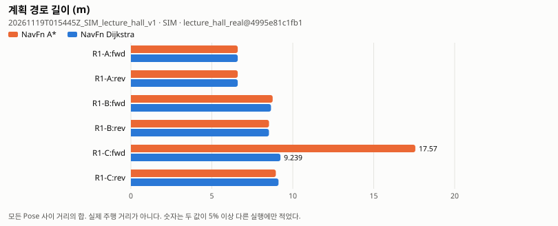
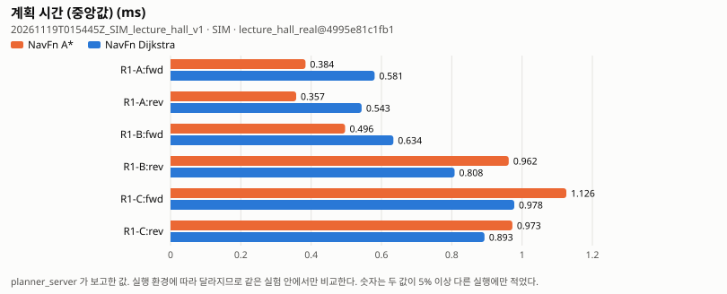

# 연구 1 기술 선정 보고서 — 전역 경로 탐색 (A* vs Dijkstra)

> **상태:** 작성 중 (초안). 항목 순서는 `docs/reference/ORIGINAL_PROPOSAL.md` §12.4를 따른다.
> **담당:** B — 정지호. 측정한 내용만 쓴다. 측정하지 않은 항목은 "미정" 또는 "미측정"으로 둔다.
> **최종 선정(P-009):** 미정 (VERIFY, B·D 실험 후 A 승인). §6은 B의 **잠정 권고**이며 확정이 아니다.

## 1. 문제 상황

물류 미션에서 전역 플래너는 두 곳에 쓰인다. D의 주행이 따라갈 경로를 만들고, C가 방문 순서를 정할 때 쓰는 계획 경로 비용표를 만든다.
같은 지도에서 A*와 Dijkstra가 어떤 차이를 보이는지, 실제 물류 운행에는 어느 쪽이 적합한지 실험으로 정해야 한다 (기획서 §5 연구 질문).

## 2. 비교 후보 및 선정 이유

| 후보 | 구현 | 설정 |
| --- | --- | --- |
| A* | Nav2 Jazzy NavFn (`nav2_navfn_planner::NavfnPlanner`) | `use_astar: true` (`NavFnAStar`) |
| Dijkstra | 같은 플러그인 | `use_astar: false` (`NavFnDijkstra`) |
| Smac 2D (추가 후보, **[초안-팀합의필요]**) | Nav2 Jazzy Smac Planner 2D (`nav2_smac_planner::SmacPlanner2D`) | Nav2 기본값, `tolerance: 0.5`만 NavFn과 맞춤 (`Smac2D`, [`config/planner_candidates.yaml`](config/planner_candidates.yaml)) |

두 후보는 `use_astar` 외 설정이 모두 같다 ([`config/navfn_compare.yaml`](config/navfn_compare.yaml)). 잠정 권고와 근거는 §6·§7에 있다.

**비교 범위:** 이 비교는 A*·Dijkstra 알고리즘 일반이 아니라 **Nav2 NavFn 플래너의 두 모드**를 비교한다.
NavFn은 정석 A*와 계산 방식이 다르므로, 결과를 "A* 알고리즘의 성능"으로 일반화하지 않는다.

### 2.1. 정석 A*와 NavFn의 차이

NavFn 내용은 Nav2 Jazzy 소스 기준이다:
[`navfn_planner.cpp`](https://github.com/ros-navigation/navigation2/blob/jazzy/nav2_navfn_planner/src/navfn_planner.cpp),
[`navfn.cpp`](https://github.com/ros-navigation/navigation2/blob/jazzy/nav2_navfn_planner/src/navfn.cpp).

| 항목 | 정석 A* | NavFn `use_astar: true` | NavFn `use_astar: false` |
| --- | --- | --- | --- |
| 계산하는 것 | 경로 하나 (칸마다 "어디서 왔는지"를 기록) | **포텐셜**: 로봇 출발 칸을 0으로 두고 퍼뜨린 각 칸까지의 누적 비용. Nav2가 출발점과 목표를 바꿔 넘기므로(`setStart(map_goal)`, `setGoal(map_start)`) 로봇 출발 칸이 기준이 된다 | 같음 |
| 칸 비용 | 이동 거리(또는 정한 간선 비용) | `COST_NEUTRAL + COST_FACTOR × costmap 값`. 장애물 근처(inflation)일수록 비싸다 | 같음 |
| 칸 값 갱신 | 이웃 칸 비용 + 간선 비용 | 이웃 두 칸의 값을 이차식으로 보간한다. 격자 방향에 덜 묶인 거리 값이 나온다 | 같음 |
| 탐색 순서 | 정확한 우선순위 큐. `f = g + h`가 가장 작은 칸부터 꺼낸다 | 임계값 구간 3개(`curP`·`nextP`·`overP`)를 쓰는 근사 순서. 같은 구간 안에서는 순서가 없고, 한 칸이 여러 번 갱신될 수 있다 | 같은 구간 방식. 포텐셜 값만으로 순서를 정한다 |
| 휴리스틱 | `h` = 목표까지 추정 거리 | 목표까지 직선거리 × `COST_NEUTRAL`. **구간 배치에만** 쓰고 저장하는 포텐셜에는 넣지 않는다 | 없음 |
| 멈추는 시점 | 목표 칸을 큐에서 **꺼낼 때**. 이 순간 비용이 최소로 확정된다 | 목표 칸에 **처음 값이 생길 때** | 목표 칸에 처음 값이 생길 때 (`calcNavFnDijkstra(..., true)`) |
| 경로 추출 | 부모 기록을 거꾸로 따라간다. 격자 칸을 잇는 지그재그 경로 | 목표에서 포텐셜 기울기를 따라 0.5칸씩 내려간다. 값이 없는 칸이 근처면 주변 8칸 중 가장 낮은 칸으로 이동한다 | 같음 |
| 최적성 | 휴리스틱이 실제 비용을 넘지 않으면 최소 비용 경로가 보장된다 | **보장되지 않는다**. 목표에 처음 닿은 순간의 포텐셜은 최소로 확정된 값이 아닐 수 있고, 주변에 값이 없는 칸이 많다 | 보장되지 않지만, 비용 순서로 고르게 퍼져서 목표에 닿을 때 더 싼 칸들의 값이 대부분 확정되어 있다 |
| 목표에 못 닿을 때 | 실패 | `tolerance`(이 설정에서 0.5 m) 사각형 안에서 값이 있는 칸 중 목표에 가장 가까운 칸으로 대신 계획한다 | 같음 |

- NavFn이 줄이는 것은 경로 **길이가 아니라 비용**이다(장애물 근처 비용 포함). 그래서 측정한 `planned_distance`가 짧다고 해서 더 최적인 것은 아니다.
- Nav2 안에서 정석에 가까운 A*는 Smac Planner 2D(정확한 우선순위 큐, 8방향 격자)다.
  이전 Humble 연구([`legacy_r1/experiments/r1/README.md`](legacy_r1/experiments/r1/README.md) §7.3)에서는 Smac 2D가 NavFn Dijkstra보다 먼 길로 돌지 않았다. Jazzy에서는 **[미확인]**이다.

## 3. 실험 환경과 통제 조건

통제 조건과 재현 명령은 [README "비교 조건"·"실행 방법"](README.md#비교-조건)에 있다.

| 항목 | 값 |
| --- | --- |
| 실행 모드 | SIM (planner-only): map_server + planner_server. Gazebo·AMCL·LiDAR는 쓰지 않았다 |
| 환경 | Docker `amr-path-planner-bench:jazzy` (ROS 2 Jazzy, Nav2 1.3.14, Python 3.12.3), Windows 11 + WSL2 |
| 지도 | `lecture_hall_real@4995e81c1fb1` — **[초안-팀합의필요]** 임시 지도 (legacy 강의실 복제 맵, D 공식 지도 전). R1-D 차단 지도는 같은 지도에 상자를 그린 사본: `lecture_hall_real+R1-D1@c254d94b7898`, `lecture_hall_real+R1-D2@07dc060afa8c` |
| 시나리오 | `lecture_hall_v1@81133c5442f3`: R1-A·R1-B·R1-C 정·역방향, FAIL-WALLED, FAIL-OFFMAP. `lecture_hall_v1_r1d@a663bec775cf`: R1-D1(복도 하나 차단 → 우회)·R1-D2(복도 셋 차단 → 실패) 정·역방향, 차단 전·후 |
| 설정 | `navfn_compare@b6b5e3a1039a` (두 실험 모두 같음) |

**주행 비교 환경 — [초안-팀합의필요] B의 임시 환경** (재현 명령은 [README "주행 비교"](README.md#주행-비교-gazebo-harmonic--초안-팀합의필요-b의-임시-환경))

| 항목 | 값 |
| --- | --- |
| 실행 모드 | SIM (Gazebo Harmonic 8.15.0 주행): TurtleBot3 Waffle Pi, Nav2 AMCL + NavFn + DWB + 기본 BT |
| 환경 | Docker `amr-sim:jazzy` (ROS 2 Jazzy, Nav2 1.3.14, `turtlebot3_gazebo` 2.3.7), Windows 11 + WSL2, GPU 가속 |
| 월드·지도 | legacy 강의실 월드를 Harmonic용으로 바꾼 `sim/worlds/lecture_hall_real.sdf`와 위 임시 지도 |
| 설정 | `nav2_drive@ccfbbd427b1e`: ROBOTIS Waffle Pi 기본 설정에서 `robot_radius` 0.22 m, inflation 0.55 m / 3.0만 계획 비교와 맞췄다. 두 후보의 차이는 `use_astar`뿐이다. **D의 배포 설정이 아니다** |
| 통제 | 시행마다 같은 출발 Pose에 로봇을 놓고, AMCL을 다시 초기화하고, costmap을 지운 뒤 출발. 반복마다 두 설정의 순서를 바꿈. 조건별 5회 |

## 4. 측정 결과 및 그래프

실험마다의 목적·조건·관찰은 [`EXPERIMENT_LOG.md`](EXPERIMENT_LOG.md)에 있다. 이 절에는 보고에 쓰는 측정만 모은다.

| 실험 ID | 날짜 | 모드 | 반복 | 결과 |
| --- | --- | --- | --- | --- |
| `20261118T061956Z_SIM_lecture_hall_v1` | 2026-11-18 | SIM (planner-only) | 예열 1 + 30 | [summary.md](results/20261118T061956Z_SIM_lecture_hall_v1/summary.md), 요약표는 [README "측정 결과"](README.md#측정-결과--sim-planner-only) |
| `20261119T012513Z_SIM_lecture_hall_v1_r1d` | 2026-11-19 | SIM (planner-only) | 예열 1 + 30 | [summary.md](results/20261119T012513Z_SIM_lecture_hall_v1_r1d/summary.md), 요약표는 [README "R1-D 경로 차단"](README.md#측정-결과--r1-d-경로-차단-sim-planner-only) |
| `20261119T075850Z_SIM_lecture_hall_v1`, `20261119T075917Z_SIM_lecture_hall_v1_r1d` | 2026-11-19 | SIM (planner-only), 세 후보 | 예열 1 + 30 | [README "세 후보 계획 비교"](README.md#측정-결과--세-후보-계획-비교-sim-planner-only--후보-확장은-초안-팀합의필요) |
| `20261120T002730Z_SIM_lecture_hall_v1_r1d` | 2026-11-20 | SIM (planner-only), lifecycle 확인 후 R1-D 재측정 | 예열 1 + 30 | [summary.md](results/20261120T002730Z_SIM_lecture_hall_v1_r1d/summary.md). 480/480 일치, 경로 길이는 앞선 R1-D 측정과 같다 |

**R1-A~C, 도달 불가** (`20261118T061956Z`)

- 도달 가능한 6개 실행: 두 설정 모두 30/30 성공. 도달 불가 2개 실행: 두 설정 모두 0/30이고 Nav2 오류 코드가 기대와 일치했다.
- 경로 길이: R1-A 같음. R1-B는 A*가 정방향 0.10 m, 역방향 0.003 m 길었다. R1-C는 정방향에서 A*가 8.33 m(약 1.9배) 길었고, 역방향에서는 0.17 m 짧았다.
- 계획 시간 중앙값: 0.33~1.04 ms. 실행마다 어느 쪽이 빠른지 달랐다.

**R1-D 경로 차단** (`20261119T012513Z`). 같은 쌍을 차단 전 지도와 상자를 그린 지도에서 계획했다.

| 항목 | A* | Dijkstra |
| --- | --- | --- |
| 차단 전 경로가 상자 자리를 지남 (4개 실행) | 120/120 | 120/120 |
| R1-D1 차단 후 재생성 성공 (정·역) | 60/60, 상자 자리 통과 0 | 60/60, 상자 자리 통과 0 |
| R1-D1 차단 후 경로 길이 정방향 / 역방향 (m) | **12.0787** / 10.8343 | 10.935 / 10.8513 |
| R1-D1 차단 전 대비 증가 정방향 / 역방향 (m) | +5.38 / +4.25 | +4.25 / +4.28 |
| R1-D2 차단 후 (경로 없음) | 0/60, `NO_VALID_PATH` | 0/60, `NO_VALID_PATH` |
| 계획 시간 중앙값 범위 (성공 실행, ms) | 0.44~1.26 | 0.48~1.26 |

- 측정 480회가 모두 기대와 일치했다. 30회 반복의 경로 길이 표준편차는 모두 0.0이었다.

**경로 품질과 경로 그림** (`20261119T015445Z`, `20261119T015502Z`). 위 두 실험과 같은 조건을 측정 코드 `39fba81`로 다시 쟀다. 경로 길이는 같았다.
전체 표는 [README "경로 품질과 경로 그림"](README.md#측정-결과--경로-품질과-경로-그림-sim-planner-only)에 있다. 값은 A* / Dijkstra다.

| 실행 | 경로 길이 (m) | 0.10 m 간격 길이 (m) | 두 경로 최대 간격 (m) | 최소 장애물 거리 (m) |
| --- | --- | --- | --- | --- |
| R1-C:fwd | 17.5687 / 9.239 | 15.1083 / 9.0754 | 5.46 | 0.38 / 0.35 |
| R1-C:rev | 8.9546 / 9.1211 | 8.9229 / 9.041 | 0.20 | 0.38 / 0.35 |
| R1-D1:fwd 차단 후 | 12.0787 / 10.935 | 10.8644 / 10.7963 | 0.10 | 0.40 / 0.40 |
| R1-D1:rev 차단 후 | 10.8343 / 10.8513 | 10.7657 / 10.7732 | 0.05 | 0.35 / 0.40 |

- 측정 960회(두 실험)가 모두 기대와 일치했고, 모든 지표가 30회 반복에서 같았다.
- 최소 장애물 거리는 모든 실행에서 0.35 m 이상이었고, 두 설정의 차이는 0.05 m 이하였다.
- 경로 그림: 결과 폴더의 `paths_*.svg`(실행마다 한 장, 두 설정을 겹쳐 그림).
- 계산 시간·경로 길이 비교 그래프: 결과 폴더의 `compare_planned_distance.svg`, `compare_planning_time.svg`.

| 계획 경로 길이 (R1-A~C) | 계획 시간 (R1-A~C) |
| --- | --- |
|  |  |

**주행 비교** (`20261119T060115Z` R1-A~C, `20261119T044830Z` R1-D1). SIM(Gazebo Harmonic), B의 임시 환경, 조건별 5회.
전체 표와 주의할 점은 [README "주행 비교"](README.md#측정-결과--주행-비교-sim-gazebo-harmonic--초안-팀합의필요-b의-임시-환경)에 있다. 값은 A* / Dijkstra다.

| 항목 | A* | Dijkstra |
| --- | --- | --- |
| 목표 도착 (100회 중 각 50회) | 47/50 (94%) | 50/50 (100%) |
| 복구 동작 합계 (발생한 시행 수) | 202회 (25개 시행) | 76회 (15개 시행) |
| R1-A 개방: 주행 시간 정 / 역 (s) | 30.3 / 29.0 | 29.2 / 29.1 |
| R1-C 좁은 통로: 주행 시간 정 / 역 (s) | 68.3 / 61.1 | 35.2 / 41.7 |
| R1-C 좁은 통로: 실제 주행 거리 정 / 역 (m) | 13.74 / 15.21 | 8.90 / 9.14 |
| R1-D1 차단 후: 도착 정 / 역 | 4/5 / 4/5 | 5/5 / 5/5 |
| R1-D1 차단 후: 주행 시간 정 / 역 (s, 도착한 시행) | 75.0 / 60.5 | 69.5 / 64.5 |

- 주행 그래프: 결과 폴더의 `compare_execution_time.svg`, `compare_actual_distance.svg`.
- 실차(REAL) 주행 결과표: **미측정**.

## 5. 결과 차이와 실패 원인 분석

- R1-C 정방향에서 NavFn A* 경로가 길어진 원인: Jazzy에서는 **미분석**이다.
  - 원인 후보(§2.1): A* 모드는 목표 쪽으로 치우쳐 퍼지다가 목표에 처음 닿으면 멈춘다. 그때의 포텐셜은 덜 완성되어 있고, 경로는 그 기울기를 따라 그려진다. 그래서 처음 닿은 우회로를 따라갈 수 있다.
  - 이전 Humble 연구(legacy §7.3)도 같은 원인(부분 포텐셜 + 기울기 따라가기)으로 보았다. Jazzy 결과에서 이 원인을 직접 확인하지는 않았다.
  - 확인 방법 후보: 두 모드의 포텐셜 배열(탐색된 칸과 그 값)과 경로를 함께 그려 비교한다.
- R1-C 역방향에서는 A*가 0.17 m 짧았다. §2.1대로 NavFn은 길이가 아니라 비용을 줄이므로, 이것이 A*가 더 좋다는 뜻은 아니다.
  장애물에 더 붙은 경로일 수 있으나 **[미확인]**이다. 장애물까지의 거리 같은 경로 품질 지표는 아직 기록하지 않았다.
- **경로 품질 측정으로 확인한 것 (2026-11-19):** A* 경로가 1 m 넘게 길었던 두 실행은 이유가 달랐다.
  - R1-C 정방향은 **다른 길**이다. 두 경로가 최대 5.46 m 떨어져 있고, 0.10 m 간격으로 재도 15.11 / 9.08 m다.
  - R1-D1 차단 후 정방향은 **같은 길**이다(최대 간격 0.10 m). 차이 1.14 m 가운데 1.08 m가 A* 경로의 0.10 m보다 잔 지그재그다. 0.10 m 간격으로 재면 차이가 0.07 m다.
  - 잔 지그재그는 A*의 정방향 두 실행에서만 컸다(2.46 m, 1.21 m). 다른 실행은 두 설정 모두 0.25 m 이하였다.
  - 위 두 현상(다른 길 선택, 잔 지그재그)이 왜 생기는지는 여전히 **[미분석]**이다. §2.1의 후보(부분 포텐셜 + 기울기 따라가기)와 어긋나지 않지만, 포텐셜을 직접 보지는 않았다.
  - R1-C 역방향에서 A*가 짧았던 경로는 평균 장애물 거리가 0.021 m 작았고 최소 장애물 거리는 0.03 m 컸다. 위에서 "장애물에 더 붙은 경로일 수 있다"고 본 것은 측정 결과 뚜렷하지 않았다.
- **주행 비교로 확인한 것 (2026-11-19, B의 임시 환경):**
  - 좁은 통로(R1-C)에서 A*는 양방향 모두 주행 시간 1.5~1.9배, 주행 거리 1.5~1.7배였다. Dijkstra는 10회 모두 9 m 안팎의 같은 길로 갔다.
  - R1-C 역방향은 계획만 볼 때와 달랐다. planner-only에서는 A*가 8.95 m로 더 짧았지만, 주행에서는 5회 모두 약 15 m를 달렸다.
    첫 계획이 8.95 m(2회)이기도 하고 15~17 m(3회)이기도 했고, 짧게 시작한 2회도 주행 중 재계획에서 먼 길로 바뀌었다.
    주행 중에는 costmap에 LiDAR 장애물이 더해지고 출발 위치가 조금씩 달라지는데, A* 모드는 이런 작은 차이로 고르는 길이 바뀌었다. 원인은 **[미분석]**이다.
  - A*의 복구 동작은 Dijkstra의 약 2.7배였다(202 / 76회). A*의 도착 실패 3건은 모두 복구 동작을 15회 이상 한 시행이었다.
  - planner-only에서 본 A* 경로의 잔 지그재그는 실제 주행 거리를 늘리지 않았다(R1-D1 차단 후 정방향 13.19 / 13.53 m).
  - 개방 경로(R1-A)에서는 두 설정의 주행이 같았다.
  - R1-B는 두 설정 모두 복구 동작이 많았고 실행마다 결과가 달랐다. 이 구간의 차이는 플래너보다 주행 설정의 영향이 커 보이며, 5회로는 판단할 수 없다.
- 도달 불가: 벽으로 막힌 목표는 `NO_VALID_PATH`, 지도 밖 목표는 `GOAL_OUTSIDE_MAP`으로 두 설정 모두 실패했다. 실패 응답에는 `planning_time`이 보고되지 않았다.
- **R1-D1 정방향**에서도 A*가 1.14 m 더 먼 우회로를 골랐다. 역방향은 거의 같았다(A*가 0.017 m 짧음).
  R1-C 정방향과 같이 "한 방향에서만 A*가 먼 길"인 사례가 하나 더 나왔다. 원인은 R1-C와 같은 후보(부분 포텐셜 + 기울기 따라가기)이고 **[미분석]**이다.
  이전 Humble 연구의 같은 쌍(A* 12.565 ± 0.265 / Dijkstra 10.942 m)과 경향이 같다.
- **R1-D2**: 경로가 없어지면 두 설정 모두 임의 경로 없이 `NO_VALID_PATH`로 실패했다. 계획 단계의 실패 처리는 두 설정이 같았다.
  주행 중 막힌 경우는 다르다. 이전 Humble 주행에서는 BT 복구가 costmap을 지우면서 180 s 안에 실패를 알리지 않았다(legacy §7.2).
  이것은 플래너가 아니라 BT·운용 쪽 문제이고 Jazzy에서는 **[미확인]**이다.
- 실패 응답의 시간: `planning_time`이 없어 `roundtrip_time`만 남는다. 그런데 `roundtrip_time`은 같은 실행 안에서 요청이 쌓일수록 커졌다
  (첫 실험 반복 0 → 30: 7.2 → 18.1 ms, R1-D 차단 전 묶음: 14.3 → 23.5 ms. 원인 **[미분석]**). 그래서 실패를 얼마나 빨리 알리는지는 이 측정으로 비교하지 않는다.

- **세 후보 계획 비교로 확인한 것 (2026-11-19):** Smac Planner 2D는 같은 조건에서 먼 길로 돌지 않았고 잔 지그재그도 없었다.
  10개 실행 중 9개에서 경로가 가장 짧았고 꺾인 각도 합은 NavFn의 20~55%였다. 계획 시간은 3~7배(최대 10.4 ms)였다.
  NavFn A*에서 본 문제는 A* 알고리즘이 아니라 NavFn의 `use_astar` 구현에서 나온다는 §2.1의 설명과 맞는 결과다. 주행에서는 아직 확인하지 않았다.
- **교차 검증 (A, PR #5 리뷰):** Ubuntu 24.04 ARM64(UTM) + Nav2 1.3.14에서 기본 비교 480/480과 R1-D 480/480이 재현됐고, 평균 계획 경로 길이가 0.0001 m까지 같았다.
  그 과정에서 `planner_server`가 `inactive`일 때 측정이 시작돼 88건이 `GOAL_REJECTED`로 기록된 실행이 한 번 있었다.
  원인은 측정 스크립트가 Action 서버 검색만 확인하고 lifecycle 활성화를 기다리지 않은 것이다. `active` 확인을 넣어 고쳤다(`acd8b7b`).

## 6. 최종 선정 기술

**최종 선정은 미정이다 (P-009 VERIFY).** 아래는 지금까지의 측정에 근거한 B의 **잠정 권고**이고, D의 검증과 A의 승인을 거쳐야 확정된다.

> **잠정 권고: NavFn Dijkstra** — `nav2_navfn_planner::NavfnPlanner`, `use_astar: false`, `tolerance: 0.5`, `allow_unknown: true` (Nav2 기본값과 같다)
>
> 이 권고는 NavFn 두 설정만 비교해 쓴 것이다. 이후 추가한 Smac Planner 2D는 계획 비교에서 Dijkstra보다 경로가 짧고 매끄러웠다(§5). Smac 2D의 주행 비교는 아직 하지 않았으므로, 그 결과가 나오면 이 권고를 다시 검토한다.

## 7. 선택 근거

잠정 권고의 근거 (모두 임시 지도, SIM 기준):

| 기준 | 측정 결과 | 어느 쪽에 유리한가 |
| --- | --- | --- |
| 경로 생성 성공률 | planner-only 1,920회(4개 실험)에서 두 설정이 같았다. 도달 가능한 실행은 모두 100%, 도달 불가·차단은 모두 실패로 처리 | 같음 |
| 계획 시간 | 중앙값 0.33~1.26 ms. 실행마다 빠른 쪽이 달랐고 차이는 1 ms 미만 | 같음 (이 지도 크기에서는 선정 기준이 되지 못한다) |
| 계획 경로의 일관성 | A*는 R1-C 정방향에서 1.9배 먼 길을 골랐고, 주행 중에는 같은 쌍에서 시행마다 다른 길을 골랐다. Dijkstra는 같은 길을 유지했다 | Dijkstra |
| 계획 거리의 신뢰도 (C의 비용표) | A* 계획 거리에는 잔 지그재그가 최대 2.46 m 들어갔다. Dijkstra는 0.25 m 이하였다 | Dijkstra |
| 목표 도달 성공률 (주행) | A* 47/50, Dijkstra 50/50 | Dijkstra |
| 주행 시간·거리 | 개방 경로는 같음. 좁은 통로에서 A*가 시간 1.5~1.9배, 거리 1.5~1.7배 | Dijkstra |
| 복구 동작 | A* 202회, Dijkstra 76회 | Dijkstra |
| 장애물과의 거리 | 최소 장애물 거리의 차이 0.05 m 이하 | 같음 |
| 설정 변경 부담 | Dijkstra는 Nav2 기본값이라 바꿀 것이 없다 | Dijkstra |

A*가 유리했던 항목은 없었다. 이론상 A*의 장점인 탐색량 감소는 이 지도 크기(190 × 213 칸)에서 계획 시간 차이로 나타나지 않았다.

이 권고가 **확정이 아닌 이유** (선정 전에 더 필요한 것):

- 지도가 임시다. D의 공식 지도와 HOME·A~D 지점(P-014)에서 다시 재야 한다.
- 주행 비교는 B의 임시 환경(ROBOTIS 기본 주행 설정, 조건별 5회)에서 했다. D의 Nav2 설정에서 확인해야 한다.
- 실차(REAL) 검증을 하지 않았다.
- 비교한 것은 NavFn의 두 모드다. 정석에 가까운 A*(Smac Planner 2D)는 Jazzy에서 비교하지 않았다. 후보를 넓힐지는 A·D와 정한다.
- A*가 길을 바꾸는 원인과 잔 지그재그의 원인을 확인하지 못했다(§5).

## 8. 실제 시스템 적용 결과

**미적용.** D의 Nav2 배포 설정과 C의 비용표에는 아직 반영하지 않았다. 반영은 D·C가 하고, 아래는 B가 제공하는 기준이다(INTERFACES §9).

**D에게 (추천 설정과 재현 절차, 잠정)**

- 플래너 블록: `plugin: "nav2_navfn_planner::NavfnPlanner"`, `use_astar: false`, `tolerance: 0.5`, `allow_unknown: true`.
- 비교에 쓴 costmap 값: `robot_radius: 0.22`, inflation `0.55` / `3.0`. 이 값은 D가 정하는 값이며, 바뀌면 B가 같은 값으로 다시 잰다.
- 재현: [README "실행 방법"](README.md#실행-방법)의 planner-only 명령과 주행 비교 명령.
- 주행 중 경로가 막혔을 때 실패를 언제 알리는지는 플래너가 아니라 BT·복구 설정에 달려 있다. A*에서 복구 15회 이상 뒤 중단·시간 초과가 3건 있었다.

**C에게 (비용표 계산 기준, 잠정)**

- `planner_id`와 `config_version`을 비용표에 함께 기록한다. 지금 기준은 "NavFn, `use_astar: false`"이고 확정 전까지 임시다.
- `ComputePathToPose`에 `start` + `use_start: true`를 주고, `A → B`와 `B → A`를 따로 계산한다. 같은 쌍도 방향에 따라 달랐다(Dijkstra에서 최대 0.20 m, A*에서 최대 8.6 m).
- `NO_VALID_PATH`, `GOAL_OUTSIDE_MAP`은 실패로 두고 거리로 바꾸지 않는다.
- 계획 거리는 Pose 사이 거리의 합이다. Dijkstra 모드에서는 잔 지그재그가 0.25 m 이하였다.
- 지도·costmap·플래너 설정이 바뀌면 `map_version`·`config_version`이 달라지므로 비용표를 다시 만든다(INTERFACES §8.4).
- 같은 조건의 계획 결과는 30회 반복에서 모두 같았다. 다만 Nav2를 새로 띄운 실행 사이에는 수 mm 차이가 있었다.

## 9. 한계 및 후속 개선 사항

| 한계 | 후속 |
| --- | --- |
| 임시 지도 한 곳에서만 비교했다 | 공식 지도(P-014) 시나리오를 추가해 계획·주행을 다시 잰다 |
| 주행 비교는 B의 임시 환경(ROBOTIS 기본 DWB·AMCL·BT)에서 조건별 5회만 했다. 표준편차가 커서 R1-B·R1-D1의 시간 차이는 판단할 수 없다 | D의 Nav2 설정에서 다시 재고 반복 횟수를 늘린다 |
| 주행의 도착 여부는 Nav2 판정(AMCL 추정)만 썼다. 오도메트리로 추정한 `final_error`는 최대 2.9 m가 나와 쓸 수 없었다 | Gazebo의 실제 위치(ground truth)를 기록해 도착 오차를 잰다 |
| 경로가 완전히 막힌 경우(R1-D2)는 주행하지 않았다 | 주행 중 실패 판정 시간을 D·A와 함께 본다 (Humble에서는 180 s 안에 실패를 알리지 않았다) |
| 실차(REAL) 결과가 없다 | C·D와 조율해 조건별 5회 이상 실차 시험을 한다 |
| 계획 시간은 WSL2 + Docker 환경의 값이다 | 같은 세션 안에서만 비교한다. 실차 PC에서 다시 잰다 |
| `roundtrip_time`이 같은 실행 안에서 요청이 쌓일수록 커진다 (원인 미분석) | 알고리즘 비교에는 `planning_time`만 쓴다. 원인(클라이언트 또는 planner_server)을 확인한다. C의 비용표 계산처럼 요청을 많이 보내는 경우에도 해당할 수 있어 C에 공유한다 |
| 교차 실행은 1건(A의 Ubuntu 24.04 ARM64 UTM)이고, 경로 품질·세 후보·주행 측정은 교차 확인하지 않았다 | 다른 팀원 환경에서도 같은 명령으로 확인한다 |
| Smac Planner 2D는 계획 비교만 했다 | 세 후보 주행 비교를 다시 측정하고 §6의 권고를 재검토한다 |
| NavFn 두 모드만 비교했다. 정석 A*와의 차이는 소스 분석뿐이다 (§2.1) | 정석에 가까운 A*인 Smac Planner 2D를 같은 조건으로 추가 비교할지 검토한다 |
| 장애물 거리는 칸 단위(0.05 m) 정확도이고 정적 지도의 점유 칸 기준이다 | 실차에서는 실제 장애물까지의 거리를 따로 본다 |
| `planned_distance`에 잔 지그재그가 들어가 같은 길도 플래너에 따라 1 m 넘게 다르다 | C와 비용표 거리 계산 방식을 상의한다. 주행 비교에서 실제 주행 거리 차이를 확인한다 |
