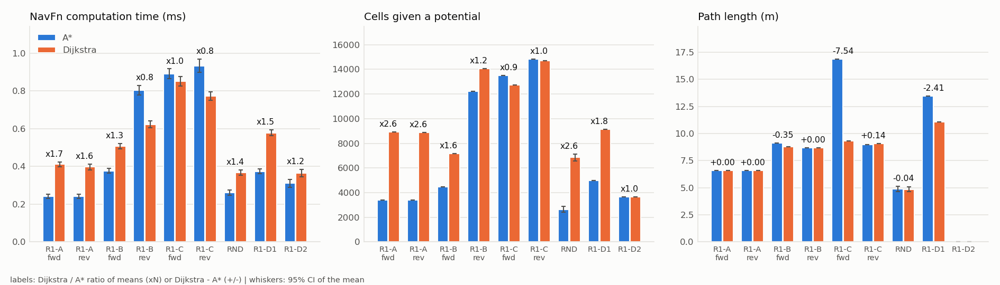
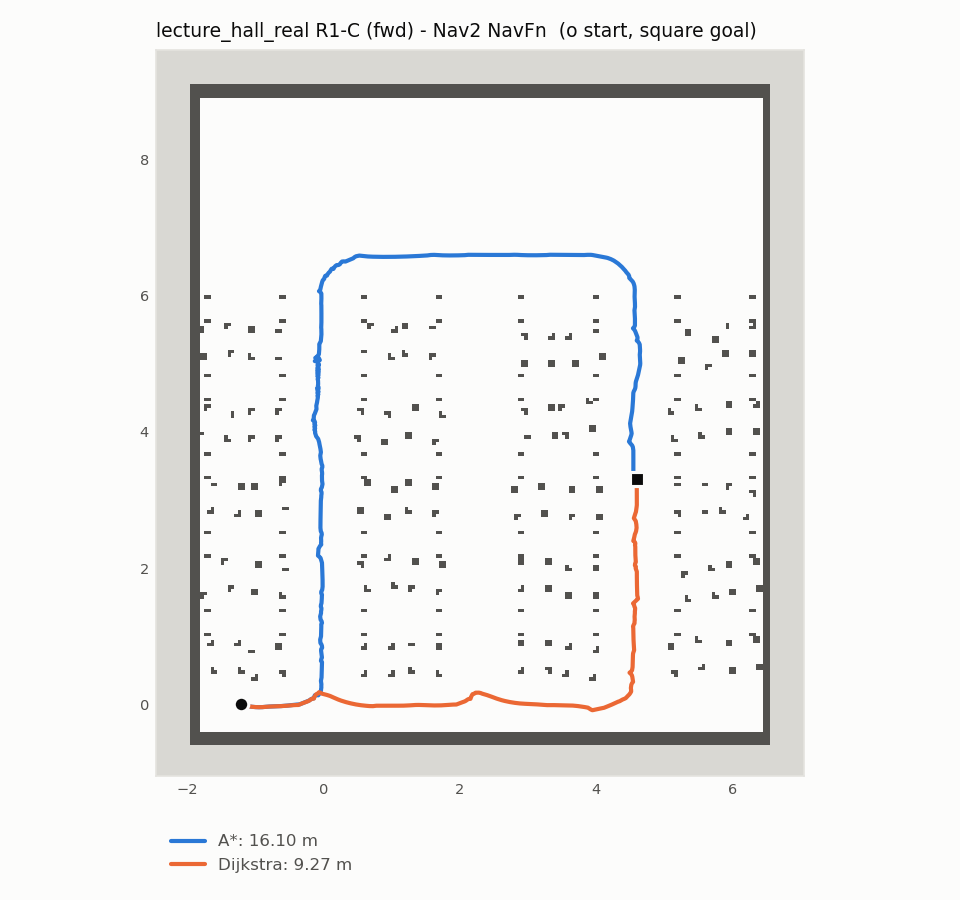
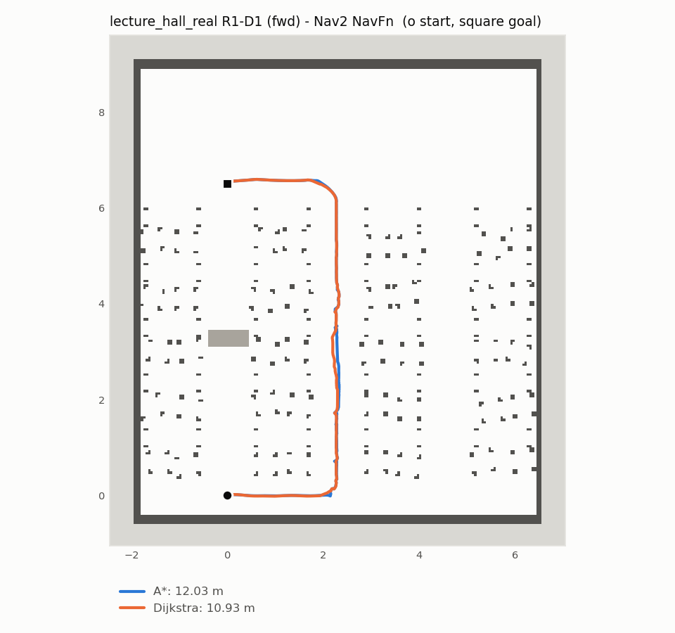
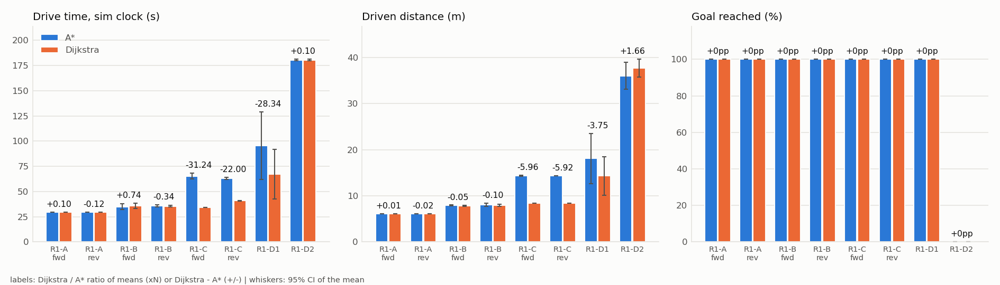

# 연구 1 — 전역 경로 탐색: A* vs Dijkstra (Nav2 NavFn)

> SMART-LOGISTICS AMR 최종 기획안 5장(연구 1)의 실험 프로토콜·실행 방법·결과. 담당: B (경로 탐색·물류 최적화)
> 실험 도구: [`tools/r1_bench.py`](../../tools/r1_bench.py), Nav2 설정: [`nav2/`](nav2/), 시나리오: [`scenarios.yaml`](scenarios.yaml)

**연구 질문**: 동일한 환경에서 A*와 Dijkstra는 어떤 성능 차이를 보이며, 실제 물류 운행에 적합한 전역 탐색 방식은 무엇인가?

## 결론 요약

- **선정: Nav2 NavFn `use_astar: false` (Dijkstra)** — 확정 설정 [`nav2/planner_server_final.yaml`](nav2/planner_server_final.yaml). Nav2 기본값과 같다.
- **경로 품질**: NavFn 의 A* 모드는 좌석·장애물 사이에서 더 긴 경로를 냈다 (강의실 R1-C +81%, 차단 우회 +22%, 무작위 200쌍 중 6쌍 5% 이상).
  "A* 가 더 짧다"는 가정은 맞지 않았다.
- **주행 (Gazebo, 5회 × 7조건)**: 둘 다 35/35 도착. A* 는 복구 동작 87번, Dijkstra 0번. 총 주행 시간은 Dijkstra 가 23% 짧았다.
- **계산 시간**: 0.2~0.9 ms 로 둘 다 충분히 빠르다. A* 는 열린 곳에서만 1.7배 빠르고 복도에서는 오히려 느렸다.
- **남은 일**: D 담당과 실차 검증 ([`REAL_ROBOT_TEST.md`](REAL_ROBOT_TEST.md)), C 담당에 경로 비용 기준 전달 ([`PATH_COST_GUIDE.md`](PATH_COST_GUIDE.md)),
  경로가 없을 때의 실패 처리는 Mission Manager 에서 (7.2 관찰 4).

---

## 1. 비교 대상

팀 최종 주행 스택은 **Nav2** 다. 기획안 5.2 대로 Nav2 `planner_server` 의 **NavFn Planner** 를 `use_astar` 만 바꿔 두 개 띄우고
(`planner_id` `AStar` / `Dijkstra`), 계획 요청이나 주행 목표마다 골라 쓴다.

| 구분 | A* (`AStar`) | Dijkstra (`Dijkstra`) |
| --- | --- | --- |
| 플러그인 | `nav2_navfn_planner/NavfnPlanner` | 같음 |
| `use_astar` | `true` | `false` |
| `tolerance` / `allow_unknown` | 0.5 m / true | 같음 |
| global costmap | 같은 costmap (static + obstacle + inflation, 반경 0.22 m, inflation 0.55 m, scaling 3.0) | 같음 |
| 주행 BT | Nav2 기본 BT ([`bt_astar.xml`](nav2/bt_astar.xml)) | 같고 `planner_id` 만 다름 ([`bt_dijkstra.xml`](nav2/bt_dijkstra.xml)) |
| 로컬 제어기 | DWB (Nav2 기본값) | 같음 |

- NavFn 은 격자 탐색으로 **포텐셜(목표까지 비용)** 을 계산한 뒤, 그 경사를 따라 내려가며 경로를 만든다.
  Dijkstra 모드는 로봇 위치에서 목표에 닿을 때까지 고르게 넓혀 가고, A* 모드는 목표 쪽으로 치우쳐 넓혀 간다.
- 기획안대로 **"A* 경로가 더 짧다"는 가정을 하지 않고**, 계산 시간·탐색 칸·경로 길이·성공률·주행 결과를 따로 측정한다.

## 2. 실험 환경

| 항목 | 구성 |
| --- | --- |
| PC | Intel Core i7-7700 (8 스레드), Windows 11 + WSL2 `ros-docker` 배포판 (메모리 7.6 GB), Docker Engine 29 |
| 컨테이너 | 저장소 `Dockerfile` 이미지 `warehouse-sim`: ROS 2 Humble, Nav2 1.1.20, Gazebo Classic 11 |
| 로봇 모델 | `worlds/models/turtlebot3_waffle_pi_real` (실물 LDS-02 사양 LiDAR, 휠 엔코더+IMU 오도메트리) |
| 월드·맵 | `lecture_hall_real` (강의실 복제 월드, 책상 20·의자 40, 세로 복도 0.9 m) + 월드에서 만든 맵 [`maps/lecture_hall_real.yaml`](maps/lecture_hall_real.yaml) (`tools/world_to_map.py`) |
| Nav2 설정 | [`nav2/nav2_r1.yaml`](nav2/nav2_r1.yaml): Humble `nav2_params.yaml` 기본값 + base_footprint, AMCL 은 `config/amcl_hall.yaml` 값, NavFn 두 개 |
| 속도 명령 | velocity_smoother → `cmd_vel_pc` → 명령 감시(`scripts/pi_cmd_watchdog.py`) → `cmd_vel` (실물과 같은 안전 경로) |
| 실행 | [`nav2/run_nav2_sim.sh`](nav2/run_nav2_sim.sh) (Gazebo + Nav2 + 초기 위치), 실시간 비율 1.0 |

## 3. 통제 조건 (기획안 5.4)

| 조건 | 적용 |
| --- | --- |
| 동일한 지도 및 Costmap | 같은 맵·같은 global costmap. 계획만 실험은 Nav2 의 costmap 을 그대로 저장해 두 알고리즘에 같이 씀 |
| 동일한 로봇 Footprint | `robot_radius` 0.22 m (global/local costmap) |
| 동일한 출발·목표 좌표 | `scenarios.yaml` 지점 (방향 포함). 주행 실험은 시도 전에 로봇을 출발점에 다시 세움 (A* 로 이동, 기록 안 함) |
| 동일한 플래너 설정 | `use_astar` 하나만 다름. 주행 시도마다 global/local costmap 초기화 |
| 동일한 장애물 배치 | 맵 + 시나리오 상자 (계획만: 상자를 그린 맵으로 `map_server/load_map`, 주행: Gazebo 에 같은 위치·크기로 생성) |
| 동일한 로컬 제어기 | DWB 같은 설정 |
| 순서 영향 | 짝수 반복은 A* 먼저, 홀수 반복은 Dijkstra 먼저 |
| 반복 | 핵심 계산 100회, planner_server 30회 (+ 무작위 200쌍 × 3회), Gazebo 주행 5회 |
| 기록 | 성공·실패 모두, 기획안 12.3 공통 항목 + `config_version` (커밋 + Nav2 설정·맵 해시) |

## 4. 시나리오 (`lecture_hall_real`)

| ID | 이름 | 출발 → 목표 | 내용 |
| --- | --- | --- | --- |
| R1-A | 개방 경로 | 강단 왼쪽 (-1.0, 7.9) → 강단 오른쪽 (5.6, 7.9) | 빈 공간을 가로지름 |
| R1-B | 장애물 우회 | 좌석 2열 뒤 (1.15, 0) → 좌석 2열 앞 (1.15, 6.5) | 직선 위 좌석 블록을 세로 복도로 돌아감 |
| R1-C | 좁은 통로·갈림길 | 뒤쪽 왼쪽 (-1.2, 0) → 세로 복도 4 가운데 (4.6, 3.3) | 갈림길 2곳을 지나 폭 0.9 m 복도로 |
| R1-D1 | 경로 차단 (재계획) | 홈 (0, 0) → 앞쪽 복도 (0, 6.5) | 세로 복도 2 를 맵에 없는 상자로 막음 → 세로 복도 3 으로 |
| R1-D2 | 경로 차단 (경로 없음) | 홈 → 강단 오른쪽 | 세로 복도 3개를 모두 막음 → 실패 처리 |
| RND | 무작위 쌍 (계획만) | 빈 칸 무작위 200쌍 | 직선거리 1 m 이상, 벽에서 0.35 m 이상, seed 1 |

R1-A ~ R1-C 는 정방향·역방향을 모두 측정한다.

## 5. 측정 방법과 지표

세 단계로 나눠 잰다. 계획 시간처럼 작은 값은 메시지 통신이 섞이면 묻히기 때문이다.

| 단계 | 모드 (`r1_bench.py`) | 무엇을 | 반복 |
| --- | --- | --- | --- |
| ① NavFn 핵심 계산 | `nav2plan` 이 저장한 costmap → `navfncore` | Nav2 global costmap(raw)을 그대로 저장하고, NavFn 라이브러리를 `NavfnPlanner::makePlan` 과 같은 순서로 C++ 에서 직접 호출 ([`navfn_bench.cpp`](nav2/navfn_bench.cpp)). 순수 계산 시간·포텐셜을 받은 칸 수·경로 | 100회 / 무작위 쌍 3회 |
| ② planner_server 계획 | `nav2plan` | `ComputePathToPose` 액션 (실제 Nav2 서버). 요청~응답 시간, 경로 길이, 성공률 | 30회 / 무작위 쌍 3회 |
| ③ Gazebo 주행 | `nav2sim` | `NavigateToPose` + 알고리즘별 BT. 주행 시간(시뮬레이션 시각), 실제 주행 거리(Gazebo 실제 위치), 도달 성공, 계획 횟수, 복구 횟수, 도착 오차 | 5회 |

| 기획안 5.5 지표 | 열 (`trials.csv`) | 출처 |
| --- | --- | --- |
| 경로 계산 시간 (ms) | `planning_time` (① 순수 계산), `roundtrip_time` (② 요청~응답) | Humble 의 `planner_server` 는 결과의 `planning_time` 을 채우지 않아 ① 로 잰다 |
| 생성 경로 길이 (m) | `planned_distance` | ①② 경로, ③ 첫 계획 |
| 경로 생성 성공률 (%) | `plan_success` | ①② |
| 실제 주행 시간 (s) | `execution_time_sim` (`execution_time` = 벽시계) | ③ |
| 실제 주행 거리 (m) | `actual_distance` | ③ Gazebo `/get_entity_state` 궤적 |
| 목표 도달 성공률 (%) | `goal_success` | ③ `NavigateToPose` SUCCEEDED |
| (추가) 탐색 칸 | `expanded` | ① 포텐셜이 계산된 칸 수 |

## 6. 실행 방법

```powershell
wsl -d ros-docker                     # Docker 가 설치된 WSL 배포판. 실험 중에는 이 창을 열어 둔다
```

```bash
cd /mnt/d/teamfinal/team_project2
docker compose build                                                   # 처음 한 번
WSIM_ARGS=none docker compose up -d                                    # 컨테이너 wsim (웹 서버만)
docker exec wsim /app/experiments/r1/nav2/run_nav2_sim.sh lecture_hall_real   # Gazebo + Nav2 + 초기 위치

# ①② 계획 (planner_server 30회 + 무작위 200쌍, 끝나면 NavFn 핵심 계산 100회를 자동 실행)
docker exec wsim bash -c 'cd /app && source scripts/env.sh && python3 tools/r1_bench.py nav2plan --world lecture_hall_real --repeat 30 --random 200'
# ③ Gazebo 주행 (5회, 약 1.5시간)
docker exec wsim bash -c 'cd /app && source scripts/env.sh && python3 tools/r1_bench.py nav2sim --world lecture_hall_real --repeat 5'
# 결과 다시 요약
docker exec wsim bash -c 'cd /app && python3 tools/r1_bench.py report experiments/r1/results/<폴더>'
docker compose down                                                    # 끄기
```

결과: `experiments/r1/results/<시각>_<모드>_<월드>/` — `trials.csv` (원자료), `summary.md` (표), `fig_*.png`, `paths_*.png`, `meta.json`

실차는 Docker 가 아니라 로봇과 같은 공유기의 리눅스 PC 에서 실행한다: [`REAL_ROBOT_TEST.md`](REAL_ROBOT_TEST.md)

## 7. 결과

코드 커밋 `4f2c662a`, `config_version` `4f2c662a-n6d95dc-m5249d1` (Nav2 설정 `nav2_r1.yaml`·맵 해시).

### 7.1 계획 (① NavFn 핵심 계산 + ② planner_server)

원자료: [`results/20261117-022910_navfncore_lecture_hall_real`](results/20261117-022910_navfncore_lecture_hall_real/summary.md) (①),
[`results/20261117-022910_nav2plan_lecture_hall_real`](results/20261117-022910_nav2plan_lecture_hall_real/summary.md) (②)

| 시나리오 | ① 계산 시간 A* / D (ms) | 배율 D/A | ① 포텐셜 칸 A* / D | 배율 | ① 경로 길이 A* / D (m) | ② 경로 길이 A* / D (m) | 성공 A* / D |
| --- | --- | ---: | --- | ---: | --- | --- | --- |
| R1-A 개방 (정) | 0.24 / 0.41 | ×1.70 | 3,389 / 8,925 | ×2.63 | 6.60 / 6.60 | 6.60 / 6.60 | 100% / 100% |
| R1-A 개방 (역) | 0.24 / 0.40 | ×1.65 | 3,388 / 8,883 | ×2.62 | 6.60 / 6.60 | 6.60 / 6.60 | 100% / 100% |
| R1-B 우회 (정) | 0.38 / 0.51 | ×1.35 | 4,474 / 7,182 | ×1.61 | **9.11** / 8.76 | **8.77** / 8.66 | 100% / 100% |
| R1-B 우회 (역) | 0.80 / 0.62 | **×0.78** | 12,216 / 14,076 | ×1.15 | 8.67 / 8.67 | 8.55 / 8.53 | 100% / 100% |
| R1-C 좁은 통로 (정) | 0.89 / 0.85 | ×0.95 | 13,512 / 12,716 | **×0.94** | **16.85** / 9.31 | **16.25** / 9.26 | 100% / 100% |
| R1-C 좁은 통로 (역) | 0.93 / 0.77 | **×0.83** | 14,821 / 14,723 | ×0.99 | 8.95 / 9.10 | 9.41 / 9.12 | 100% / 100% |
| R1-D1 차단·우회 | 0.37 / 0.58 | ×1.54 | 4,983 / 9,143 | ×1.83 | **13.48** / 11.07 | **12.57** / 10.94 | 100% / 100% |
| R1-D2 경로 없음 | 0.31 / 0.37 | ×1.18 | 3,643 / 3,643 | ×1.00 | 실패 / 실패 | 실패 / 실패 | 0% / 0% (정상) |
| 무작위 200쌍 | 0.26 / 0.37 | ×1.41 | 2,650 / 6,857 | ×2.59 | 4.89 / 4.84 | 4.90 / 4.86 | 100% / 100% |

② planner_server 요청~응답 시간은 이 측정에서 평균 130~190 ms 였고 (예비 측정에서는 약 25 ms), 두 알고리즘의 짝 비교 배율은
×0.92~×1.07, 무작위 600쌍에서 차이 0.00 ms [−1.73, +1.73] 로 **알고리즘 차이가 보이지 않았다.** 순수 계산(0.2~0.9 ms)보다
액션 통신·서버 처리 시간이 수백 배 커서, 측정마다 달라지는 시스템 지연이 전부다.



| R1-C 정방향: A* 는 앞쪽으로 크게 돌아 16.25 m, Dijkstra 는 뒤쪽 복도 9.26 m | R1-D1: 같은 복도를 쓰지만 A* 경로가 1.1~2.4 m 더 김 |
| --- | --- |
|  |  |

**무작위 200쌍의 경로 길이 (A* − Dijkstra, 핵심 계산)**: A* 가 1 cm 넘게 긴 쌍 83개(42%), 짧은 쌍 48개(24%),
5% 넘게 긴 쌍 6개, 가장 나쁜 경우 +1.87 m (+35%). planner_server 결과도 같은 경향 (83 / 50 / 6개, 최대 +1.91 m).

**관찰 (계획)**

1. **NavFn 의 A* 는 Dijkstra 와 같은 경로를 보장하지 않는다.** 빈 공간(R1-A)에서는 같지만, 좌석·차단 상자 사이에서는
   크게 돌아가는 경로가 나왔다: R1-C 정방향 +7.5 m (+81%), R1-D1 +2.4 m (+22%), R1-B 정방향 +0.35 m. 같은 costmap 에서 매번 같은 결과라
   우연이 아니다. NavFn 은 포텐셜의 경사를 따라 경로를 만드는데, A* 모드는 목표 쪽으로 치우친 일부 영역에만 포텐셜을 계산하므로
   그 경사가 실제 최소 비용 방향과 어긋나는 것으로 보인다 (부록 A 의 정석 A* 는 경로 비용이 항상 Dijkstra 와 같았다).
2. **계산량 이득은 상황에 따라 다르다.** 열린 곳에서는 A* 의 탐색 칸이 1/2.6, 시간이 1/1.7 이지만, 복도·좌석 사이(R1-B 역, R1-C)에서는
   탐색 칸이 거의 같거나 더 많고 시간은 오히려 5~29% 길었다.
3. **계산 시간 자체가 의미 없을 만큼 작다.** 강의실 맵 전체에서 0.2~0.9 ms 로, BT 의 재계획 주기(1 Hz)·planner_server 요청~응답(수십~수백 ms)·
   주행 시간(수십 초)에 비하면 무시할 수 있다.
4. **경로가 없을 때(R1-D2)** 두 알고리즘 모두 같은 칸(3,643칸)을 다 탐색한 뒤 실패를 알리고, Nav2 는 목표를 포기(ABORTED)한다.

### 7.2 Gazebo 주행 (③)

원자료: [`results/20261117-023953_nav2sim_lecture_hall_real`](results/20261117-023953_nav2sim_lecture_hall_real/summary.md)
(5회 반복 × 시나리오·방향 8개 × 2 = 80회, 시도 전 출발점 재정렬, 시도마다 costmap 초기화)

| 시나리오 | 도달 A* / D | 주행 시간 (sim, s) A* / D | 실제 거리 (m) A* / D | 복구 동작 (평균) A* / D | 차이 D − A: 시간 [95% CI] |
| --- | --- | --- | --- | --- | --- |
| R1-A 개방 (정) | 5/5 / 5/5 | 29.5 / 29.6 | 6.11 / 6.12 | 0 / 0 | +0.1 [+0.0, +0.2] |
| R1-A 개방 (역) | 5/5 / 5/5 | 29.6 / 29.5 | 6.11 / 6.10 | 0 / 0 | −0.1 [−0.3, +0.1] |
| R1-B 우회 (정) | 5/5 / 5/5 | 34.9 / 35.7 | 7.91 / 7.87 | 0.2 / 0 | +0.7 [−4.8, +6.3] |
| R1-B 우회 (역) | 5/5 / 5/5 | 35.8 / 35.4 | 8.05 / 7.95 | 0 / 0 | −0.3 [−2.4, +1.7] |
| R1-C 좁은 통로 (정) | 5/5 / 5/5 | **65.3** / 34.1 | **14.35** / 8.39 | **6.4** / 0 | **−31.2 [−34.2, −28.3]** |
| R1-C 좁은 통로 (역) | 5/5 / 5/5 | **62.9** / 40.9 | **14.33** / 8.41 | 0 / 0 | **−22.0 [−22.9, −21.1]** |
| R1-D1 차단·재계획 | 5/5 / 5/5 | **95.6** / 67.3 | **18.09** / 14.34 | **10.8** / 0 | **−28.3 [−53.6, −3.1]** |
| R1-D2 경로 없음 | 0/5 / 0/5 | 180 초과 / 180 초과 | 36.0 / 37.7 (헤맴) | 11.2 / 4.8 | +0.1 [−0.9, +1.1] |

**합계 (R1-A ~ R1-D1, 각 35회)**: 도달 A* 35/35, Dijkstra 35/35 · 복구 동작 A* 87회 (11회 시도에서), Dijkstra **0회** ·
총 주행 시간 A* 1,769 s / Dijkstra 1,363 s (**23% 짧음**) · 총 주행 거리 374.8 m / 295.9 m (21% 짧음)



**관찰 (주행)**

1. **열린 곳·단순 우회(R1-A, R1-B)에서는 차이가 없다** (95% CI 가 0 을 포함).
2. **좁은 통로(R1-C)에서는 A* 가 계획 단계와 같은 먼 길로 주행해** 시간 +22~31 s (+54~92%), 거리 +5.9 m 였고,
   정방향에서는 복구 동작(제자리 회전·후진 등)이 평균 6.4번 일어났다. 역방향은 첫 계획이 짧아도 1 Hz 재계획 중 먼 길로 바뀌었다.
3. **차단 재계획(R1-D1)**: 두 알고리즘 모두 상자를 발견하고 다른 복도로 재계획해 도착했지만, A* 는 복구 동작이 평균 10.8번으로
   시간이 평균 28 s 더 걸렸다. 상자를 발견하는 시점에 따라 편차가 크다.
4. **경로 없음(R1-D2)**: 두 알고리즘 모두 180 초 안에 실패를 알리지 못하고 강의실을 36~38 m 헤맸다. Nav2 기본 BT 의 복구 동작이
   costmap 을 지우면서 LiDAR 로 본 상자를 잊고, 막힌 다른 복도로 다시 가기 때문이다 (플래너 문제가 아니라 BT·운용 문제).
   → **미션 관리(Mission Manager)에서 이동 시간 상한·진행 없음 감시로 오류 처리해야 한다** (기획안 3.5 "장시간 이동이 불가능한 상태는
   Mission Manager 가 오류 또는 관리자 확인 상태로 관리" 와 같은 방향).
5. 도착 오차는 두 알고리즘 모두 0.19~0.27 m 로, Nav2 기본 목표 허용 오차(`xy_goal_tolerance` 0.25 m) 수준이다.

### 7.3 재시험: Nav2 Smac Planner 2D (격자 A*) vs NavFn Dijkstra

**왜**: 7.1·7.2 에서 NavFn 의 A* 모드가 이론(A* = 최단 경로, 탐색 적음)과 달리 긴 경로를 냈다. 반면 부록 A 의 자체 플래너(정석 A*)는
이론대로였다. 원인이 A* 알고리즘인지 NavFn 구현인지 가리려고, Nav2 의 다른 A* 플래너인 **Smac Planner 2D** (8방향 격자 A*,
Humble 기본값, `tolerance` 0.5) 를 A* 자리에 넣어 같은 시나리오·같은 costmap 으로 다시 쟀다 (`--astar-planner Smac2D`, 커밋 `4ff6971f`).

원자료: [`results/20261117-064029_nav2plan-smac2d_lecture_hall_real`](results/20261117-064029_nav2plan-smac2d_lecture_hall_real/summary.md) (계획)

| 시나리오 | 경로 길이 (m): Smac 2D A* / NavFn Dijkstra / NavFn A* (7.1) | 요청~응답 (ms): Smac 2D / NavFn Dijkstra |
| --- | --- | --- |
| R1-A 개방 (정 / 역) | 6.60 / 6.60 / 6.60 | 17.1 / 30.2, 18.8 / 29.8 |
| R1-B 우회 (정) | 8.36 / 8.66 / 8.77 | 27.8 / 40.7 |
| R1-B 우회 (역) | 8.32 / 8.53 / 8.55 | 31.1 / 40.5 |
| R1-C 좁은 통로 (정) | 8.85 / 9.24 / **16.25** | 34.8 / 44.1 |
| R1-C 좁은 통로 (역) | 8.60 / 9.11 / 9.41 | 37.4 / 47.8 |
| R1-D1 차단 우회 | 10.66 / 10.96 / 12.57 | 42.4 / 53.5 |
| R1-D2 경로 없음 | 없음 / 없음 / 없음 | 30.6 / 29.4 |
| 무작위 200쌍 (평균) | 4.75 / 4.86 / 4.90 | 76.5 / 83.2 |

- **보편적인 A* 구현은 예상대로 나왔다**: Smac 2D 는 모든 시나리오에서 NavFn Dijkstra 보다 짧거나 같았고 먼 길로 돌지 않았다.
  무작위 200쌍에서 1 cm 넘게 짧은 쌍 149개, 긴 쌍 44개, 5% 넘게 긴 쌍 3개 (최대 +0.25 m, +6.2%; NavFn A* 는 최대 +1.87 m, +35%).
  같은 조건 30회 경로 길이 표준편차 최대 0.025 m.
- 따라서 **이론과 어긋난 원인은 A* 가 아니라 NavFn 의 A* 모드 구현**이다 (부분 포텐셜 + 경사 따라가기, 7.1 관찰 1).
- Smac 2D 가 NavFn Dijkstra 보다 조금 짧은 것은 비용 계산 방식(`cost_travel_multiplier`)과 경로 다듬기(smoother)가 달라서다.
  비용 함수가 달라 "더 최적"이라고 할 수는 없고, 이 재시험의 결론은 "정석 A* 는 먼 길로 돌지 않는다"이다.
- 요청~응답은 같은 세션에서 Smac 2D 가 시나리오마다 9~13 ms 빨랐다.

**주행 재시험 (Gazebo, 7개 조건 × 5회)**: 원자료 [`results/20261117-064405_nav2sim-smac2d_lecture_hall_real`](results/20261117-064405_nav2sim-smac2d_lecture_hall_real/summary.md)

| 시나리오 | 주행 시간 (sim, s) Smac 2D / Dijkstra | 실제 거리 (m) Smac 2D / Dijkstra | 복구 동작 (평균) Smac 2D / Dijkstra |
| --- | --- | --- | --- |
| R1-A 개방 (정 / 역) | 29.5 / 29.6, 29.5 / 29.6 | 6.14 / 6.14, 6.10 / 6.11 | 0 / 0 |
| R1-B 우회 (정) | 34.3 / 32.8 | 7.74 / 7.87 | 0 / 0 |
| R1-B 우회 (역) | 36.1 / 36.5 | 7.69 / 8.23 | 0 / 0 |
| R1-C 좁은 통로 (정) | 33.6 / 34.3 | 8.30 / 8.40 | 0 / 0 |
| R1-C 좁은 통로 (역) | 41.4 / 40.8 | 8.40 / 8.41 | 0 / 0 |
| R1-D1 차단 재계획 | 61.9 / 61.4 | 13.33 / 13.39 | 0.2 / 0 |
| **합계 (35회씩)** | **1,332 / 1,325** | **288.5 / 292.8** | **1 / 0** (도달 35/35 둘 다) |

- 조건별 주행 시간 차이는 모두 1.5 s 이내 (95% CI 가 0 을 포함하거나 1 s 미만). 총 주행 거리는 Smac 2D 가 1.5% 짧았다.
- 경로 없음(R1-D2)은 빼고 쟀다 (7.2 에서 두 플래너 모두 Nav2 BT 때문에 같은 결과).
- **결론: A* 와 Dijkstra 는 제대로 구현되면 강의실 주행에서 성능 차이가 없다.** 7.2 의 차이는 NavFn A* 모드의 구현 때문이었다.

### 7.4 큰 맵 시험: 물류 창고 40 × 30 m

**왜**: 강의실 맵(190 × 213 칸)이 작아 A* 의 계산 이점이 드러나지 않았을 수 있다. 랙 구역 3개(랙 27개, 통로 1.5 m), 주 통로 4 m,
구역 사이 통로 3 m, 하역장으로 된 창고 월드를 만들고 (`tools/make_warehouse_world.py`, 맵 825 × 624 칸 = 강의실의 12.7배)
같은 방법으로 다시 쟀다 (커밋 `70e232e5`). 시나리오: L-A 개방(하역장 26 m), L-B 랙 우회, L-C 창고 끝에서 끝(약 36 m),
L-D1 주 통로 차단, L-D2 경로 없음, 무작위 200쌍.

원자료: [`results/20261117-075953_navfncore_warehouse_large`](results/20261117-075953_navfncore_warehouse_large/summary.md),
[`results/20261117-075953_nav2plan_warehouse_large`](results/20261117-075953_nav2plan_warehouse_large/summary.md),
[`results/20261117-080614_nav2plan-smac2d_warehouse_large`](results/20261117-080614_nav2plan-smac2d_warehouse_large/summary.md)

| 시나리오 | NavFn 계산 시간 A* / D (ms) | NavFn 탐색 칸 A* / D | 경로 길이 (m): NavFn A* / NavFn D / Smac 2D |
| --- | --- | --- | --- |
| L-A 개방 (정 / 역) | 2.84 / 7.22, 2.81 / 7.25 | 27,274 / 165,388, 27,277 / 172,701 | 27.00 / 27.00 / 27.00 |
| L-B 랙 우회 (정) | 3.15 / 4.82 | 22,032 / 91,422 | 16.23 / 15.89 / 15.61 |
| L-B 랙 우회 (역) | 3.05 / 6.80 | 20,729 / 129,869 | 16.00 / 15.85 / 15.61 |
| L-C 끝에서 끝 (정) | 5.86 / 11.27 | 77,340 / 285,356 | 35.83 / 35.50 / 35.52 |
| L-C 끝에서 끝 (역) | 3.90 / 11.25 | 37,819 / 276,476 | 35.74 / 35.42 / 35.41 |
| L-D1 차단 우회 | 5.11 / 12.66 | 61,655 / 299,874 | 38.32 / 37.57 / 37.70 |
| L-D2 경로 없음 | **21.65** / 13.31 | 324,714 / 324,714 | 없음 / 없음 / 없음 |
| 무작위 200쌍 (평균) | 3.65 / 7.95 | 33,214 / 170,903 | 22.64 / 22.38 / 22.43 |

| 비교 | 강의실 (4만 칸) | 창고 (51만 칸) |
| --- | --- | --- |
| NavFn 계산 시간 D/A (도달 가능) | ×0.78~1.70 (복도에서 A* 가 느림) | **×1.53~2.89** (모두 A* 가 빠름) |
| NavFn 탐색 칸 D/A | ×0.94~2.63 | **×3.69~7.31** |
| Dijkstra 최대 계산 시간 (도달 가능) | 0.85 ms | 12.7 ms |
| NavFn A* 가 5% 넘게 긴 무작위 쌍 (최대) | 6쌍 (+35%) | 5쌍 (+21%), 1 cm 넘게 긴 쌍 162/200 |
| Smac 2D 가 5% 넘게 긴 무작위 쌍 (최대) | 3쌍 (+6.2%) | 0쌍 (+4.0%) |

- **맵이 커지자 A* 의 계산 이점이 일관되게 나타났다.** 강의실에서 차이가 작았던 것은 맵이 작아서가 맞다.
- 그래도 51만 칸 창고에서 Dijkstra 도 12.7 ms 이하로, 1 Hz 재계획과 `planner_server` 요청~응답(세션마다 100~240 ms)에 비해 작다.
  같은 세션 안에서 NavFn A* 와 Dijkstra 의 요청~응답은 거의 같았고, Smac 2D 는 NavFn Dijkstra 보다 12~48 ms (8~27%) 빨랐다.
- NavFn A* 의 경로가 조금 긴 현상은 창고에서도 남았다 (무작위 쌍 81% 에서 김). Smac 2D 는 Dijkstra 와 같은 수준이었다.
- 경로가 없을 때(L-D2)는 두 A* 모두 더 느렸다 (NavFn 계산 1.6배, Smac 2D 요청~응답 1.8배): 같은 칸을 다 탐색하고 휴리스틱 계산만 더 든다.

**주행 (L-C 약 36 m, 왕복 3회)**: 원자료 [`results/20261117-081621_nav2sim_warehouse_large`](results/20261117-081621_nav2sim_warehouse_large/summary.md)
(NavFn A* vs Dijkstra, 세션 종료로 Dijkstra 3회차 2회 빠짐), [`results/20261118-014155_nav2sim-smac2d_warehouse_large`](results/20261118-014155_nav2sim-smac2d_warehouse_large/summary.md)

| 비교 (같은 세션끼리) | 주행 시간 sim, 정 / 역 (s) | 실제 거리 (m) | 복구 동작 | 도달 |
| --- | --- | --- | --- | --- |
| NavFn A* | 140.0 / 145.8 | 35.22 | 0 | 6/6 |
| NavFn Dijkstra | 139.4 / 145.6 | 35.08 | 0 | 4/4 |
| Smac 2D A* | 139.5 / 145.0 | 34.91 | 1 | 6/6 |
| NavFn Dijkstra | 138.8 / 145.1 | 34.97 | 1 | 6/6 |

- 세 플래너의 주행 결과가 같았다 (주행 시간 차이 1 s 이내, 95% CI 가 0 포함, 거리 차이 0.3 m 이내).
  큰 맵에서도 알고리즘 차이는 계획 계산 시간(A* 가 빠름)과 경로 품질(NavFn A* 만 조금 김)에서만 나타났다.

## 8. 기술 선정 (기획안 5.6-6·7)

**선정: Nav2 NavFn, `use_astar: false` (Dijkstra)** — 확정 설정 [`nav2/planner_server_final.yaml`](nav2/planner_server_final.yaml)
(`planner_id` 는 Nav2 기본 BT 가 쓰는 `GridBased`)

| 기준 (기획안 6.7·12) | A* (`use_astar: true`) | Dijkstra (`use_astar: false`) |
| --- | --- | --- |
| 경로 품질 | 좌석·차단 사이에서 최대 +81% 긴 경로 (R1-C), 무작위 쌍 3% 에서 5% 이상 김 | 기준 |
| 주행 시간·거리 | R1-C 에서 +54~92%, 7개 조건 합계 +30% | 기준 |
| 안전성 (복구 동작) | 35회 중 11회에서 87번 | **0번** |
| 재현성 (같은 조건 경로 길이 표준편차) | 최대 1.63 m | 최대 0.013 m |
| 목표 도달 | 35/35 | 35/35 |
| 계산 시간 | 열린 곳 0.24 ms (1.7배 빠름), 복도에서 오히려 최대 29% 느림 | 0.37~0.85 ms |
| 거리표(연구 2) 기준 | 계산할 때마다 바뀌어 부적합 | 적합 ([`PATH_COST_GUIDE.md`](PATH_COST_GUIDE.md)) |

- 계산 시간에서 A* 의 이득은 열린 곳에서 0.2 ms 이하로, 1 Hz 재계획과 주행 시간에 비해 의미가 없다. 반면 경로 품질·주행·안전성은
  Dijkstra 가 같거나 더 좋았고 나빠진 경우가 없었다. 따라서 **실제 물류 운행에는 Dijkstra 가 적합**하다 (Nav2 기본값과 같음).
- **다시 볼 조건**: 맵이 훨씬 커져 계획 시간이 재계획 주기에 가까워지면, NavFn A* 대신 경로 품질을 보장하는 Nav2 의 다른 A* 계열
  플래너(Smac Planner 2D, Theta*; 이미지에 설치되어 있음)를 따로 비교한다. 실차 검증(5.6-5) 결과가 다르면 이 선정을 고친다.

## 9. 한계와 후속

| 한계 | 영향 | 후속 |
| --- | --- | --- |
| Gazebo 시뮬레이션만 | 실제 바닥·센서 잡음·Wi-Fi 지연 미반영 | D 담당과 실차 검증: [`REAL_ROBOT_TEST.md`](REAL_ROBOT_TEST.md) (`r1_bench.py nav2sim --real`) |
| 월드에서 만든 이상적인 맵 | 실제 SLAM 맵의 잡음·빈틈 없음 | 실차 검증에서 강의실 SLAM 맵 사용 |
| 강의실 복제 월드 한 곳, 물류 지점 미정 | 실제 HOME·A~D 경로와 다를 수 있음 | 지점이 정해지면 HOME·A~D 사이 20개 방향 쌍을 시나리오로 추가 |
| 로컬 제어기 DWB 기본값 | 주행 시간·복구 횟수는 제어기에 따라 달라짐 | 연구 3 에서 제어기가 정해지면 `nav2_r1.yaml` 을 바꿔 ③ 을 다시 측정 |
| planner_server 요청~응답 시간은 시스템 지연이 지배 | 서버 수준 계산 시간을 직접 못 잼 (Humble 이 `planning_time` 을 비움) | ① C++ 핵심 계산으로 대신 측정 |
| R1-D2 에서 Nav2 가 실패를 늦게 알림 | 경로가 없을 때 로봇이 헤맴 | Mission Manager 시간 상한·진행 감시 (A 담당과 공유) |

## 10. 기획안 5.6 / 5.7 대응

| 기획안 | 결과물 |
| --- | --- |
| 5.6-1~4 비교 환경·단독 실행·반복 실험·계산/경로 품질 비교 | 2~7절, `results/` |
| 5.6-5 D 담당과 실차 주행 검증 | **준비 완료, 실행 전**: [`REAL_ROBOT_TEST.md`](REAL_ROBOT_TEST.md), [`nav2/run_nav2_real.sh`](nav2/run_nav2_real.sh), `r1_bench.py nav2sim --real` |
| 5.6-6 안전성·재현성 포함 기술 선정 | 8절 (복구 동작 횟수, 경로 길이 표준편차 포함) |
| 5.6-7 최종 플래너 설정 적용 | [`nav2/planner_server_final.yaml`](nav2/planner_server_final.yaml) (팀 공통 Nav2 설정에 반영 필요) |
| 5.6-8 C 담당과 계획 경로 비용 계산 기준 공유 | [`PATH_COST_GUIDE.md`](PATH_COST_GUIDE.md) |
| 5.6-9 통합 미션 회귀 검증 | 통합 후 (미착수) |
| 5.7 실험 로그 / 경로 시각화 / 비교 그래프 | `results/*/trials.csv`, `paths_*.png`, `fig_*.png` |
| 5.7 실차 주행 결과표 | Gazebo 결과표 (7.2). 실차는 5.6-5 후 7.3 에 추가 |
| 5.7 최종 플래너 선정 근거 / 확정 설정 / C 담당 기준 | 8절 / `planner_server_final.yaml` / `PATH_COST_GUIDE.md` |

## 부록 A. 자체 격자 탐색(정석 A*)과의 비교

Nav2 로 정하기 전, 기반 저장소(team_project2)의 자체 플래너 `warehouse_robot/astar.py` 에서 같은 시나리오로 비교했다.
이 플래너는 칸 비용 ≥ 1 이고 휴리스틱(octile 거리)이 일관적이라 **정석 A*** 다. 같은 탐색 코드에서 휴리스틱만 끄면 Dijkstra 가 된다.

원자료: [`results/20261117-014217_offline_lecture_hall_real`](results/20261117-014217_offline_lecture_hall_real/summary.md) (강의실),
[`results/20261117-014322_offline_turtlebot3_world`](results/20261117-014322_offline_turtlebot3_world/summary.md) (TurtleBot3 월드),
[`results/20261117-014513_sim_lecture_hall_real`](results/20261117-014513_sim_lecture_hall_real/summary.md) (Gazebo 주행 1회분, Nav2 결정으로 중단)

| 강의실 | 탐색 시간 배율 D/A | 확장 칸 배율 D/A | 경로 비용 |
| --- | ---: | ---: | --- |
| R1-A 개방 | ×32 | ×62 | 같음 |
| R1-B 우회 | ×1.5 | ×1.7~1.9 | 같음 |
| R1-C 좁은 통로 | ×2.3~2.5 | ×2.6~3.1 | 같음 |
| R1-D1 차단·우회 | ×2.4 | ×2.8 | 같음 |
| R1-D2 경로 없음 | ×0.85 (A* 가 느림) | ×1.00 | 둘 다 실패 |
| 무작위 600쌍 | ×3.4 | ×4.3 | 같음 (810/810 짝) |

- 정석 A* 는 **모든 짝에서 경로 비용이 Dijkstra 와 같았고** (강의실 810/810, TurtleBot3 월드 780/780) 탐색 칸은 항상 적거나 같았다.
  NavFn 의 A* 모드에서 경로가 길어지는 것은 A* 라는 알고리즘의 성질이 아니라 NavFn 구현(부분 포텐셜 + 경사 따라가기)의 특성이다.
- 이 플래너의 비용 구조는 부록 B 에 정리했다.

## 부록 B. 자체 플래너의 비용 격자 (참고)

`astar.py` `GridPlanner`: 장애물(점유 ≥ 65, 미탐색) → 장애물까지 거리 변환 → 로봇 반경 0.24 m 이내 통과 불가 →
0.24 ~ 0.55 m 구간 비용 배율 `1 + 3 × (가까운 정도)²` (벽 쪽 4.0 → 0.55 m 이상 1.0). 이동 비용 = 이동 거리 × 들어가는 칸 배율.
계획 전에 `plan_map.py` 가 미탐색 줄무늬를 메우고 책상·의자 다리 점을 0.1 m 부풀린다. Nav2 의 inflation layer 와 같은 역할이다.
