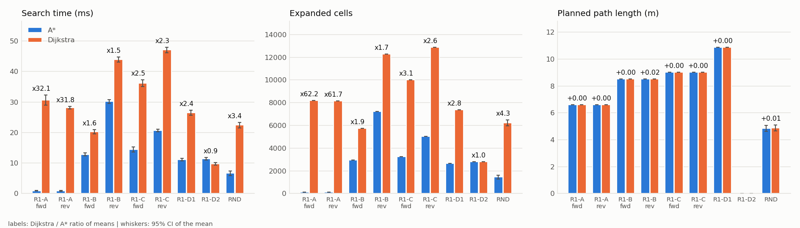

# 연구 1 결과 요약: A* vs Dijkstra

- 모드: **계획만 (오프라인)**, 월드 `lecture_hall_real`, 기록 1680행
- 원자료: experiments/r1/results/20261117-014217_offline_lecture_hall_real/trials.csv
- 설정 버전: 36a17f72-p67f491-m5249d1
- 값: 평균 ± 95% 신뢰구간 반폭. 차이 = Dijkstra − A* (같은 시나리오·방향·반복끼리 짝지음)

## 1. 시나리오별 결과

| 시나리오 | 알고리즘 | n | 계획 성공 | 탐색 시간 (ms) | 계획 시간 (ms) | 확장 칸 수 | 계획 경로 길이 (m) | 경로 비용 |
|---|---|---|---|---|---|---|---|---|
| R1-A fwd 개방 경로 | A* | 30 | 30/30 | 0.96 ± 0.13 | 2.54 ± 0.30 | 132 ± 0 | 6.615 ± 0.000 | 6.600 ± 0.000 |
| R1-A fwd 개방 경로 | Dijkstra | 30 | 30/30 | 30.67 ± 1.68 | 32.29 ± 1.74 | 8208 ± 0 | 6.615 ± 0.000 | 6.600 ± 0.000 |
| R1-A rev 개방 경로 | A* | 30 | 30/30 | 0.88 ± 0.08 | 2.27 ± 0.16 | 132 ± 0 | 6.615 ± 0.000 | 6.600 ± 0.000 |
| R1-A rev 개방 경로 | Dijkstra | 30 | 30/30 | 28.16 ± 0.46 | 29.77 ± 0.47 | 8146 ± 0 | 6.615 ± 0.000 | 6.600 ± 0.000 |
| R1-B fwd 장애물 우회 | A* | 30 | 30/30 | 12.86 ± 0.42 | 14.62 ± 0.40 | 2964 ± 0 | 8.535 ± 0.000 | 10.977 ± 0.000 |
| R1-B fwd 장애물 우회 | Dijkstra | 30 | 30/30 | 20.29 ± 0.69 | 22.02 ± 0.69 | 5758 ± 0 | 8.535 ± 0.000 | 10.977 ± 0.000 |
| R1-B rev 장애물 우회 | A* | 30 | 30/30 | 30.19 ± 0.62 | 32.08 ± 0.60 | 7227 ± 0 | 8.509 ± 0.000 | 11.075 ± 0.000 |
| R1-B rev 장애물 우회 | Dijkstra | 30 | 30/30 | 43.91 ± 0.81 | 45.85 ± 0.81 | 12299 ± 0 | 8.524 ± 0.000 | 11.075 ± 0.000 |
| R1-C fwd 좁은 통로·갈림길 | A* | 30 | 30/30 | 14.42 ± 0.84 | 16.20 ± 0.91 | 3256 ± 0 | 9.025 ± 0.000 | 14.810 ± 0.000 |
| R1-C fwd 좁은 통로·갈림길 | Dijkstra | 30 | 30/30 | 36.17 ± 1.06 | 38.17 ± 1.05 | 10028 ± 0 | 9.025 ± 0.000 | 14.810 ± 0.000 |
| R1-C rev 좁은 통로·갈림길 | A* | 30 | 30/30 | 20.70 ± 0.44 | 22.59 ± 0.50 | 5027 ± 0 | 9.023 ± 0.000 | 14.949 ± 0.000 |
| R1-C rev 좁은 통로·갈림길 | Dijkstra | 30 | 30/30 | 47.07 ± 0.85 | 49.26 ± 0.84 | 12866 ± 0 | 9.023 ± 0.000 | 14.949 ± 0.000 |
| R1-D1 경로 차단 (재계획) | A* | 30 | 30/30 | 11.19 ± 0.41 | 13.31 ± 0.39 | 2673 ± 0 | 10.865 ± 0.000 | 14.339 ± 0.000 |
| R1-D1 경로 차단 (재계획) | Dijkstra | 30 | 30/30 | 26.53 ± 0.80 | 28.84 ± 0.79 | 7374 ± 0 | 10.865 ± 0.000 | 14.339 ± 0.000 |
| R1-D2 경로 차단 (경로 없음) | A* | 30 | 0/30 | 11.39 ± 0.47 | 11.60 ± 0.47 | 2795 ± 0 | - | - |
| R1-D2 경로 차단 (경로 없음) | Dijkstra | 30 | 0/30 | 9.69 ± 0.43 | 9.90 ± 0.43 | 2795 ± 0 | - | - |
| RND 무작위 쌍 | A* | 600 | 600/600 | 6.64 ± 0.72 | 7.74 ± 0.75 | 1455 ± 158 | 4.856 ± 0.217 | 5.466 ± 0.269 |
| RND 무작위 쌍 | Dijkstra | 600 | 600/600 | 22.42 ± 0.91 | 23.63 ± 0.94 | 6231 ± 253 | 4.871 ± 0.217 | 5.466 ± 0.269 |

## 2. 짝 비교 (Dijkstra − A*)

| 시나리오 | 짝 수 | 탐색 시간 (ms) 차이 [95% CI] | 계획 시간 (ms) 차이 [95% CI] | 확장 칸 수 차이 [95% CI] | 계획 경로 길이 (m) 차이 [95% CI] | 경로 비용 차이 [95% CI] | 탐색 시간 배율 (D/A) | 확장 배율 (D/A) |
|---|---|---|---|---|---|---|---|---|
| R1-A fwd 개방 경로 | 30 | +29.72 [+28.08, +31.35] | +29.75 [+28.09, +31.40] | +8076 | +0.000 | +0.000 | ×32.09 | ×62.18 |
| R1-A rev 개방 경로 | 30 | +27.28 [+26.82, +27.73] | +27.50 [+27.05, +27.94] | +8014 | +0.000 | +0.000 | ×31.83 | ×61.71 |
| R1-B fwd 장애물 우회 | 30 | +7.43 [+6.73, +8.12] | +7.40 [+6.72, +8.08] | +2794 | +0.000 | +0.000 | ×1.58 | ×1.94 |
| R1-B rev 장애물 우회 | 30 | +13.72 [+12.87, +14.57] | +13.78 [+12.92, +14.63] | +5072 | +0.016 | +0.000 | ×1.45 | ×1.70 |
| R1-C fwd 좁은 통로·갈림길 | 30 | +21.76 [+20.62, +22.90] | +21.97 [+20.78, +23.15] | +6772 | +0.000 | +0.000 | ×2.51 | ×3.08 |
| R1-C rev 좁은 통로·갈림길 | 30 | +26.37 [+25.52, +27.21] | +26.68 [+25.83, +27.52] | +7839 | +0.000 | +0.000 | ×2.27 | ×2.56 |
| R1-D1 경로 차단 (재계획) | 30 | +15.34 [+14.52, +16.16] | +15.53 [+14.71, +16.36] | +4701 | +0.000 | +0.000 | ×2.37 | ×2.76 |
| R1-D2 경로 차단 (경로 없음) | 30 | -1.70 [-2.25, -1.15] | -1.70 [-2.24, -1.16] | +0 | - | - | ×0.85 | ×1.00 |
| RND 무작위 쌍 | 600 | +15.77 [+15.13, +16.42] | +15.89 [+15.24, +16.54] | +4777 [+4605, +4948] | +0.015 [+0.013, +0.016] | +0.000 | ×3.37 | ×4.28 |

- 경로 비용이 같은 짝: 810/810 (최대 차이 0.000000) — 두 알고리즘 모두 최소 비용 경로를 찾는지 확인

## 3. 실패 기록

| 시나리오 | 방향 | 반복 | 알고리즘 | 이유 |
|---|---|---|---|---|
| R1-D2 | fwd | 0 | A* | 목표까지 갈 수 있는 경로가 없습니다. |
| R1-D2 | fwd | 0 | Dijkstra | 목표까지 갈 수 있는 경로가 없습니다. |
| R1-D2 | fwd | 1 | Dijkstra | 목표까지 갈 수 있는 경로가 없습니다. |
| R1-D2 | fwd | 1 | A* | 목표까지 갈 수 있는 경로가 없습니다. |
| R1-D2 | fwd | 2 | A* | 목표까지 갈 수 있는 경로가 없습니다. |
| R1-D2 | fwd | 2 | Dijkstra | 목표까지 갈 수 있는 경로가 없습니다. |
| R1-D2 | fwd | 3 | Dijkstra | 목표까지 갈 수 있는 경로가 없습니다. |
| R1-D2 | fwd | 3 | A* | 목표까지 갈 수 있는 경로가 없습니다. |
| R1-D2 | fwd | 4 | A* | 목표까지 갈 수 있는 경로가 없습니다. |
| R1-D2 | fwd | 4 | Dijkstra | 목표까지 갈 수 있는 경로가 없습니다. |
| R1-D2 | fwd | 5 | Dijkstra | 목표까지 갈 수 있는 경로가 없습니다. |
| R1-D2 | fwd | 5 | A* | 목표까지 갈 수 있는 경로가 없습니다. |
| R1-D2 | fwd | 6 | A* | 목표까지 갈 수 있는 경로가 없습니다. |
| R1-D2 | fwd | 6 | Dijkstra | 목표까지 갈 수 있는 경로가 없습니다. |
| R1-D2 | fwd | 7 | Dijkstra | 목표까지 갈 수 있는 경로가 없습니다. |
| R1-D2 | fwd | 7 | A* | 목표까지 갈 수 있는 경로가 없습니다. |
| R1-D2 | fwd | 8 | A* | 목표까지 갈 수 있는 경로가 없습니다. |
| R1-D2 | fwd | 8 | Dijkstra | 목표까지 갈 수 있는 경로가 없습니다. |
| R1-D2 | fwd | 9 | Dijkstra | 목표까지 갈 수 있는 경로가 없습니다. |
| R1-D2 | fwd | 9 | A* | 목표까지 갈 수 있는 경로가 없습니다. |
| R1-D2 | fwd | 10 | A* | 목표까지 갈 수 있는 경로가 없습니다. |
| R1-D2 | fwd | 10 | Dijkstra | 목표까지 갈 수 있는 경로가 없습니다. |
| R1-D2 | fwd | 11 | Dijkstra | 목표까지 갈 수 있는 경로가 없습니다. |
| R1-D2 | fwd | 11 | A* | 목표까지 갈 수 있는 경로가 없습니다. |
| R1-D2 | fwd | 12 | A* | 목표까지 갈 수 있는 경로가 없습니다. |
| R1-D2 | fwd | 12 | Dijkstra | 목표까지 갈 수 있는 경로가 없습니다. |
| R1-D2 | fwd | 13 | Dijkstra | 목표까지 갈 수 있는 경로가 없습니다. |
| R1-D2 | fwd | 13 | A* | 목표까지 갈 수 있는 경로가 없습니다. |
| R1-D2 | fwd | 14 | A* | 목표까지 갈 수 있는 경로가 없습니다. |
| R1-D2 | fwd | 14 | Dijkstra | 목표까지 갈 수 있는 경로가 없습니다. |
| R1-D2 | fwd | 15 | Dijkstra | 목표까지 갈 수 있는 경로가 없습니다. |
| R1-D2 | fwd | 15 | A* | 목표까지 갈 수 있는 경로가 없습니다. |
| R1-D2 | fwd | 16 | A* | 목표까지 갈 수 있는 경로가 없습니다. |
| R1-D2 | fwd | 16 | Dijkstra | 목표까지 갈 수 있는 경로가 없습니다. |
| R1-D2 | fwd | 17 | Dijkstra | 목표까지 갈 수 있는 경로가 없습니다. |
| R1-D2 | fwd | 17 | A* | 목표까지 갈 수 있는 경로가 없습니다. |
| R1-D2 | fwd | 18 | A* | 목표까지 갈 수 있는 경로가 없습니다. |
| R1-D2 | fwd | 18 | Dijkstra | 목표까지 갈 수 있는 경로가 없습니다. |
| R1-D2 | fwd | 19 | Dijkstra | 목표까지 갈 수 있는 경로가 없습니다. |
| R1-D2 | fwd | 19 | A* | 목표까지 갈 수 있는 경로가 없습니다. |
| R1-D2 | fwd | 20 | A* | 목표까지 갈 수 있는 경로가 없습니다. |
| R1-D2 | fwd | 20 | Dijkstra | 목표까지 갈 수 있는 경로가 없습니다. |
| R1-D2 | fwd | 21 | Dijkstra | 목표까지 갈 수 있는 경로가 없습니다. |
| R1-D2 | fwd | 21 | A* | 목표까지 갈 수 있는 경로가 없습니다. |
| R1-D2 | fwd | 22 | A* | 목표까지 갈 수 있는 경로가 없습니다. |
| R1-D2 | fwd | 22 | Dijkstra | 목표까지 갈 수 있는 경로가 없습니다. |
| R1-D2 | fwd | 23 | Dijkstra | 목표까지 갈 수 있는 경로가 없습니다. |
| R1-D2 | fwd | 23 | A* | 목표까지 갈 수 있는 경로가 없습니다. |
| R1-D2 | fwd | 24 | A* | 목표까지 갈 수 있는 경로가 없습니다. |
| R1-D2 | fwd | 24 | Dijkstra | 목표까지 갈 수 있는 경로가 없습니다. |
| R1-D2 | fwd | 25 | Dijkstra | 목표까지 갈 수 있는 경로가 없습니다. |
| R1-D2 | fwd | 25 | A* | 목표까지 갈 수 있는 경로가 없습니다. |
| R1-D2 | fwd | 26 | A* | 목표까지 갈 수 있는 경로가 없습니다. |
| R1-D2 | fwd | 26 | Dijkstra | 목표까지 갈 수 있는 경로가 없습니다. |
| R1-D2 | fwd | 27 | Dijkstra | 목표까지 갈 수 있는 경로가 없습니다. |
| R1-D2 | fwd | 27 | A* | 목표까지 갈 수 있는 경로가 없습니다. |
| R1-D2 | fwd | 28 | A* | 목표까지 갈 수 있는 경로가 없습니다. |
| R1-D2 | fwd | 28 | Dijkstra | 목표까지 갈 수 있는 경로가 없습니다. |
| R1-D2 | fwd | 29 | Dijkstra | 목표까지 갈 수 있는 경로가 없습니다. |
| R1-D2 | fwd | 29 | A* | 목표까지 갈 수 있는 경로가 없습니다. |

## 그림

