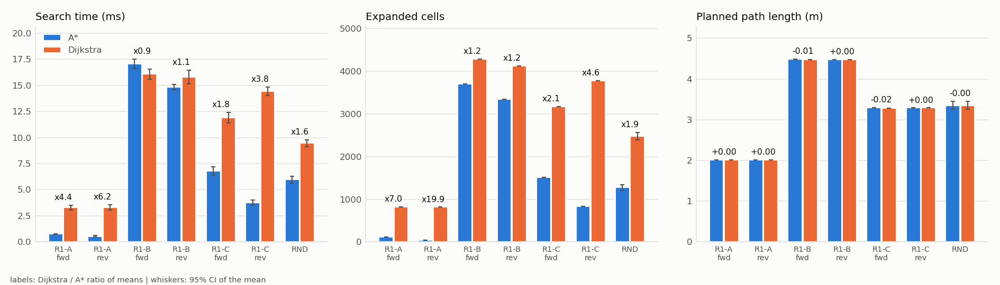

# 연구 1 결과 요약: A* vs Dijkstra

- 모드: **계획만 (오프라인)**, 월드 `turtlebot3_world`, 기록 1560행
- 원자료: experiments/r1/results/20261117-014322_offline_turtlebot3_world/trials.csv
- 설정 버전: 36a17f72-p67f491-md41de9
- 값: 평균 ± 95% 신뢰구간 반폭. 차이 = Dijkstra − A* (같은 시나리오·방향·반복끼리 짝지음)

## 1. 시나리오별 결과

| 시나리오 | 알고리즘 | n | 계획 성공 | 탐색 시간 (ms) | 계획 시간 (ms) | 확장 칸 수 | 계획 경로 길이 (m) | 경로 비용 |
|---|---|---|---|---|---|---|---|---|
| R1-A fwd 개방 경로 | A* | 30 | 30/30 | 0.76 ± 0.04 | 1.65 ± 0.09 | 117 ± 0 | 2.015 ± 0.000 | 2.067 ± 0.000 |
| R1-A fwd 개방 경로 | Dijkstra | 30 | 30/30 | 3.29 ± 0.23 | 4.24 ± 0.26 | 820 ± 0 | 2.015 ± 0.000 | 2.067 ± 0.000 |
| R1-A rev 개방 경로 | A* | 30 | 30/30 | 0.53 ± 0.07 | 1.47 ± 0.15 | 41 ± 0 | 2.015 ± 0.000 | 2.057 ± 0.000 |
| R1-A rev 개방 경로 | Dijkstra | 30 | 30/30 | 3.32 ± 0.26 | 4.40 ± 0.30 | 815 ± 0 | 2.015 ± 0.000 | 2.057 ± 0.000 |
| R1-B fwd 장애물 우회 | A* | 30 | 30/30 | 17.05 ± 0.44 | 18.48 ± 0.47 | 3700 ± 0 | 4.484 ± 0.000 | 8.434 ± 0.000 |
| R1-B fwd 장애물 우회 | Dijkstra | 30 | 30/30 | 16.07 ± 0.48 | 17.48 ± 0.49 | 4278 ± 0 | 4.469 ± 0.000 | 8.434 ± 0.000 |
| R1-B rev 장애물 우회 | A* | 30 | 30/30 | 14.83 ± 0.27 | 16.14 ± 0.28 | 3340 ± 0 | 4.481 ± 0.000 | 8.349 ± 0.000 |
| R1-B rev 장애물 우회 | Dijkstra | 30 | 30/30 | 15.79 ± 0.64 | 17.32 ± 0.67 | 4123 ± 0 | 4.481 ± 0.000 | 8.349 ± 0.000 |
| R1-C fwd 좁은 통로·갈림길 | A* | 30 | 30/30 | 6.79 ± 0.42 | 7.98 ± 0.43 | 1519 ± 0 | 3.295 ± 0.000 | 5.893 ± 0.000 |
| R1-C fwd 좁은 통로·갈림길 | Dijkstra | 30 | 30/30 | 11.89 ± 0.50 | 13.20 ± 0.48 | 3175 ± 0 | 3.279 ± 0.000 | 5.893 ± 0.000 |
| R1-C rev 좁은 통로·갈림길 | A* | 30 | 30/30 | 3.76 ± 0.25 | 4.89 ± 0.27 | 828 ± 0 | 3.290 ± 0.000 | 5.893 ± 0.000 |
| R1-C rev 좁은 통로·갈림길 | Dijkstra | 30 | 30/30 | 14.43 ± 0.39 | 15.60 ± 0.42 | 3777 ± 0 | 3.290 ± 0.000 | 5.893 ± 0.000 |
| RND 무작위 쌍 | A* | 600 | 600/600 | 5.97 ± 0.33 | 7.18 ± 0.35 | 1273 ± 71 | 3.351 ± 0.097 | 5.134 ± 0.142 |
| RND 무작위 쌍 | Dijkstra | 600 | 600/600 | 9.46 ± 0.34 | 10.67 ± 0.36 | 2478 ± 86 | 3.350 ± 0.097 | 5.134 ± 0.142 |

## 2. 짝 비교 (Dijkstra − A*)

| 시나리오 | 짝 수 | 탐색 시간 (ms) 차이 [95% CI] | 계획 시간 (ms) 차이 [95% CI] | 확장 칸 수 차이 [95% CI] | 계획 경로 길이 (m) 차이 [95% CI] | 경로 비용 차이 [95% CI] | 탐색 시간 배율 (D/A) | 확장 배율 (D/A) |
|---|---|---|---|---|---|---|---|---|
| R1-A fwd 개방 경로 | 30 | +2.54 [+2.30, +2.78] | +2.59 [+2.32, +2.86] | +703 | +0.000 | +0.000 | ×4.36 | ×7.01 |
| R1-A rev 개방 경로 | 30 | +2.79 [+2.52, +3.05] | +2.93 [+2.62, +3.24] | +774 | +0.000 | +0.000 | ×6.22 | ×19.88 |
| R1-B fwd 장애물 우회 | 30 | -0.98 [-1.53, -0.43] | -1.01 [-1.56, -0.46] | +578 | -0.014 | +0.000 | ×0.94 | ×1.16 |
| R1-B rev 장애물 우회 | 30 | +0.96 [+0.33, +1.59] | +1.18 [+0.53, +1.83] | +783 | +0.000 | +0.000 | ×1.06 | ×1.23 |
| R1-C fwd 좁은 통로·갈림길 | 30 | +5.10 [+4.57, +5.63] | +5.22 [+4.69, +5.74] | +1656 | -0.017 | +0.000 | ×1.75 | ×2.09 |
| R1-C rev 좁은 통로·갈림길 | 30 | +10.67 [+10.26, +11.08] | +10.71 [+10.32, +11.11] | +2949 | +0.000 | +0.000 | ×3.84 | ×4.56 |
| RND 무작위 쌍 | 600 | +3.48 [+3.25, +3.72] | +3.49 [+3.26, +3.73] | +1205 [+1162, +1248] | -0.001 [-0.002, -0.001] | +0.000 | ×1.58 | ×1.95 |

- 경로 비용이 같은 짝: 780/780 (최대 차이 0.000000) — 두 알고리즘 모두 최소 비용 경로를 찾는지 확인

## 그림

