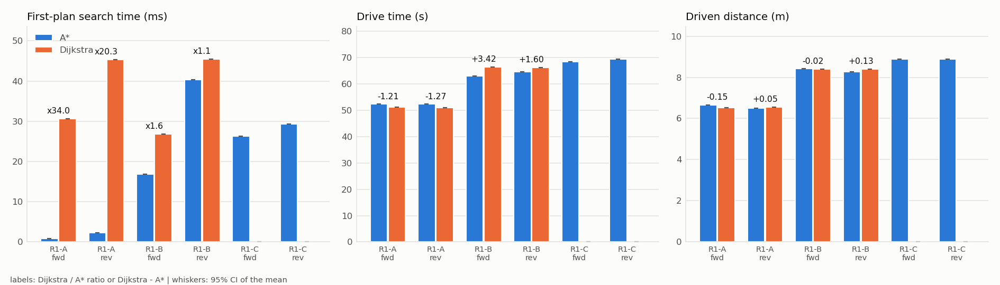

# 연구 1 결과 요약: A* vs Dijkstra

- 모드: **Gazebo 주행**, 월드 `lecture_hall_real`, 기록 10행
- 원자료: experiments/r1/results/20261117-014513_sim_lecture_hall_real/trials.csv
- 설정 버전: 36a17f72-p67f491-m5249d1
- 값: 평균 ± 95% 신뢰구간 반폭. 차이 = Dijkstra − A* (같은 시나리오·방향·반복끼리 짝지음)

## 1. 시나리오별 결과

| 시나리오 | 알고리즘 | n | 계획 성공 | 도착 성공 | 탐색 시간 (ms) | 계획 시간 (ms) | 확장 칸 수 | 계획 경로 길이 (m) | 경로 비용 | 주행 시간 (s) | 실제 주행 거리 (m) | 계획 횟수 | 도착 오차 (m) |
|---|---|---|---|---|---|---|---|---|---|---|---|---|---|
| R1-A fwd 개방 경로 | A* | 1 | 1/1 | 1/1 | 0.90 | 58.14 | 132 | 6.617 | 6.600 | 52.3 | 6.67 | 1.00 | 0.047 |
| R1-A fwd 개방 경로 | Dijkstra | 1 | 1/1 | 1/1 | 30.60 | 90.59 | 8161 | 6.586 | 6.550 | 51.1 | 6.52 | 1.00 | 0.046 |
| R1-A rev 개방 경로 | A* | 1 | 1/1 | 1/1 | 2.23 | 66.93 | 263 | 6.593 | 6.621 | 52.3 | 6.51 | 1.00 | 0.053 |
| R1-A rev 개방 경로 | Dijkstra | 1 | 1/1 | 1/1 | 45.38 | 109.72 | 8230 | 6.591 | 6.600 | 51.0 | 6.55 | 1.00 | 0.059 |
| R1-B fwd 장애물 우회 | A* | 1 | 1/1 | 1/1 | 16.81 | 73.88 | 3123 | 8.541 | 11.133 | 63.0 | 8.41 | 1.00 | 0.014 |
| R1-B fwd 장애물 우회 | Dijkstra | 1 | 1/1 | 1/1 | 26.77 | 109.52 | 6367 | 8.559 | 11.133 | 66.4 | 8.40 | 1.00 | 0.036 |
| R1-B rev 장애물 우회 | A* | 1 | 1/1 | 1/1 | 40.37 | 98.79 | 7299 | 8.554 | 11.172 | 64.7 | 8.28 | 1.00 | 0.092 |
| R1-B rev 장애물 우회 | Dijkstra | 1 | 1/1 | 1/1 | 45.41 | 99.37 | 12320 | 8.545 | 11.152 | 66.3 | 8.40 | 1.00 | 0.084 |
| R1-C fwd 좁은 통로·갈림길 | A* | 1 | 1/1 | 1/1 | 26.36 | 126.06 | 3315 | 8.985 | 14.683 | 68.5 | 8.87 | 1.00 | 0.026 |
| R1-C rev 좁은 통로·갈림길 | A* | 1 | 1/1 | 1/1 | 29.37 | 87.83 | 4844 | 9.048 | 14.942 | 69.4 | 8.88 | 1.00 | 0.068 |

## 2. 짝 비교 (Dijkstra − A*)

| 시나리오 | 짝 수 | 탐색 시간 (ms) 차이 [95% CI] | 계획 시간 (ms) 차이 [95% CI] | 확장 칸 수 차이 [95% CI] | 계획 경로 길이 (m) 차이 [95% CI] | 경로 비용 차이 [95% CI] | 주행 시간 (s) 차이 [95% CI] | 실제 주행 거리 (m) 차이 [95% CI] | 탐색 시간 배율 (D/A) | 확장 배율 (D/A) |
|---|---|---|---|---|---|---|---|---|---|---|
| R1-A fwd 개방 경로 | 1 | +29.70 | +32.46 | +8029 | -0.031 | -0.050 | -1.2 | -0.15 | ×34.02 | ×61.83 |
| R1-A rev 개방 경로 | 1 | +43.15 | +42.78 | +7967 | -0.002 | -0.021 | -1.3 | +0.05 | ×20.31 | ×31.29 |
| R1-B fwd 장애물 우회 | 1 | +9.96 | +35.63 | +3244 | +0.018 | +0.000 | +3.4 | -0.02 | ×1.59 | ×2.04 |
| R1-B rev 장애물 우회 | 1 | +5.04 | +0.58 | +5021 | -0.008 | -0.021 | +1.6 | +0.13 | ×1.12 | ×1.69 |
| R1-C fwd 좁은 통로·갈림길 | 0 | - | - | - | - | - | - | - | - | - |
| R1-C rev 좁은 통로·갈림길 | 0 | - | - | - | - | - | - | - | - | - |

- 경로 비용이 같은 짝: 1/4 (최대 차이 0.050000) — 두 알고리즘 모두 최소 비용 경로를 찾는지 확인

## 그림

