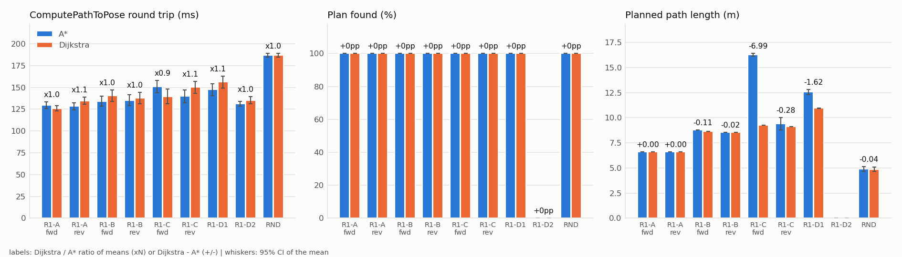

# 연구 1 결과 요약: A* vs Dijkstra

- 모드: **계획만 — Nav2 NavFn (ComputePathToPose, planner_id AStar / Dijkstra)**, 월드 `lecture_hall_real`, 기록 1680행
- 원자료: experiments/r1/results/20261117-022910_nav2plan_lecture_hall_real/trials.csv
- 설정 버전: 4f2c662a-n6d95dc-m5249d1
- 값: 평균 ± 95% 신뢰구간 반폭. 차이 = Dijkstra − A* (같은 시나리오·방향·반복끼리 짝지음)

## 1. 시나리오별 결과

| 시나리오 | 알고리즘 | n | 계획 성공 | 요청~응답 (ms) | 계획 경로 길이 (m) | 경로 점 수 |
|---|---|---|---|---|---|---|
| R1-A fwd 개방 경로 | A* | 30 | 30/30 | 129.66 ± 3.93 | 6.600 ± 0.000 | 262 ± 0 |
| R1-A fwd 개방 경로 | Dijkstra | 30 | 30/30 | 125.95 ± 3.12 | 6.600 ± 0.000 | 262 ± 0 |
| R1-A rev 개방 경로 | A* | 30 | 30/30 | 128.24 ± 4.10 | 6.600 ± 0.000 | 263 ± 0 |
| R1-A rev 개방 경로 | Dijkstra | 30 | 30/30 | 134.66 ± 4.05 | 6.600 ± 0.000 | 263 ± 0 |
| R1-B fwd 장애물 우회 | A* | 30 | 30/30 | 134.02 ± 5.80 | 8.771 ± 0.008 | 347 ± 0 |
| R1-B fwd 장애물 우회 | Dijkstra | 30 | 30/30 | 140.63 ± 6.54 | 8.656 ± 0.000 | 345 ± 0 |
| R1-B rev 장애물 우회 | A* | 30 | 30/30 | 135.15 ± 6.23 | 8.548 ± 0.000 | 341 ± 0 |
| R1-B rev 장애물 우회 | Dijkstra | 30 | 30/30 | 137.82 ± 6.56 | 8.530 ± 0.000 | 341 ± 0 |
| R1-C fwd 좁은 통로·갈림길 | A* | 30 | 30/30 | 150.82 ± 7.26 | 16.251 ± 0.144 | 642 ± 6 |
| R1-C fwd 좁은 통로·갈림길 | Dijkstra | 30 | 30/30 | 139.50 ± 8.57 | 9.264 ± 0.001 | 369 ± 0 |
| R1-C rev 좁은 통로·갈림길 | A* | 30 | 30/30 | 139.67 ± 7.21 | 9.405 ± 0.619 | 373 ± 25 |
| R1-C rev 좁은 통로·갈림길 | Dijkstra | 30 | 30/30 | 150.02 ± 6.66 | 9.122 ± 0.005 | 363 ± 0 |
| R1-D1 경로 차단 (재계획) | A* | 30 | 30/30 | 147.50 ± 6.86 | 12.565 ± 0.265 | 498 ± 9 |
| R1-D1 경로 차단 (재계획) | Dijkstra | 30 | 30/30 | 156.15 ± 6.86 | 10.942 ± 0.004 | 437 ± 0 |
| R1-D2 경로 차단 (경로 없음) | A* | 30 | 0/30 | 131.42 ± 2.75 | - | 0 ± 0 |
| R1-D2 경로 차단 (경로 없음) | Dijkstra | 30 | 0/30 | 135.24 ± 4.31 | - | 0 ± 0 |
| RND 무작위 쌍 | A* | 600 | 600/600 | 186.67 ± 2.10 | 4.902 ± 0.223 | 192 ± 9 |
| RND 무작위 쌍 | Dijkstra | 600 | 600/600 | 186.67 ± 2.19 | 4.859 ± 0.219 | 193 ± 9 |

## 2. 짝 비교 (Dijkstra − A*)

| 시나리오 | 짝 수 | 요청~응답 (ms) 차이 [95% CI] | 계획 경로 길이 (m) 차이 [95% CI] | 요청~응답 배율 (D/A) |
|---|---|---|---|---|
| R1-A fwd 개방 경로 | 30 | -3.71 [-9.38, +1.96] | +0.000 | ×0.97 |
| R1-A rev 개방 경로 | 30 | +6.42 [+0.48, +12.36] | +0.000 | ×1.05 |
| R1-B fwd 장애물 우회 | 30 | +6.61 [-2.14, +15.36] | -0.115 [-0.123, -0.107] | ×1.05 |
| R1-B rev 장애물 우회 | 30 | +2.67 [-5.93, +11.27] | -0.018 [-0.018, -0.018] | ×1.02 |
| R1-C fwd 좁은 통로·갈림길 | 30 | -11.32 [-23.06, +0.42] | -6.987 [-7.132, -6.842] | ×0.92 |
| R1-C rev 좁은 통로·갈림길 | 30 | +10.35 [-1.28, +21.98] | -0.283 [-0.903, +0.338] | ×1.07 |
| R1-D1 경로 차단 (재계획) | 30 | +8.65 [-0.66, +17.95] | -1.623 [-1.885, -1.361] | ×1.06 |
| R1-D2 경로 차단 (경로 없음) | 30 | +3.82 [-1.30, +8.95] | - | ×1.03 |
| RND 무작위 쌍 | 600 | -0.00 [-1.73, +1.73] | -0.043 [-0.056, -0.030] | ×1.00 |

- 계획 경로 길이 차이 |D − A|: 평균 0.388 m, 최대 8.127 m, 1 cm 넘는 짝 550/810

## 3. 실패 기록

| 시나리오 | 방향 | 반복 | 알고리즘 | 이유 |
|---|---|---|---|---|
| R1-D2 | fwd | 0 | A* | 계획 실패 (상태 6) |
| R1-D2 | fwd | 0 | Dijkstra | 계획 실패 (상태 6) |
| R1-D2 | fwd | 1 | Dijkstra | 계획 실패 (상태 6) |
| R1-D2 | fwd | 1 | A* | 계획 실패 (상태 6) |
| R1-D2 | fwd | 2 | A* | 계획 실패 (상태 6) |
| R1-D2 | fwd | 2 | Dijkstra | 계획 실패 (상태 6) |
| R1-D2 | fwd | 3 | Dijkstra | 계획 실패 (상태 6) |
| R1-D2 | fwd | 3 | A* | 계획 실패 (상태 6) |
| R1-D2 | fwd | 4 | A* | 계획 실패 (상태 6) |
| R1-D2 | fwd | 4 | Dijkstra | 계획 실패 (상태 6) |
| R1-D2 | fwd | 5 | Dijkstra | 계획 실패 (상태 6) |
| R1-D2 | fwd | 5 | A* | 계획 실패 (상태 6) |
| R1-D2 | fwd | 6 | A* | 계획 실패 (상태 6) |
| R1-D2 | fwd | 6 | Dijkstra | 계획 실패 (상태 6) |
| R1-D2 | fwd | 7 | Dijkstra | 계획 실패 (상태 6) |
| R1-D2 | fwd | 7 | A* | 계획 실패 (상태 6) |
| R1-D2 | fwd | 8 | A* | 계획 실패 (상태 6) |
| R1-D2 | fwd | 8 | Dijkstra | 계획 실패 (상태 6) |
| R1-D2 | fwd | 9 | Dijkstra | 계획 실패 (상태 6) |
| R1-D2 | fwd | 9 | A* | 계획 실패 (상태 6) |
| R1-D2 | fwd | 10 | A* | 계획 실패 (상태 6) |
| R1-D2 | fwd | 10 | Dijkstra | 계획 실패 (상태 6) |
| R1-D2 | fwd | 11 | Dijkstra | 계획 실패 (상태 6) |
| R1-D2 | fwd | 11 | A* | 계획 실패 (상태 6) |
| R1-D2 | fwd | 12 | A* | 계획 실패 (상태 6) |
| R1-D2 | fwd | 12 | Dijkstra | 계획 실패 (상태 6) |
| R1-D2 | fwd | 13 | Dijkstra | 계획 실패 (상태 6) |
| R1-D2 | fwd | 13 | A* | 계획 실패 (상태 6) |
| R1-D2 | fwd | 14 | A* | 계획 실패 (상태 6) |
| R1-D2 | fwd | 14 | Dijkstra | 계획 실패 (상태 6) |
| R1-D2 | fwd | 15 | Dijkstra | 계획 실패 (상태 6) |
| R1-D2 | fwd | 15 | A* | 계획 실패 (상태 6) |
| R1-D2 | fwd | 16 | A* | 계획 실패 (상태 6) |
| R1-D2 | fwd | 16 | Dijkstra | 계획 실패 (상태 6) |
| R1-D2 | fwd | 17 | Dijkstra | 계획 실패 (상태 6) |
| R1-D2 | fwd | 17 | A* | 계획 실패 (상태 6) |
| R1-D2 | fwd | 18 | A* | 계획 실패 (상태 6) |
| R1-D2 | fwd | 18 | Dijkstra | 계획 실패 (상태 6) |
| R1-D2 | fwd | 19 | Dijkstra | 계획 실패 (상태 6) |
| R1-D2 | fwd | 19 | A* | 계획 실패 (상태 6) |
| R1-D2 | fwd | 20 | A* | 계획 실패 (상태 6) |
| R1-D2 | fwd | 20 | Dijkstra | 계획 실패 (상태 6) |
| R1-D2 | fwd | 21 | Dijkstra | 계획 실패 (상태 6) |
| R1-D2 | fwd | 21 | A* | 계획 실패 (상태 6) |
| R1-D2 | fwd | 22 | A* | 계획 실패 (상태 6) |
| R1-D2 | fwd | 22 | Dijkstra | 계획 실패 (상태 6) |
| R1-D2 | fwd | 23 | Dijkstra | 계획 실패 (상태 6) |
| R1-D2 | fwd | 23 | A* | 계획 실패 (상태 6) |
| R1-D2 | fwd | 24 | A* | 계획 실패 (상태 6) |
| R1-D2 | fwd | 24 | Dijkstra | 계획 실패 (상태 6) |
| R1-D2 | fwd | 25 | Dijkstra | 계획 실패 (상태 6) |
| R1-D2 | fwd | 25 | A* | 계획 실패 (상태 6) |
| R1-D2 | fwd | 26 | A* | 계획 실패 (상태 6) |
| R1-D2 | fwd | 26 | Dijkstra | 계획 실패 (상태 6) |
| R1-D2 | fwd | 27 | Dijkstra | 계획 실패 (상태 6) |
| R1-D2 | fwd | 27 | A* | 계획 실패 (상태 6) |
| R1-D2 | fwd | 28 | A* | 계획 실패 (상태 6) |
| R1-D2 | fwd | 28 | Dijkstra | 계획 실패 (상태 6) |
| R1-D2 | fwd | 29 | Dijkstra | 계획 실패 (상태 6) |
| R1-D2 | fwd | 29 | A* | 계획 실패 (상태 6) |

## 그림

