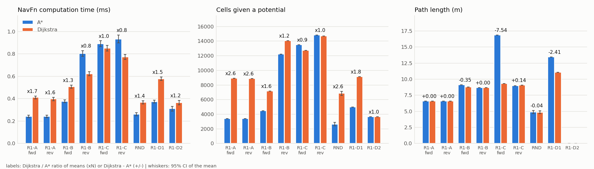

# 연구 1 결과 요약: A* vs Dijkstra

- 모드: **계획만 — Nav2 NavFn 핵심 계산 (C++, Nav2 global costmap 그대로, 메시지 통신 없음)**, 월드 `lecture_hall_real`, 기록 2800행
- 원자료: experiments/r1/results/20261117-022910_navfncore_lecture_hall_real/trials.csv
- 설정 버전: 4f2c662a-n6d95dc-m5249d1
- 값: 평균 ± 95% 신뢰구간 반폭. 차이 = Dijkstra − A* (같은 시나리오·방향·반복끼리 짝지음)

## 1. 시나리오별 결과

| 시나리오 | 알고리즘 | n | 계획 성공 | 계획 시간 (ms) | 확장 칸 수 | 계획 경로 길이 (m) | 경로 점 수 |
|---|---|---|---|---|---|---|---|
| R1-A fwd 개방 경로 | A* | 100 | 100/100 | 0.24 ± 0.01 | 3389 ± 0 | 6.600 ± 0.000 | 262 ± 0 |
| R1-A fwd 개방 경로 | Dijkstra | 100 | 100/100 | 0.41 ± 0.01 | 8925 ± 0 | 6.600 ± 0.000 | 262 ± 0 |
| R1-A rev 개방 경로 | A* | 100 | 100/100 | 0.24 ± 0.01 | 3388 ± 0 | 6.600 ± 0.000 | 262 ± 0 |
| R1-A rev 개방 경로 | Dijkstra | 100 | 100/100 | 0.40 ± 0.02 | 8883 ± 0 | 6.600 ± 0.000 | 262 ± 0 |
| R1-B fwd 장애물 우회 | A* | 100 | 100/100 | 0.38 ± 0.01 | 4474 ± 0 | 9.109 ± 0.000 | 362 ± 0 |
| R1-B fwd 장애물 우회 | Dijkstra | 100 | 100/100 | 0.51 ± 0.01 | 7182 ± 0 | 8.758 ± 0.000 | 349 ± 0 |
| R1-B rev 장애물 우회 | A* | 100 | 100/100 | 0.80 ± 0.03 | 12216 ± 0 | 8.665 ± 0.000 | 345 ± 0 |
| R1-B rev 장애물 우회 | Dijkstra | 100 | 100/100 | 0.62 ± 0.02 | 14076 ± 0 | 8.667 ± 0.000 | 345 ± 0 |
| R1-C fwd 좁은 통로·갈림길 | A* | 100 | 100/100 | 0.89 ± 0.03 | 13512 ± 0 | 16.847 ± 0.000 | 670 ± 0 |
| R1-C fwd 좁은 통로·갈림길 | Dijkstra | 100 | 100/100 | 0.85 ± 0.02 | 12716 ± 0 | 9.308 ± 0.000 | 369 ± 0 |
| R1-C rev 좁은 통로·갈림길 | A* | 100 | 100/100 | 0.93 ± 0.03 | 14821 ± 0 | 8.954 ± 0.000 | 357 ± 0 |
| R1-C rev 좁은 통로·갈림길 | Dijkstra | 100 | 100/100 | 0.77 ± 0.02 | 14723 ± 0 | 9.098 ± 0.000 | 362 ± 0 |
| RND 무작위 쌍 | A* | 600 | 600/600 | 0.26 ± 0.01 | 2650 ± 223 | 4.887 ± 0.223 | 191 ± 9 |
| RND 무작위 쌍 | Dijkstra | 600 | 600/600 | 0.37 ± 0.01 | 6857 ± 289 | 4.843 ± 0.219 | 192 ± 9 |
| R1-D1 경로 차단 (재계획) | A* | 100 | 100/100 | 0.37 ± 0.01 | 4983 ± 0 | 13.477 ± 0.000 | 538 ± 0 |
| R1-D1 경로 차단 (재계획) | Dijkstra | 100 | 100/100 | 0.58 ± 0.01 | 9143 ± 0 | 11.066 ± 0.000 | 441 ± 0 |
| R1-D2 경로 차단 (경로 없음) | A* | 100 | 0/100 | 0.31 ± 0.02 | 3643 ± 0 | - | 0 ± 0 |
| R1-D2 경로 차단 (경로 없음) | Dijkstra | 100 | 0/100 | 0.37 ± 0.02 | 3643 ± 0 | - | 0 ± 0 |

## 2. 짝 비교 (Dijkstra − A*)

| 시나리오 | 짝 수 | 계획 시간 (ms) 차이 [95% CI] | 확장 칸 수 차이 [95% CI] | 계획 경로 길이 (m) 차이 [95% CI] | 계획 시간 배율 (D/A) | 확장 칸 수 배율 (D/A) |
|---|---|---|---|---|---|---|
| R1-A fwd 개방 경로 | 100 | +0.17 [+0.16, +0.18] | +5536 | +0.000 | ×1.70 | ×2.63 |
| R1-A rev 개방 경로 | 100 | +0.16 [+0.14, +0.17] | +5495 | +0.000 | ×1.65 | ×2.62 |
| R1-B fwd 장애물 우회 | 100 | +0.13 [+0.12, +0.15] | +2708 | -0.351 [-0.351, -0.351] | ×1.35 | ×1.61 |
| R1-B rev 장애물 우회 | 100 | -0.18 [-0.21, -0.15] | +1860 | +0.002 | ×0.78 | ×1.15 |
| R1-C fwd 좁은 통로·갈림길 | 100 | -0.04 [-0.07, -0.01] | -796 | -7.539 [-7.539, -7.539] | ×0.95 | ×0.94 |
| R1-C rev 좁은 통로·갈림길 | 100 | -0.16 [-0.19, -0.13] | -98 | +0.143 | ×0.83 | ×0.99 |
| RND 무작위 쌍 | 600 | +0.11 [+0.10, +0.12] | +4207 [+4044, +4370] | -0.044 [-0.057, -0.031] | ×1.41 | ×2.59 |
| R1-D1 경로 차단 (재계획) | 100 | +0.20 [+0.19, +0.22] | +4160 | -2.410 [-2.410, -2.410] | ×1.54 | ×1.83 |
| R1-D2 경로 차단 (경로 없음) | 100 | +0.05 [+0.03, +0.07] | +0 | - | ×1.18 | ×1.00 |

- 계획 경로 길이 차이 |D − A|: 평균 0.830 m, 최대 7.539 m, 1 cm 넘는 짝 793/1300

## 3. 실패 기록

| 시나리오 | 방향 | 반복 | 알고리즘 | 이유 |
|---|---|---|---|---|
| R1-D2 | fwd | 0 | A* | 경로 없음 (포텐셜/경사 따라가기 실패) |
| R1-D2 | fwd | 0 | Dijkstra | 경로 없음 (포텐셜/경사 따라가기 실패) |
| R1-D2 | fwd | 1 | Dijkstra | 경로 없음 (포텐셜/경사 따라가기 실패) |
| R1-D2 | fwd | 1 | A* | 경로 없음 (포텐셜/경사 따라가기 실패) |
| R1-D2 | fwd | 2 | A* | 경로 없음 (포텐셜/경사 따라가기 실패) |
| R1-D2 | fwd | 2 | Dijkstra | 경로 없음 (포텐셜/경사 따라가기 실패) |
| R1-D2 | fwd | 3 | Dijkstra | 경로 없음 (포텐셜/경사 따라가기 실패) |
| R1-D2 | fwd | 3 | A* | 경로 없음 (포텐셜/경사 따라가기 실패) |
| R1-D2 | fwd | 4 | A* | 경로 없음 (포텐셜/경사 따라가기 실패) |
| R1-D2 | fwd | 4 | Dijkstra | 경로 없음 (포텐셜/경사 따라가기 실패) |
| R1-D2 | fwd | 5 | Dijkstra | 경로 없음 (포텐셜/경사 따라가기 실패) |
| R1-D2 | fwd | 5 | A* | 경로 없음 (포텐셜/경사 따라가기 실패) |
| R1-D2 | fwd | 6 | A* | 경로 없음 (포텐셜/경사 따라가기 실패) |
| R1-D2 | fwd | 6 | Dijkstra | 경로 없음 (포텐셜/경사 따라가기 실패) |
| R1-D2 | fwd | 7 | Dijkstra | 경로 없음 (포텐셜/경사 따라가기 실패) |
| R1-D2 | fwd | 7 | A* | 경로 없음 (포텐셜/경사 따라가기 실패) |
| R1-D2 | fwd | 8 | A* | 경로 없음 (포텐셜/경사 따라가기 실패) |
| R1-D2 | fwd | 8 | Dijkstra | 경로 없음 (포텐셜/경사 따라가기 실패) |
| R1-D2 | fwd | 9 | Dijkstra | 경로 없음 (포텐셜/경사 따라가기 실패) |
| R1-D2 | fwd | 9 | A* | 경로 없음 (포텐셜/경사 따라가기 실패) |
| R1-D2 | fwd | 10 | A* | 경로 없음 (포텐셜/경사 따라가기 실패) |
| R1-D2 | fwd | 10 | Dijkstra | 경로 없음 (포텐셜/경사 따라가기 실패) |
| R1-D2 | fwd | 11 | Dijkstra | 경로 없음 (포텐셜/경사 따라가기 실패) |
| R1-D2 | fwd | 11 | A* | 경로 없음 (포텐셜/경사 따라가기 실패) |
| R1-D2 | fwd | 12 | A* | 경로 없음 (포텐셜/경사 따라가기 실패) |
| R1-D2 | fwd | 12 | Dijkstra | 경로 없음 (포텐셜/경사 따라가기 실패) |
| R1-D2 | fwd | 13 | Dijkstra | 경로 없음 (포텐셜/경사 따라가기 실패) |
| R1-D2 | fwd | 13 | A* | 경로 없음 (포텐셜/경사 따라가기 실패) |
| R1-D2 | fwd | 14 | A* | 경로 없음 (포텐셜/경사 따라가기 실패) |
| R1-D2 | fwd | 14 | Dijkstra | 경로 없음 (포텐셜/경사 따라가기 실패) |
| R1-D2 | fwd | 15 | Dijkstra | 경로 없음 (포텐셜/경사 따라가기 실패) |
| R1-D2 | fwd | 15 | A* | 경로 없음 (포텐셜/경사 따라가기 실패) |
| R1-D2 | fwd | 16 | A* | 경로 없음 (포텐셜/경사 따라가기 실패) |
| R1-D2 | fwd | 16 | Dijkstra | 경로 없음 (포텐셜/경사 따라가기 실패) |
| R1-D2 | fwd | 17 | Dijkstra | 경로 없음 (포텐셜/경사 따라가기 실패) |
| R1-D2 | fwd | 17 | A* | 경로 없음 (포텐셜/경사 따라가기 실패) |
| R1-D2 | fwd | 18 | A* | 경로 없음 (포텐셜/경사 따라가기 실패) |
| R1-D2 | fwd | 18 | Dijkstra | 경로 없음 (포텐셜/경사 따라가기 실패) |
| R1-D2 | fwd | 19 | Dijkstra | 경로 없음 (포텐셜/경사 따라가기 실패) |
| R1-D2 | fwd | 19 | A* | 경로 없음 (포텐셜/경사 따라가기 실패) |
| R1-D2 | fwd | 20 | A* | 경로 없음 (포텐셜/경사 따라가기 실패) |
| R1-D2 | fwd | 20 | Dijkstra | 경로 없음 (포텐셜/경사 따라가기 실패) |
| R1-D2 | fwd | 21 | Dijkstra | 경로 없음 (포텐셜/경사 따라가기 실패) |
| R1-D2 | fwd | 21 | A* | 경로 없음 (포텐셜/경사 따라가기 실패) |
| R1-D2 | fwd | 22 | A* | 경로 없음 (포텐셜/경사 따라가기 실패) |
| R1-D2 | fwd | 22 | Dijkstra | 경로 없음 (포텐셜/경사 따라가기 실패) |
| R1-D2 | fwd | 23 | Dijkstra | 경로 없음 (포텐셜/경사 따라가기 실패) |
| R1-D2 | fwd | 23 | A* | 경로 없음 (포텐셜/경사 따라가기 실패) |
| R1-D2 | fwd | 24 | A* | 경로 없음 (포텐셜/경사 따라가기 실패) |
| R1-D2 | fwd | 24 | Dijkstra | 경로 없음 (포텐셜/경사 따라가기 실패) |
| R1-D2 | fwd | 25 | Dijkstra | 경로 없음 (포텐셜/경사 따라가기 실패) |
| R1-D2 | fwd | 25 | A* | 경로 없음 (포텐셜/경사 따라가기 실패) |
| R1-D2 | fwd | 26 | A* | 경로 없음 (포텐셜/경사 따라가기 실패) |
| R1-D2 | fwd | 26 | Dijkstra | 경로 없음 (포텐셜/경사 따라가기 실패) |
| R1-D2 | fwd | 27 | Dijkstra | 경로 없음 (포텐셜/경사 따라가기 실패) |
| R1-D2 | fwd | 27 | A* | 경로 없음 (포텐셜/경사 따라가기 실패) |
| R1-D2 | fwd | 28 | A* | 경로 없음 (포텐셜/경사 따라가기 실패) |
| R1-D2 | fwd | 28 | Dijkstra | 경로 없음 (포텐셜/경사 따라가기 실패) |
| R1-D2 | fwd | 29 | Dijkstra | 경로 없음 (포텐셜/경사 따라가기 실패) |
| R1-D2 | fwd | 29 | A* | 경로 없음 (포텐셜/경사 따라가기 실패) |

## 그림

