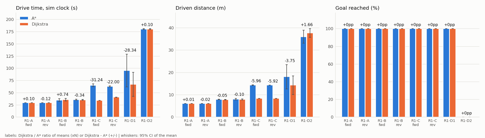

# 연구 1 결과 요약: A* vs Dijkstra

- 모드: **Gazebo 주행 — Nav2 (NavigateToPose, NavFn AStar / Dijkstra + DWB)**, 월드 `lecture_hall_real`, 기록 80행
- 원자료: experiments/r1/results/20261117-023953_nav2sim_lecture_hall_real/trials.csv
- 설정 버전: 4f2c662a-n6d95dc-m5249d1
- 값: 평균 ± 95% 신뢰구간 반폭. 차이 = Dijkstra − A* (같은 시나리오·방향·반복끼리 짝지음)

## 1. 시나리오별 결과

| 시나리오 | 알고리즘 | n | 계획 성공 | 도착 성공 | 주행 시간 (s) | 주행 시간, sim (s) | 실제 주행 거리 (m) | 계획 경로 길이 (m) | 계획 횟수 | 복구 횟수 | 도착 오차 (m) |
|---|---|---|---|---|---|---|---|---|---|---|---|
| R1-A fwd 개방 경로 | A* | 5 | 5/5 | 5/5 | 32.9 ± 0.5 | 29.5 ± 0.1 | 6.11 ± 0.02 | 6.427 ± 0.033 | 29.2 ± 0.6 | 0.00 ± 0.00 | 0.239 ± 0.014 |
| R1-A fwd 개방 경로 | Dijkstra | 5 | 5/5 | 5/5 | 32.9 ± 0.4 | 29.6 ± 0.1 | 6.12 ± 0.02 | 6.433 ± 0.033 | 29.2 ± 0.6 | 0.00 ± 0.00 | 0.241 ± 0.013 |
| R1-A rev 개방 경로 | A* | 5 | 5/5 | 5/5 | 32.8 ± 0.5 | 29.6 ± 0.2 | 6.11 ± 0.03 | 6.417 ± 0.011 | 29.2 ± 0.6 | 0.00 ± 0.00 | 0.255 ± 0.015 |
| R1-A rev 개방 경로 | Dijkstra | 5 | 5/5 | 5/5 | 32.9 ± 0.5 | 29.5 ± 0.1 | 6.10 ± 0.02 | 6.408 ± 0.014 | 29.4 ± 0.7 | 0.00 ± 0.00 | 0.271 ± 0.012 |
| R1-B fwd 장애물 우회 | A* | 5 | 5/5 | 5/5 | 38.4 ± 3.4 | 34.9 ± 2.9 | 7.91 ± 0.08 | 8.655 ± 0.092 | 34.8 ± 3.7 | 0.20 ± 0.56 | 0.210 ± 0.040 |
| R1-B fwd 장애물 우회 | Dijkstra | 5 | 5/5 | 5/5 | 39.9 ± 3.8 | 35.7 ± 2.7 | 7.87 ± 0.10 | 8.518 ± 0.148 | 35.4 ± 2.3 | 0.00 ± 0.00 | 0.222 ± 0.042 |
| R1-B rev 장애물 우회 | A* | 5 | 5/5 | 5/5 | 39.1 ± 0.8 | 35.8 ± 1.1 | 8.05 ± 0.30 | 8.572 ± 0.257 | 35.6 ± 0.7 | 0.00 ± 0.00 | 0.240 ± 0.017 |
| R1-B rev 장애물 우회 | Dijkstra | 5 | 5/5 | 5/5 | 39.0 ± 1.1 | 35.4 ± 0.9 | 7.95 ± 0.27 | 8.512 ± 0.265 | 35.2 ± 1.6 | 0.00 ± 0.00 | 0.233 ± 0.014 |
| R1-C fwd 좁은 통로·갈림길 | A* | 5 | 5/5 | 5/5 | 72.5 ± 3.6 | 65.3 ± 3.0 | 14.35 ± 0.10 | 16.265 ± 0.251 | 60.2 ± 1.6 | 6.40 ± 3.68 | 0.264 ± 0.012 |
| R1-C fwd 좁은 통로·갈림길 | Dijkstra | 5 | 5/5 | 5/5 | 37.7 ± 0.2 | 34.1 ± 0.1 | 8.39 ± 0.01 | 9.038 ± 0.029 | 34.0 ± 0.0 | 0.00 ± 0.00 | 0.187 ± 0.010 |
| R1-C rev 좁은 통로·갈림길 | A* | 5 | 5/5 | 5/5 | 69.7 ± 1.3 | 62.9 ± 1.1 | 14.33 ± 0.03 | 14.113 ± 3.369 | 62.6 ± 1.7 | 0.00 ± 0.00 | 0.252 ± 0.020 |
| R1-C rev 좁은 통로·갈림길 | Dijkstra | 5 | 5/5 | 5/5 | 45.2 ± 1.9 | 40.9 ± 0.3 | 8.41 ± 0.01 | 8.889 ± 0.037 | 40.8 ± 0.6 | 0.00 ± 0.00 | 0.247 ± 0.015 |
| R1-D1 경로 차단 (재계획) | A* | 5 | 5/5 | 5/5 | 106.7 ± 36.8 | 95.6 ± 33.6 | 18.09 ± 5.41 | 6.726 ± 0.137 | 83.0 ± 25.9 | 10.80 ± 7.62 | 0.254 ± 0.012 |
| R1-D1 경로 차단 (재계획) | Dijkstra | 5 | 5/5 | 5/5 | 74.3 ± 28.4 | 67.3 ± 24.5 | 14.34 ± 4.17 | 6.585 ± 0.191 | 66.6 ± 24.7 | 0.00 ± 0.00 | 0.250 ± 0.014 |
| R1-D2 경로 차단 (경로 없음) | A* | 5 | 5/5 | 0/5 | 198.6 ± 2.0 | 180.4 ± 0.8 | 36.01 ± 2.90 | 12.414 ± 0.253 | 169.4 ± 6.8 | 11.20 ± 5.51 | 7.570 ± 1.142 |
| R1-D2 경로 차단 (경로 없음) | Dijkstra | 5 | 5/5 | 0/5 | 199.7 ± 2.2 | 180.5 ± 0.6 | 37.67 ± 1.92 | 12.400 ± 0.219 | 175.4 ± 3.1 | 4.80 ± 2.69 | 7.695 ± 0.777 |

## 2. 짝 비교 (Dijkstra − A*)

| 시나리오 | 짝 수 | 주행 시간 (s) 차이 [95% CI] | 주행 시간, sim (s) 차이 [95% CI] | 실제 주행 거리 (m) 차이 [95% CI] | 계획 경로 길이 (m) 차이 [95% CI] |
|---|---|---|---|---|---|
| R1-A fwd 개방 경로 | 5 | -0.0 [-0.3, +0.3] | +0.1 [+0.0, +0.2] | +0.01 [-0.03, +0.04] | +0.006 [-0.053, +0.064] |
| R1-A rev 개방 경로 | 5 | +0.1 [-0.1, +0.3] | -0.1 [-0.3, +0.1] | -0.02 [-0.06, +0.03] | -0.008 [-0.031, +0.015] |
| R1-B fwd 장애물 우회 | 5 | +1.5 [-5.3, +8.3] | +0.7 [-4.8, +6.3] | -0.05 [-0.23, +0.13] | -0.137 [-0.331, +0.057] |
| R1-B rev 장애물 우회 | 5 | -0.1 [-2.0, +1.8] | -0.3 [-2.4, +1.7] | -0.10 [-0.67, +0.48] | -0.060 [-0.581, +0.461] |
| R1-C fwd 좁은 통로·갈림길 | 5 | -34.8 [-38.2, -31.3] | -31.2 [-34.2, -28.3] | -5.96 [-6.05, -5.86] | -7.227 [-7.464, -6.990] |
| R1-C rev 좁은 통로·갈림길 | 5 | -24.5 [-26.1, -23.0] | -22.0 [-22.9, -21.1] | -5.92 [-5.96, -5.87] | -5.224 [-8.570, -1.878] |
| R1-D1 경로 차단 (재계획) | 5 | -32.4 [-61.5, -3.4] | -28.3 [-53.6, -3.1] | -3.75 [-6.83, -0.68] | -0.141 [-0.464, +0.183] |
| R1-D2 경로 차단 (경로 없음) | 5 | +1.1 [-2.7, +4.8] | +0.1 [-0.9, +1.1] | +1.66 [-1.87, +5.19] | -0.014 [-0.413, +0.384] |

- 계획 경로 길이 차이 |D − A|: 평균 1.693 m, 최대 7.449 m, 1 cm 넘는 짝 36/40

## 3. 실패 기록

| 시나리오 | 방향 | 반복 | 알고리즘 | 이유 |
|---|---|---|---|---|
| R1-D2 | fwd | 0 | A* | 시간 초과 (180초) → 목표 취소 |
| R1-D2 | fwd | 0 | Dijkstra | 시간 초과 (180초) → 목표 취소 |
| R1-D2 | fwd | 1 | Dijkstra | 시간 초과 (180초) → 목표 취소 |
| R1-D2 | fwd | 1 | A* | 시간 초과 (180초) → 목표 취소 |
| R1-D2 | fwd | 2 | A* | 시간 초과 (180초) → 목표 취소 |
| R1-D2 | fwd | 2 | Dijkstra | 시간 초과 (180초) → 목표 취소 |
| R1-D2 | fwd | 3 | Dijkstra | 시간 초과 (180초) → 목표 취소 |
| R1-D2 | fwd | 3 | A* | 시간 초과 (180초) → 목표 취소 |
| R1-D2 | fwd | 4 | A* | 시간 초과 (180초) → 목표 취소 |
| R1-D2 | fwd | 4 | Dijkstra | 시간 초과 (180초) → 목표 취소 |

## 그림

