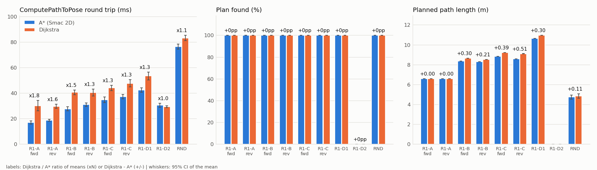

# 연구 1 결과 요약: A* vs Dijkstra

- 모드: **계획만 — Nav2 NavFn (ComputePathToPose, planner_id AStar / Dijkstra)**, 월드 `lecture_hall_real`, 기록 1680행
- 원자료: experiments/r1/results/20261117-064029_nav2plan-smac2d_lecture_hall_real/trials.csv
- 설정 버전: 4ff6971f-nb4ca30-m5249d1
- 값: 평균 ± 95% 신뢰구간 반폭. 차이 = Dijkstra − A* (같은 시나리오·방향·반복끼리 짝지음)

## 1. 시나리오별 결과

| 시나리오 | 알고리즘 | n | 계획 성공 | 요청~응답 (ms) | 계획 경로 길이 (m) | 경로 점 수 |
|---|---|---|---|---|---|---|
| R1-A fwd 개방 경로 | A* (Smac 2D) | 30 | 30/30 | 17.12 ± 1.29 | 6.600 ± 0.000 | 133 ± 0 |
| R1-A fwd 개방 경로 | Dijkstra | 30 | 30/30 | 30.24 ± 4.09 | 6.600 ± 0.000 | 262 ± 0 |
| R1-A rev 개방 경로 | A* (Smac 2D) | 30 | 30/30 | 18.81 ± 0.63 | 6.600 ± 0.000 | 133 ± 0 |
| R1-A rev 개방 경로 | Dijkstra | 30 | 30/30 | 29.76 ± 1.62 | 6.600 ± 0.000 | 263 ± 0 |
| R1-B fwd 장애물 우회 | A* (Smac 2D) | 30 | 30/30 | 27.80 ± 1.54 | 8.359 ± 0.000 | 167 ± 0 |
| R1-B fwd 장애물 우회 | Dijkstra | 30 | 30/30 | 40.69 ± 1.86 | 8.660 ± 0.001 | 346 ± 0 |
| R1-B rev 장애물 우회 | A* (Smac 2D) | 30 | 30/30 | 31.10 ± 1.34 | 8.315 ± 0.009 | 167 ± 0 |
| R1-B rev 장애물 우회 | Dijkstra | 30 | 30/30 | 40.49 ± 2.72 | 8.529 ± 0.000 | 341 ± 0 |
| R1-C fwd 좁은 통로·갈림길 | A* (Smac 2D) | 30 | 30/30 | 34.83 ± 2.12 | 8.851 ± 0.002 | 177 ± 0 |
| R1-C fwd 좁은 통로·갈림길 | Dijkstra | 30 | 30/30 | 44.08 ± 2.17 | 9.240 ± 0.001 | 368 ± 0 |
| R1-C rev 좁은 통로·갈림길 | A* (Smac 2D) | 30 | 30/30 | 37.37 ± 1.78 | 8.597 ± 0.003 | 172 ± 0 |
| R1-C rev 좁은 통로·갈림길 | Dijkstra | 30 | 30/30 | 47.77 ± 2.94 | 9.111 ± 0.006 | 363 ± 0 |
| R1-D1 경로 차단 (재계획) | A* (Smac 2D) | 30 | 30/30 | 42.40 ± 1.71 | 10.661 ± 0.000 | 213 ± 0 |
| R1-D1 경로 차단 (재계획) | Dijkstra | 30 | 30/30 | 53.47 ± 3.02 | 10.960 ± 0.000 | 438 ± 0 |
| R1-D2 경로 차단 (경로 없음) | A* (Smac 2D) | 30 | 0/30 | 30.60 ± 1.64 | - | 0 ± 0 |
| R1-D2 경로 차단 (경로 없음) | Dijkstra | 30 | 0/30 | 29.41 ± 0.80 | - | 0 ± 0 |
| RND 무작위 쌍 | A* (Smac 2D) | 600 | 600/600 | 76.50 ± 2.06 | 4.751 ± 0.212 | 92 ± 4 |
| RND 무작위 쌍 | Dijkstra | 600 | 600/600 | 83.21 ± 2.06 | 4.859 ± 0.219 | 193 ± 9 |

## 2. 짝 비교 (Dijkstra − A*)

| 시나리오 | 짝 수 | 요청~응답 (ms) 차이 [95% CI] | 계획 경로 길이 (m) 차이 [95% CI] | 요청~응답 배율 (D/A) |
|---|---|---|---|---|
| R1-A fwd 개방 경로 | 30 | +13.12 [+8.84, +17.39] | +0.000 | ×1.77 |
| R1-A rev 개방 경로 | 30 | +10.95 [+9.60, +12.30] | +0.000 | ×1.58 |
| R1-B fwd 장애물 우회 | 30 | +12.89 [+10.74, +15.04] | +0.301 [+0.299, +0.302] | ×1.46 |
| R1-B rev 장애물 우회 | 30 | +9.39 [+6.51, +12.26] | +0.214 [+0.205, +0.224] | ×1.30 |
| R1-C fwd 좁은 통로·갈림길 | 30 | +9.25 [+6.64, +11.87] | +0.388 [+0.387, +0.390] | ×1.27 |
| R1-C rev 좁은 통로·갈림길 | 30 | +10.40 [+8.03, +12.77] | +0.514 [+0.510, +0.518] | ×1.28 |
| R1-D1 경로 차단 (재계획) | 30 | +11.07 [+7.29, +14.86] | +0.299 | ×1.26 |
| R1-D2 경로 차단 (경로 없음) | 30 | -1.19 [-2.91, +0.54] | - | ×0.96 |
| RND 무작위 쌍 | 600 | +6.72 [+5.58, +7.86] | +0.108 [+0.096, +0.121] | ×1.09 |

- 계획 경로 길이 차이 |D − A|: 평균 0.170 m, 최대 0.521 m, 1 cm 넘는 짝 729/810

## 3. 실패 기록

| 시나리오 | 방향 | 반복 | 알고리즘 | 이유 |
|---|---|---|---|---|
| R1-D2 | fwd | 0 | A* (Smac 2D) | 계획 실패 (상태 6) |
| R1-D2 | fwd | 0 | Dijkstra | 계획 실패 (상태 6) |
| R1-D2 | fwd | 1 | Dijkstra | 계획 실패 (상태 6) |
| R1-D2 | fwd | 1 | A* (Smac 2D) | 계획 실패 (상태 6) |
| R1-D2 | fwd | 2 | A* (Smac 2D) | 계획 실패 (상태 6) |
| R1-D2 | fwd | 2 | Dijkstra | 계획 실패 (상태 6) |
| R1-D2 | fwd | 3 | Dijkstra | 계획 실패 (상태 6) |
| R1-D2 | fwd | 3 | A* (Smac 2D) | 계획 실패 (상태 6) |
| R1-D2 | fwd | 4 | A* (Smac 2D) | 계획 실패 (상태 6) |
| R1-D2 | fwd | 4 | Dijkstra | 계획 실패 (상태 6) |
| R1-D2 | fwd | 5 | Dijkstra | 계획 실패 (상태 6) |
| R1-D2 | fwd | 5 | A* (Smac 2D) | 계획 실패 (상태 6) |
| R1-D2 | fwd | 6 | A* (Smac 2D) | 계획 실패 (상태 6) |
| R1-D2 | fwd | 6 | Dijkstra | 계획 실패 (상태 6) |
| R1-D2 | fwd | 7 | Dijkstra | 계획 실패 (상태 6) |
| R1-D2 | fwd | 7 | A* (Smac 2D) | 계획 실패 (상태 6) |
| R1-D2 | fwd | 8 | A* (Smac 2D) | 계획 실패 (상태 6) |
| R1-D2 | fwd | 8 | Dijkstra | 계획 실패 (상태 6) |
| R1-D2 | fwd | 9 | Dijkstra | 계획 실패 (상태 6) |
| R1-D2 | fwd | 9 | A* (Smac 2D) | 계획 실패 (상태 6) |
| R1-D2 | fwd | 10 | A* (Smac 2D) | 계획 실패 (상태 6) |
| R1-D2 | fwd | 10 | Dijkstra | 계획 실패 (상태 6) |
| R1-D2 | fwd | 11 | Dijkstra | 계획 실패 (상태 6) |
| R1-D2 | fwd | 11 | A* (Smac 2D) | 계획 실패 (상태 6) |
| R1-D2 | fwd | 12 | A* (Smac 2D) | 계획 실패 (상태 6) |
| R1-D2 | fwd | 12 | Dijkstra | 계획 실패 (상태 6) |
| R1-D2 | fwd | 13 | Dijkstra | 계획 실패 (상태 6) |
| R1-D2 | fwd | 13 | A* (Smac 2D) | 계획 실패 (상태 6) |
| R1-D2 | fwd | 14 | A* (Smac 2D) | 계획 실패 (상태 6) |
| R1-D2 | fwd | 14 | Dijkstra | 계획 실패 (상태 6) |
| R1-D2 | fwd | 15 | Dijkstra | 계획 실패 (상태 6) |
| R1-D2 | fwd | 15 | A* (Smac 2D) | 계획 실패 (상태 6) |
| R1-D2 | fwd | 16 | A* (Smac 2D) | 계획 실패 (상태 6) |
| R1-D2 | fwd | 16 | Dijkstra | 계획 실패 (상태 6) |
| R1-D2 | fwd | 17 | Dijkstra | 계획 실패 (상태 6) |
| R1-D2 | fwd | 17 | A* (Smac 2D) | 계획 실패 (상태 6) |
| R1-D2 | fwd | 18 | A* (Smac 2D) | 계획 실패 (상태 6) |
| R1-D2 | fwd | 18 | Dijkstra | 계획 실패 (상태 6) |
| R1-D2 | fwd | 19 | Dijkstra | 계획 실패 (상태 6) |
| R1-D2 | fwd | 19 | A* (Smac 2D) | 계획 실패 (상태 6) |
| R1-D2 | fwd | 20 | A* (Smac 2D) | 계획 실패 (상태 6) |
| R1-D2 | fwd | 20 | Dijkstra | 계획 실패 (상태 6) |
| R1-D2 | fwd | 21 | Dijkstra | 계획 실패 (상태 6) |
| R1-D2 | fwd | 21 | A* (Smac 2D) | 계획 실패 (상태 6) |
| R1-D2 | fwd | 22 | A* (Smac 2D) | 계획 실패 (상태 6) |
| R1-D2 | fwd | 22 | Dijkstra | 계획 실패 (상태 6) |
| R1-D2 | fwd | 23 | Dijkstra | 계획 실패 (상태 6) |
| R1-D2 | fwd | 23 | A* (Smac 2D) | 계획 실패 (상태 6) |
| R1-D2 | fwd | 24 | A* (Smac 2D) | 계획 실패 (상태 6) |
| R1-D2 | fwd | 24 | Dijkstra | 계획 실패 (상태 6) |
| R1-D2 | fwd | 25 | Dijkstra | 계획 실패 (상태 6) |
| R1-D2 | fwd | 25 | A* (Smac 2D) | 계획 실패 (상태 6) |
| R1-D2 | fwd | 26 | A* (Smac 2D) | 계획 실패 (상태 6) |
| R1-D2 | fwd | 26 | Dijkstra | 계획 실패 (상태 6) |
| R1-D2 | fwd | 27 | Dijkstra | 계획 실패 (상태 6) |
| R1-D2 | fwd | 27 | A* (Smac 2D) | 계획 실패 (상태 6) |
| R1-D2 | fwd | 28 | A* (Smac 2D) | 계획 실패 (상태 6) |
| R1-D2 | fwd | 28 | Dijkstra | 계획 실패 (상태 6) |
| R1-D2 | fwd | 29 | Dijkstra | 계획 실패 (상태 6) |
| R1-D2 | fwd | 29 | A* (Smac 2D) | 계획 실패 (상태 6) |

## 그림

