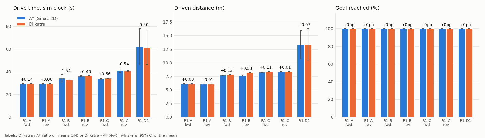

# 연구 1 결과 요약: A* vs Dijkstra

- 모드: **Gazebo 주행 — Nav2 (NavigateToPose, NavFn AStar / Dijkstra + DWB)**, 월드 `lecture_hall_real`, 기록 70행
- 원자료: experiments/r1/results/20261117-064405_nav2sim-smac2d_lecture_hall_real/trials.csv
- 설정 버전: 4ff6971f-nb4ca30-m5249d1
- 값: 평균 ± 95% 신뢰구간 반폭. 차이 = Dijkstra − A* (같은 시나리오·방향·반복끼리 짝지음)

## 1. 시나리오별 결과

| 시나리오 | 알고리즘 | n | 계획 성공 | 도착 성공 | 주행 시간 (s) | 주행 시간, sim (s) | 실제 주행 거리 (m) | 계획 경로 길이 (m) | 계획 횟수 | 복구 횟수 | 도착 오차 (m) |
|---|---|---|---|---|---|---|---|---|---|---|---|
| R1-A fwd 개방 경로 | A* (Smac 2D) | 5 | 5/5 | 5/5 | 32.2 ± 1.8 | 29.5 ± 0.3 | 6.14 ± 0.08 | 6.456 ± 0.062 | 29.2 ± 0.6 | 0.00 ± 0.00 | 0.272 ± 0.013 |
| R1-A fwd 개방 경로 | Dijkstra | 5 | 5/5 | 5/5 | 32.4 ± 1.7 | 29.6 ± 0.1 | 6.14 ± 0.03 | 6.436 ± 0.051 | 29.2 ± 0.6 | 0.00 ± 0.00 | 0.230 ± 0.012 |
| R1-A rev 개방 경로 | A* (Smac 2D) | 5 | 5/5 | 5/5 | 33.5 ± 1.1 | 29.5 ± 0.3 | 6.10 ± 0.02 | 6.394 ± 0.028 | 29.2 ± 0.6 | 0.00 ± 0.00 | 0.243 ± 0.017 |
| R1-A rev 개방 경로 | Dijkstra | 5 | 5/5 | 5/5 | 31.5 ± 2.2 | 29.6 ± 0.2 | 6.11 ± 0.02 | 6.412 ± 0.014 | 29.2 ± 0.6 | 0.00 ± 0.00 | 0.268 ± 0.015 |
| R1-B fwd 장애물 우회 | A* (Smac 2D) | 5 | 5/5 | 5/5 | 37.9 ± 3.5 | 34.3 ± 3.2 | 7.74 ± 0.06 | 8.074 ± 0.061 | 34.4 ± 3.6 | 0.00 ± 0.00 | 0.209 ± 0.012 |
| R1-B fwd 장애물 우회 | Dijkstra | 5 | 5/5 | 5/5 | 36.3 ± 0.2 | 32.8 ± 0.1 | 7.87 ± 0.03 | 8.588 ± 0.036 | 32.4 ± 0.7 | 0.00 ± 0.00 | 0.201 ± 0.007 |
| R1-B rev 장애물 우회 | A* (Smac 2D) | 5 | 5/5 | 5/5 | 39.6 ± 0.7 | 36.1 ± 0.3 | 7.69 ± 0.09 | 8.037 ± 0.063 | 35.8 ± 1.0 | 0.00 ± 0.00 | 0.225 ± 0.010 |
| R1-B rev 장애물 우회 | Dijkstra | 5 | 5/5 | 5/5 | 40.0 ± 0.3 | 36.5 ± 0.1 | 8.23 ± 0.02 | 8.743 ± 0.034 | 36.4 ± 0.7 | 0.00 ± 0.00 | 0.238 ± 0.012 |
| R1-C fwd 좁은 통로·갈림길 | A* (Smac 2D) | 5 | 5/5 | 5/5 | 37.2 ± 3.0 | 33.6 ± 0.2 | 8.30 ± 0.04 | 8.629 ± 0.028 | 33.6 ± 0.7 | 0.00 ± 0.00 | 0.216 ± 0.022 |
| R1-C fwd 좁은 통로·갈림길 | Dijkstra | 5 | 5/5 | 5/5 | 37.7 ± 0.2 | 34.3 ± 0.2 | 8.40 ± 0.03 | 9.029 ± 0.075 | 34.0 ± 0.0 | 0.00 ± 0.00 | 0.200 ± 0.008 |
| R1-C rev 좁은 통로·갈림길 | A* (Smac 2D) | 5 | 5/5 | 5/5 | 47.1 ± 2.3 | 41.4 ± 2.0 | 8.40 ± 0.03 | 8.426 ± 0.037 | 41.4 ± 1.9 | 0.00 ± 0.00 | 0.223 ± 0.022 |
| R1-C rev 좁은 통로·갈림길 | Dijkstra | 5 | 5/5 | 5/5 | 44.3 ± 0.6 | 40.8 ± 0.4 | 8.41 ± 0.02 | 8.861 ± 0.009 | 40.4 ± 0.7 | 0.00 ± 0.00 | 0.251 ± 0.008 |
| R1-D1 경로 차단 (재계획) | A* (Smac 2D) | 5 | 5/5 | 5/5 | 66.9 ± 17.9 | 61.9 ± 16.0 | 13.33 ± 2.58 | 6.447 ± 0.193 | 61.2 ± 15.4 | 0.20 ± 0.56 | 0.225 ± 0.015 |
| R1-D1 경로 차단 (재계획) | Dijkstra | 5 | 5/5 | 5/5 | 67.5 ± 18.3 | 61.4 ± 15.2 | 13.39 ± 2.89 | 6.622 ± 0.217 | 60.8 ± 15.9 | 0.00 ± 0.00 | 0.252 ± 0.018 |

## 2. 짝 비교 (Dijkstra − A*)

| 시나리오 | 짝 수 | 주행 시간 (s) 차이 [95% CI] | 주행 시간, sim (s) 차이 [95% CI] | 실제 주행 거리 (m) 차이 [95% CI] | 계획 경로 길이 (m) 차이 [95% CI] |
|---|---|---|---|---|---|
| R1-A fwd 개방 경로 | 5 | +0.1 [-2.6, +2.8] | +0.1 [-0.2, +0.5] | +0.00 [-0.11, +0.11] | -0.019 [-0.127, +0.088] |
| R1-A rev 개방 경로 | 5 | -2.0 [-3.8, -0.2] | +0.1 [-0.4, +0.5] | +0.01 [-0.01, +0.04] | +0.019 [-0.017, +0.055] |
| R1-B fwd 장애물 우회 | 5 | -1.6 [-5.4, +2.1] | -1.5 [-4.7, +1.7] | +0.13 [+0.10, +0.16] | +0.514 [+0.430, +0.599] |
| R1-B rev 장애물 우회 | 5 | +0.3 [-0.1, +0.7] | +0.4 [+0.1, +0.7] | +0.53 [+0.44, +0.63] | +0.705 [+0.626, +0.785] |
| R1-C fwd 좁은 통로·갈림길 | 5 | +0.5 [-2.5, +3.6] | +0.7 [+0.4, +0.9] | +0.11 [+0.05, +0.17] | +0.399 [+0.315, +0.484] |
| R1-C rev 좁은 통로·갈림길 | 5 | -2.8 [-4.6, -1.0] | -0.5 [-2.6, +1.5] | +0.01 [-0.01, +0.03] | +0.435 [+0.393, +0.478] |
| R1-D1 경로 차단 (재계획) | 5 | +0.6 [-32.0, +33.3] | -0.5 [-28.1, +27.1] | +0.07 [-4.74, +4.87] | +0.175 [-0.226, +0.576] |

- 계획 경로 길이 차이 |D − A|: 평균 0.343 m, 최대 0.774 m, 1 cm 넘는 짝 32/35

## 그림

