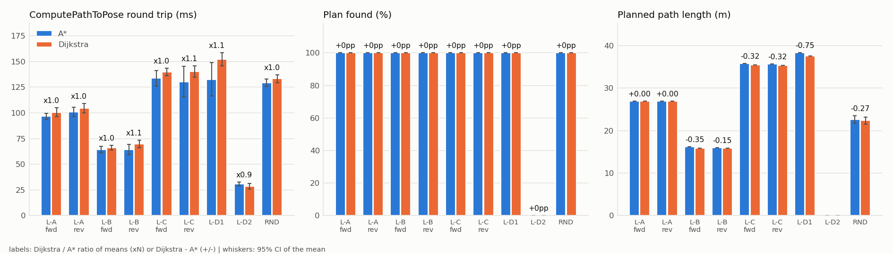

# 연구 1 결과 요약: A* vs Dijkstra

- 모드: **계획만 — Nav2 NavFn (ComputePathToPose, planner_id AStar / Dijkstra)**, 월드 `warehouse_large`, 기록 1680행
- 원자료: experiments/r1/results/20261117-075953_nav2plan_warehouse_large/trials.csv
- 설정 버전: 70e232e5-nb4ca30-mbb536c
- 값: 평균 ± 95% 신뢰구간 반폭. 차이 = Dijkstra − A* (같은 시나리오·방향·반복끼리 짝지음)

## 1. 시나리오별 결과

| 시나리오 | 알고리즘 | n | 계획 성공 | 요청~응답 (ms) | 계획 경로 길이 (m) | 경로 점 수 |
|---|---|---|---|---|---|---|
| L-A fwd 개방 경로 (하역장 26 m) | A* | 30 | 30/30 | 96.60 ± 3.18 | 27.000 ± 0.000 | 1078 ± 0 |
| L-A fwd 개방 경로 (하역장 26 m) | Dijkstra | 30 | 30/30 | 100.66 ± 4.33 | 27.000 ± 0.000 | 1079 ± 0 |
| L-A rev 개방 경로 (하역장 26 m) | A* | 30 | 30/30 | 101.12 ± 4.57 | 27.000 ± 0.000 | 1079 ± 0 |
| L-A rev 개방 경로 (하역장 26 m) | Dijkstra | 30 | 30/30 | 104.61 ± 4.76 | 27.000 ± 0.000 | 1080 ± 0 |
| L-B fwd 랙 우회 | A* | 30 | 30/30 | 64.25 ± 3.29 | 16.234 ± 0.000 | 632 ± 0 |
| L-B fwd 랙 우회 | Dijkstra | 30 | 30/30 | 66.15 ± 2.23 | 15.888 ± 0.000 | 637 ± 0 |
| L-B rev 랙 우회 | A* | 30 | 30/30 | 64.28 ± 5.09 | 16.004 ± 0.000 | 633 ± 0 |
| L-B rev 랙 우회 | Dijkstra | 30 | 30/30 | 69.66 ± 3.69 | 15.852 ± 0.000 | 634 ± 0 |
| L-C fwd 창고 끝에서 끝 | A* | 30 | 30/30 | 133.84 ± 7.59 | 35.827 ± 0.000 | 1418 ± 0 |
| L-C fwd 창고 끝에서 끝 | Dijkstra | 30 | 30/30 | 139.88 ± 3.65 | 35.503 ± 0.000 | 1417 ± 0 |
| L-C rev 창고 끝에서 끝 | A* | 30 | 30/30 | 130.24 ± 14.89 | 35.740 ± 0.000 | 1426 ± 0 |
| L-C rev 창고 끝에서 끝 | Dijkstra | 30 | 30/30 | 140.34 ± 5.53 | 35.422 ± 0.000 | 1416 ± 0 |
| L-D1 경로 차단 (재계획) | A* | 30 | 30/30 | 132.72 ± 16.20 | 38.324 ± 0.000 | 1464 ± 0 |
| L-D1 경로 차단 (재계획) | Dijkstra | 30 | 30/30 | 152.06 ± 6.42 | 37.570 ± 0.000 | 1500 ± 0 |
| L-D2 경로 차단 (경로 없음) | A* | 30 | 0/30 | 30.85 ± 1.73 | - | 0 ± 0 |
| L-D2 경로 차단 (경로 없음) | Dijkstra | 30 | 0/30 | 28.63 ± 2.60 | - | 0 ± 0 |
| RND 무작위 쌍 | A* | 600 | 600/600 | 129.31 ± 3.54 | 22.643 ± 0.848 | 895 ± 34 |
| RND 무작위 쌍 | Dijkstra | 600 | 600/600 | 133.24 ± 3.71 | 22.377 ± 0.839 | 894 ± 34 |

## 2. 짝 비교 (Dijkstra − A*)

| 시나리오 | 짝 수 | 요청~응답 (ms) 차이 [95% CI] | 계획 경로 길이 (m) 차이 [95% CI] | 요청~응답 배율 (D/A) |
|---|---|---|---|---|
| L-A fwd 개방 경로 (하역장 26 m) | 30 | +4.07 [-1.52, +9.65] | +0.000 | ×1.04 |
| L-A rev 개방 경로 (하역장 26 m) | 30 | +3.49 [-2.15, +9.13] | +0.000 | ×1.03 |
| L-B fwd 랙 우회 | 30 | +1.90 [-2.73, +6.53] | -0.346 | ×1.03 |
| L-B rev 랙 우회 | 30 | +5.38 [-1.68, +12.45] | -0.152 | ×1.08 |
| L-C fwd 창고 끝에서 끝 | 30 | +6.04 [-2.95, +15.03] | -0.324 | ×1.05 |
| L-C rev 창고 끝에서 끝 | 30 | +10.10 [-7.12, +27.32] | -0.317 | ×1.08 |
| L-D1 경로 차단 (재계획) | 30 | +19.34 [-0.46, +39.14] | -0.754 | ×1.15 |
| L-D2 경로 차단 (경로 없음) | 30 | -2.22 [-5.47, +1.03] | - | ×0.93 |
| RND 무작위 쌍 | 600 | +3.92 [+0.33, +7.52] | -0.266 [-0.303, -0.230] | ×1.03 |

- 계획 경로 길이 차이 |D − A|: 평균 0.279 m, 최대 4.621 m, 1 cm 넘는 짝 699/810

## 3. 실패 기록

| 시나리오 | 방향 | 반복 | 알고리즘 | 이유 |
|---|---|---|---|---|
| L-D2 | fwd | 0 | A* | 계획 실패 (상태 6) |
| L-D2 | fwd | 0 | Dijkstra | 계획 실패 (상태 6) |
| L-D2 | fwd | 1 | Dijkstra | 계획 실패 (상태 6) |
| L-D2 | fwd | 1 | A* | 계획 실패 (상태 6) |
| L-D2 | fwd | 2 | A* | 계획 실패 (상태 6) |
| L-D2 | fwd | 2 | Dijkstra | 계획 실패 (상태 6) |
| L-D2 | fwd | 3 | Dijkstra | 계획 실패 (상태 6) |
| L-D2 | fwd | 3 | A* | 계획 실패 (상태 6) |
| L-D2 | fwd | 4 | A* | 계획 실패 (상태 6) |
| L-D2 | fwd | 4 | Dijkstra | 계획 실패 (상태 6) |
| L-D2 | fwd | 5 | Dijkstra | 계획 실패 (상태 6) |
| L-D2 | fwd | 5 | A* | 계획 실패 (상태 6) |
| L-D2 | fwd | 6 | A* | 계획 실패 (상태 6) |
| L-D2 | fwd | 6 | Dijkstra | 계획 실패 (상태 6) |
| L-D2 | fwd | 7 | Dijkstra | 계획 실패 (상태 6) |
| L-D2 | fwd | 7 | A* | 계획 실패 (상태 6) |
| L-D2 | fwd | 8 | A* | 계획 실패 (상태 6) |
| L-D2 | fwd | 8 | Dijkstra | 계획 실패 (상태 6) |
| L-D2 | fwd | 9 | Dijkstra | 계획 실패 (상태 6) |
| L-D2 | fwd | 9 | A* | 계획 실패 (상태 6) |
| L-D2 | fwd | 10 | A* | 계획 실패 (상태 6) |
| L-D2 | fwd | 10 | Dijkstra | 계획 실패 (상태 6) |
| L-D2 | fwd | 11 | Dijkstra | 계획 실패 (상태 6) |
| L-D2 | fwd | 11 | A* | 계획 실패 (상태 6) |
| L-D2 | fwd | 12 | A* | 계획 실패 (상태 6) |
| L-D2 | fwd | 12 | Dijkstra | 계획 실패 (상태 6) |
| L-D2 | fwd | 13 | Dijkstra | 계획 실패 (상태 6) |
| L-D2 | fwd | 13 | A* | 계획 실패 (상태 6) |
| L-D2 | fwd | 14 | A* | 계획 실패 (상태 6) |
| L-D2 | fwd | 14 | Dijkstra | 계획 실패 (상태 6) |
| L-D2 | fwd | 15 | Dijkstra | 계획 실패 (상태 6) |
| L-D2 | fwd | 15 | A* | 계획 실패 (상태 6) |
| L-D2 | fwd | 16 | A* | 계획 실패 (상태 6) |
| L-D2 | fwd | 16 | Dijkstra | 계획 실패 (상태 6) |
| L-D2 | fwd | 17 | Dijkstra | 계획 실패 (상태 6) |
| L-D2 | fwd | 17 | A* | 계획 실패 (상태 6) |
| L-D2 | fwd | 18 | A* | 계획 실패 (상태 6) |
| L-D2 | fwd | 18 | Dijkstra | 계획 실패 (상태 6) |
| L-D2 | fwd | 19 | Dijkstra | 계획 실패 (상태 6) |
| L-D2 | fwd | 19 | A* | 계획 실패 (상태 6) |
| L-D2 | fwd | 20 | A* | 계획 실패 (상태 6) |
| L-D2 | fwd | 20 | Dijkstra | 계획 실패 (상태 6) |
| L-D2 | fwd | 21 | Dijkstra | 계획 실패 (상태 6) |
| L-D2 | fwd | 21 | A* | 계획 실패 (상태 6) |
| L-D2 | fwd | 22 | A* | 계획 실패 (상태 6) |
| L-D2 | fwd | 22 | Dijkstra | 계획 실패 (상태 6) |
| L-D2 | fwd | 23 | Dijkstra | 계획 실패 (상태 6) |
| L-D2 | fwd | 23 | A* | 계획 실패 (상태 6) |
| L-D2 | fwd | 24 | A* | 계획 실패 (상태 6) |
| L-D2 | fwd | 24 | Dijkstra | 계획 실패 (상태 6) |
| L-D2 | fwd | 25 | Dijkstra | 계획 실패 (상태 6) |
| L-D2 | fwd | 25 | A* | 계획 실패 (상태 6) |
| L-D2 | fwd | 26 | A* | 계획 실패 (상태 6) |
| L-D2 | fwd | 26 | Dijkstra | 계획 실패 (상태 6) |
| L-D2 | fwd | 27 | Dijkstra | 계획 실패 (상태 6) |
| L-D2 | fwd | 27 | A* | 계획 실패 (상태 6) |
| L-D2 | fwd | 28 | A* | 계획 실패 (상태 6) |
| L-D2 | fwd | 28 | Dijkstra | 계획 실패 (상태 6) |
| L-D2 | fwd | 29 | Dijkstra | 계획 실패 (상태 6) |
| L-D2 | fwd | 29 | A* | 계획 실패 (상태 6) |

## 그림

