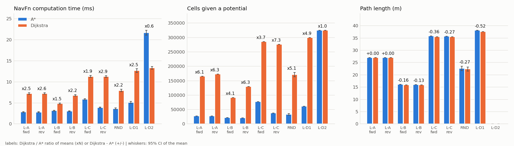

# 연구 1 결과 요약: A* vs Dijkstra

- 모드: **계획만 — Nav2 NavFn 핵심 계산 (C++, Nav2 global costmap 그대로, 메시지 통신 없음)**, 월드 `warehouse_large`, 기록 2800행
- 원자료: experiments/r1/results/20261117-075953_navfncore_warehouse_large/trials.csv
- 설정 버전: 70e232e5-nb4ca30-mbb536c
- 값: 평균 ± 95% 신뢰구간 반폭. 차이 = Dijkstra − A* (같은 시나리오·방향·반복끼리 짝지음)

## 1. 시나리오별 결과

| 시나리오 | 알고리즘 | n | 계획 성공 | 계획 시간 (ms) | 확장 칸 수 | 계획 경로 길이 (m) | 경로 점 수 |
|---|---|---|---|---|---|---|---|
| L-A fwd 개방 경로 (하역장 26 m) | A* | 100 | 100/100 | 2.84 ± 0.09 | 27274 ± 0 | 27.000 ± 0.000 | 1078 ± 0 |
| L-A fwd 개방 경로 (하역장 26 m) | Dijkstra | 100 | 100/100 | 7.22 ± 0.19 | 165388 ± 0 | 27.000 ± 0.000 | 1079 ± 0 |
| L-A rev 개방 경로 (하역장 26 m) | A* | 100 | 100/100 | 2.81 ± 0.11 | 27277 ± 0 | 27.000 ± 0.000 | 1078 ± 0 |
| L-A rev 개방 경로 (하역장 26 m) | Dijkstra | 100 | 100/100 | 7.25 ± 0.17 | 172701 ± 0 | 27.000 ± 0.000 | 1079 ± 0 |
| L-B fwd 랙 우회 | A* | 100 | 100/100 | 3.15 ± 0.09 | 22032 ± 0 | 16.105 ± 0.000 | 633 ± 0 |
| L-B fwd 랙 우회 | Dijkstra | 100 | 100/100 | 4.82 ± 0.13 | 91422 ± 0 | 15.948 ± 0.000 | 637 ± 0 |
| L-B rev 랙 우회 | A* | 100 | 100/100 | 3.05 ± 0.08 | 20729 ± 0 | 15.993 ± 0.000 | 626 ± 0 |
| L-B rev 랙 우회 | Dijkstra | 100 | 100/100 | 6.80 ± 0.17 | 129869 ± 0 | 15.866 ± 0.000 | 635 ± 0 |
| L-C fwd 창고 끝에서 끝 | A* | 100 | 100/100 | 5.86 ± 0.13 | 77340 ± 0 | 35.870 ± 0.000 | 1429 ± 0 |
| L-C fwd 창고 끝에서 끝 | Dijkstra | 100 | 100/100 | 11.27 ± 0.23 | 285356 ± 0 | 35.511 ± 0.000 | 1419 ± 0 |
| L-C rev 창고 끝에서 끝 | A* | 100 | 100/100 | 3.90 ± 0.10 | 37819 ± 0 | 35.732 ± 0.000 | 1427 ± 0 |
| L-C rev 창고 끝에서 끝 | Dijkstra | 100 | 100/100 | 11.25 ± 0.20 | 276476 ± 0 | 35.461 ± 0.000 | 1417 ± 0 |
| RND 무작위 쌍 | A* | 600 | 600/600 | 3.65 ± 0.16 | 33214 ± 2661 | 22.628 ± 0.848 | 894 ± 34 |
| RND 무작위 쌍 | Dijkstra | 600 | 600/600 | 7.95 ± 0.28 | 170903 ± 7487 | 22.362 ± 0.839 | 893 ± 34 |
| L-D1 경로 차단 (재계획) | A* | 100 | 100/100 | 5.11 ± 0.23 | 61655 ± 0 | 38.126 ± 0.000 | 1485 ± 0 |
| L-D1 경로 차단 (재계획) | Dijkstra | 100 | 100/100 | 12.66 ± 0.43 | 299874 ± 0 | 37.604 ± 0.000 | 1501 ± 0 |
| L-D2 경로 차단 (경로 없음) | A* | 100 | 0/100 | 21.65 ± 0.57 | 324714 ± 0 | - | 0 ± 0 |
| L-D2 경로 차단 (경로 없음) | Dijkstra | 100 | 0/100 | 13.31 ± 0.32 | 324714 ± 0 | - | 0 ± 0 |

## 2. 짝 비교 (Dijkstra − A*)

| 시나리오 | 짝 수 | 계획 시간 (ms) 차이 [95% CI] | 확장 칸 수 차이 [95% CI] | 계획 경로 길이 (m) 차이 [95% CI] | 계획 시간 배율 (D/A) | 확장 칸 수 배율 (D/A) |
|---|---|---|---|---|---|---|
| L-A fwd 개방 경로 (하역장 26 m) | 100 | +4.38 [+4.19, +4.58] | +138114 | +0.000 | ×2.54 | ×6.06 |
| L-A rev 개방 경로 (하역장 26 m) | 100 | +4.44 [+4.25, +4.63] | +145424 | +0.000 | ×2.58 | ×6.33 |
| L-B fwd 랙 우회 | 100 | +1.67 [+1.51, +1.83] | +69390 | -0.157 | ×1.53 | ×4.15 |
| L-B rev 랙 우회 | 100 | +3.74 [+3.56, +3.92] | +109140 | -0.127 | ×2.23 | ×6.27 |
| L-C fwd 창고 끝에서 끝 | 100 | +5.41 [+5.15, +5.66] | +208016 | -0.360 | ×1.92 | ×3.69 |
| L-C rev 창고 끝에서 끝 | 100 | +7.36 [+7.14, +7.57] | +238657 | -0.271 | ×2.89 | ×7.31 |
| RND 무작위 쌍 | 600 | +4.29 [+4.07, +4.51] | +137689 [+131864, +143514] | -0.266 [-0.303, -0.230] | ×2.18 | ×5.15 |
| L-D1 경로 차단 (재계획) | 100 | +7.55 [+7.12, +7.97] | +238219 | -0.521 | ×2.48 | ×4.86 |
| L-D2 경로 차단 (경로 없음) | 100 | -8.35 [-8.90, -7.79] | +0 | - | ×0.61 | ×1.00 |

- 계획 경로 길이 차이 |D − A|: 평균 0.241 m, 최대 4.621 m, 1 cm 넘는 짝 1049/1300

## 3. 실패 기록

| 시나리오 | 방향 | 반복 | 알고리즘 | 이유 |
|---|---|---|---|---|
| L-D2 | fwd | 0 | A* | 경로 없음 (포텐셜/경사 따라가기 실패) |
| L-D2 | fwd | 0 | Dijkstra | 경로 없음 (포텐셜/경사 따라가기 실패) |
| L-D2 | fwd | 1 | Dijkstra | 경로 없음 (포텐셜/경사 따라가기 실패) |
| L-D2 | fwd | 1 | A* | 경로 없음 (포텐셜/경사 따라가기 실패) |
| L-D2 | fwd | 2 | A* | 경로 없음 (포텐셜/경사 따라가기 실패) |
| L-D2 | fwd | 2 | Dijkstra | 경로 없음 (포텐셜/경사 따라가기 실패) |
| L-D2 | fwd | 3 | Dijkstra | 경로 없음 (포텐셜/경사 따라가기 실패) |
| L-D2 | fwd | 3 | A* | 경로 없음 (포텐셜/경사 따라가기 실패) |
| L-D2 | fwd | 4 | A* | 경로 없음 (포텐셜/경사 따라가기 실패) |
| L-D2 | fwd | 4 | Dijkstra | 경로 없음 (포텐셜/경사 따라가기 실패) |
| L-D2 | fwd | 5 | Dijkstra | 경로 없음 (포텐셜/경사 따라가기 실패) |
| L-D2 | fwd | 5 | A* | 경로 없음 (포텐셜/경사 따라가기 실패) |
| L-D2 | fwd | 6 | A* | 경로 없음 (포텐셜/경사 따라가기 실패) |
| L-D2 | fwd | 6 | Dijkstra | 경로 없음 (포텐셜/경사 따라가기 실패) |
| L-D2 | fwd | 7 | Dijkstra | 경로 없음 (포텐셜/경사 따라가기 실패) |
| L-D2 | fwd | 7 | A* | 경로 없음 (포텐셜/경사 따라가기 실패) |
| L-D2 | fwd | 8 | A* | 경로 없음 (포텐셜/경사 따라가기 실패) |
| L-D2 | fwd | 8 | Dijkstra | 경로 없음 (포텐셜/경사 따라가기 실패) |
| L-D2 | fwd | 9 | Dijkstra | 경로 없음 (포텐셜/경사 따라가기 실패) |
| L-D2 | fwd | 9 | A* | 경로 없음 (포텐셜/경사 따라가기 실패) |
| L-D2 | fwd | 10 | A* | 경로 없음 (포텐셜/경사 따라가기 실패) |
| L-D2 | fwd | 10 | Dijkstra | 경로 없음 (포텐셜/경사 따라가기 실패) |
| L-D2 | fwd | 11 | Dijkstra | 경로 없음 (포텐셜/경사 따라가기 실패) |
| L-D2 | fwd | 11 | A* | 경로 없음 (포텐셜/경사 따라가기 실패) |
| L-D2 | fwd | 12 | A* | 경로 없음 (포텐셜/경사 따라가기 실패) |
| L-D2 | fwd | 12 | Dijkstra | 경로 없음 (포텐셜/경사 따라가기 실패) |
| L-D2 | fwd | 13 | Dijkstra | 경로 없음 (포텐셜/경사 따라가기 실패) |
| L-D2 | fwd | 13 | A* | 경로 없음 (포텐셜/경사 따라가기 실패) |
| L-D2 | fwd | 14 | A* | 경로 없음 (포텐셜/경사 따라가기 실패) |
| L-D2 | fwd | 14 | Dijkstra | 경로 없음 (포텐셜/경사 따라가기 실패) |
| L-D2 | fwd | 15 | Dijkstra | 경로 없음 (포텐셜/경사 따라가기 실패) |
| L-D2 | fwd | 15 | A* | 경로 없음 (포텐셜/경사 따라가기 실패) |
| L-D2 | fwd | 16 | A* | 경로 없음 (포텐셜/경사 따라가기 실패) |
| L-D2 | fwd | 16 | Dijkstra | 경로 없음 (포텐셜/경사 따라가기 실패) |
| L-D2 | fwd | 17 | Dijkstra | 경로 없음 (포텐셜/경사 따라가기 실패) |
| L-D2 | fwd | 17 | A* | 경로 없음 (포텐셜/경사 따라가기 실패) |
| L-D2 | fwd | 18 | A* | 경로 없음 (포텐셜/경사 따라가기 실패) |
| L-D2 | fwd | 18 | Dijkstra | 경로 없음 (포텐셜/경사 따라가기 실패) |
| L-D2 | fwd | 19 | Dijkstra | 경로 없음 (포텐셜/경사 따라가기 실패) |
| L-D2 | fwd | 19 | A* | 경로 없음 (포텐셜/경사 따라가기 실패) |
| L-D2 | fwd | 20 | A* | 경로 없음 (포텐셜/경사 따라가기 실패) |
| L-D2 | fwd | 20 | Dijkstra | 경로 없음 (포텐셜/경사 따라가기 실패) |
| L-D2 | fwd | 21 | Dijkstra | 경로 없음 (포텐셜/경사 따라가기 실패) |
| L-D2 | fwd | 21 | A* | 경로 없음 (포텐셜/경사 따라가기 실패) |
| L-D2 | fwd | 22 | A* | 경로 없음 (포텐셜/경사 따라가기 실패) |
| L-D2 | fwd | 22 | Dijkstra | 경로 없음 (포텐셜/경사 따라가기 실패) |
| L-D2 | fwd | 23 | Dijkstra | 경로 없음 (포텐셜/경사 따라가기 실패) |
| L-D2 | fwd | 23 | A* | 경로 없음 (포텐셜/경사 따라가기 실패) |
| L-D2 | fwd | 24 | A* | 경로 없음 (포텐셜/경사 따라가기 실패) |
| L-D2 | fwd | 24 | Dijkstra | 경로 없음 (포텐셜/경사 따라가기 실패) |
| L-D2 | fwd | 25 | Dijkstra | 경로 없음 (포텐셜/경사 따라가기 실패) |
| L-D2 | fwd | 25 | A* | 경로 없음 (포텐셜/경사 따라가기 실패) |
| L-D2 | fwd | 26 | A* | 경로 없음 (포텐셜/경사 따라가기 실패) |
| L-D2 | fwd | 26 | Dijkstra | 경로 없음 (포텐셜/경사 따라가기 실패) |
| L-D2 | fwd | 27 | Dijkstra | 경로 없음 (포텐셜/경사 따라가기 실패) |
| L-D2 | fwd | 27 | A* | 경로 없음 (포텐셜/경사 따라가기 실패) |
| L-D2 | fwd | 28 | A* | 경로 없음 (포텐셜/경사 따라가기 실패) |
| L-D2 | fwd | 28 | Dijkstra | 경로 없음 (포텐셜/경사 따라가기 실패) |
| L-D2 | fwd | 29 | Dijkstra | 경로 없음 (포텐셜/경사 따라가기 실패) |
| L-D2 | fwd | 29 | A* | 경로 없음 (포텐셜/경사 따라가기 실패) |

## 그림

