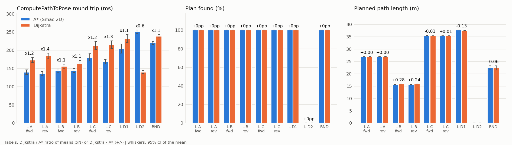

# 연구 1 결과 요약: A* vs Dijkstra

- 모드: **계획만 — Nav2 NavFn (ComputePathToPose, planner_id AStar / Dijkstra)**, 월드 `warehouse_large`, 기록 1680행
- 원자료: experiments/r1/results/20261117-080614_nav2plan-smac2d_warehouse_large/trials.csv
- 설정 버전: 70e232e5-nb4ca30-mbb536c
- 값: 평균 ± 95% 신뢰구간 반폭. 차이 = Dijkstra − A* (같은 시나리오·방향·반복끼리 짝지음)

## 1. 시나리오별 결과

| 시나리오 | 알고리즘 | n | 계획 성공 | 요청~응답 (ms) | 계획 경로 길이 (m) | 경로 점 수 |
|---|---|---|---|---|---|---|
| L-A fwd 개방 경로 (하역장 26 m) | A* (Smac 2D) | 30 | 30/30 | 139.88 ± 6.19 | 27.000 ± 0.000 | 541 ± 0 |
| L-A fwd 개방 경로 (하역장 26 m) | Dijkstra | 30 | 30/30 | 173.20 ± 7.02 | 27.000 ± 0.000 | 1079 ± 0 |
| L-A rev 개방 경로 (하역장 26 m) | A* (Smac 2D) | 30 | 30/30 | 136.28 ± 5.86 | 27.000 ± 0.000 | 541 ± 0 |
| L-A rev 개방 경로 (하역장 26 m) | Dijkstra | 30 | 30/30 | 184.44 ± 7.52 | 27.000 ± 0.000 | 1080 ± 0 |
| L-B fwd 랙 우회 | A* (Smac 2D) | 30 | 30/30 | 143.58 ± 5.01 | 15.612 ± 0.000 | 310 ± 0 |
| L-B fwd 랙 우회 | Dijkstra | 30 | 30/30 | 155.67 ± 6.43 | 15.888 ± 0.000 | 637 ± 0 |
| L-B rev 랙 우회 | A* (Smac 2D) | 30 | 30/30 | 144.47 ± 5.72 | 15.613 ± 0.000 | 310 ± 0 |
| L-B rev 랙 우회 | Dijkstra | 30 | 30/30 | 164.26 ± 7.76 | 15.852 ± 0.000 | 634 ± 0 |
| L-C fwd 창고 끝에서 끝 | A* (Smac 2D) | 30 | 30/30 | 180.51 ± 10.02 | 35.516 ± 0.000 | 651 ± 0 |
| L-C fwd 창고 끝에서 끝 | Dijkstra | 30 | 30/30 | 213.23 ± 10.80 | 35.503 ± 0.000 | 1417 ± 0 |
| L-C rev 창고 끝에서 끝 | A* (Smac 2D) | 30 | 30/30 | 168.89 ± 6.44 | 35.411 ± 0.000 | 651 ± 0 |
| L-C rev 창고 끝에서 끝 | Dijkstra | 30 | 30/30 | 215.15 ± 10.81 | 35.422 ± 0.000 | 1416 ± 0 |
| L-D1 경로 차단 (재계획) | A* (Smac 2D) | 30 | 30/30 | 204.74 ± 12.34 | 37.704 ± 0.000 | 707 ± 0 |
| L-D1 경로 차단 (재계획) | Dijkstra | 30 | 30/30 | 232.33 ± 10.73 | 37.570 ± 0.000 | 1500 ± 0 |
| L-D2 경로 차단 (경로 없음) | A* (Smac 2D) | 30 | 0/30 | 250.77 ± 4.47 | - | 0 ± 0 |
| L-D2 경로 차단 (경로 없음) | Dijkstra | 30 | 0/30 | 139.84 ± 4.01 | - | 0 ± 0 |
| RND 무작위 쌍 | A* (Smac 2D) | 600 | 600/600 | 219.99 ± 4.44 | 22.434 ± 0.850 | 422 ± 16 |
| RND 무작위 쌍 | Dijkstra | 600 | 600/600 | 238.51 ± 4.36 | 22.377 ± 0.839 | 894 ± 34 |

## 2. 짝 비교 (Dijkstra − A*)

| 시나리오 | 짝 수 | 요청~응답 (ms) 차이 [95% CI] | 계획 경로 길이 (m) 차이 [95% CI] | 요청~응답 배율 (D/A) |
|---|---|---|---|---|
| L-A fwd 개방 경로 (하역장 26 m) | 30 | +33.32 [+23.62, +43.02] | +0.000 | ×1.24 |
| L-A rev 개방 경로 (하역장 26 m) | 30 | +48.16 [+40.38, +55.95] | +0.000 | ×1.35 |
| L-B fwd 랙 우회 | 30 | +12.09 [+2.99, +21.19] | +0.276 | ×1.08 |
| L-B rev 랙 우회 | 30 | +19.79 [+10.44, +29.14] | +0.239 | ×1.14 |
| L-C fwd 창고 끝에서 끝 | 30 | +32.72 [+13.96, +51.48] | -0.014 | ×1.18 |
| L-C rev 창고 끝에서 끝 | 30 | +46.26 [+32.63, +59.90] | +0.012 | ×1.27 |
| L-D1 경로 차단 (재계획) | 30 | +27.58 [+6.72, +48.45] | -0.134 | ×1.13 |
| L-D2 경로 차단 (경로 없음) | 30 | -110.93 [-116.45, -105.40] | - | ×0.56 |
| RND 무작위 쌍 | 600 | +18.51 [+13.88, +23.15] | -0.057 [-0.087, -0.027] | ×1.08 |

- 계획 경로 길이 차이 |D − A|: 평균 0.213 m, 최대 1.403 m, 1 cm 넘는 짝 729/810

## 3. 실패 기록

| 시나리오 | 방향 | 반복 | 알고리즘 | 이유 |
|---|---|---|---|---|
| L-D2 | fwd | 0 | A* (Smac 2D) | 계획 실패 (상태 6) |
| L-D2 | fwd | 0 | Dijkstra | 계획 실패 (상태 6) |
| L-D2 | fwd | 1 | Dijkstra | 계획 실패 (상태 6) |
| L-D2 | fwd | 1 | A* (Smac 2D) | 계획 실패 (상태 6) |
| L-D2 | fwd | 2 | A* (Smac 2D) | 계획 실패 (상태 6) |
| L-D2 | fwd | 2 | Dijkstra | 계획 실패 (상태 6) |
| L-D2 | fwd | 3 | Dijkstra | 계획 실패 (상태 6) |
| L-D2 | fwd | 3 | A* (Smac 2D) | 계획 실패 (상태 6) |
| L-D2 | fwd | 4 | A* (Smac 2D) | 계획 실패 (상태 6) |
| L-D2 | fwd | 4 | Dijkstra | 계획 실패 (상태 6) |
| L-D2 | fwd | 5 | Dijkstra | 계획 실패 (상태 6) |
| L-D2 | fwd | 5 | A* (Smac 2D) | 계획 실패 (상태 6) |
| L-D2 | fwd | 6 | A* (Smac 2D) | 계획 실패 (상태 6) |
| L-D2 | fwd | 6 | Dijkstra | 계획 실패 (상태 6) |
| L-D2 | fwd | 7 | Dijkstra | 계획 실패 (상태 6) |
| L-D2 | fwd | 7 | A* (Smac 2D) | 계획 실패 (상태 6) |
| L-D2 | fwd | 8 | A* (Smac 2D) | 계획 실패 (상태 6) |
| L-D2 | fwd | 8 | Dijkstra | 계획 실패 (상태 6) |
| L-D2 | fwd | 9 | Dijkstra | 계획 실패 (상태 6) |
| L-D2 | fwd | 9 | A* (Smac 2D) | 계획 실패 (상태 6) |
| L-D2 | fwd | 10 | A* (Smac 2D) | 계획 실패 (상태 6) |
| L-D2 | fwd | 10 | Dijkstra | 계획 실패 (상태 6) |
| L-D2 | fwd | 11 | Dijkstra | 계획 실패 (상태 6) |
| L-D2 | fwd | 11 | A* (Smac 2D) | 계획 실패 (상태 6) |
| L-D2 | fwd | 12 | A* (Smac 2D) | 계획 실패 (상태 6) |
| L-D2 | fwd | 12 | Dijkstra | 계획 실패 (상태 6) |
| L-D2 | fwd | 13 | Dijkstra | 계획 실패 (상태 6) |
| L-D2 | fwd | 13 | A* (Smac 2D) | 계획 실패 (상태 6) |
| L-D2 | fwd | 14 | A* (Smac 2D) | 계획 실패 (상태 6) |
| L-D2 | fwd | 14 | Dijkstra | 계획 실패 (상태 6) |
| L-D2 | fwd | 15 | Dijkstra | 계획 실패 (상태 6) |
| L-D2 | fwd | 15 | A* (Smac 2D) | 계획 실패 (상태 6) |
| L-D2 | fwd | 16 | A* (Smac 2D) | 계획 실패 (상태 6) |
| L-D2 | fwd | 16 | Dijkstra | 계획 실패 (상태 6) |
| L-D2 | fwd | 17 | Dijkstra | 계획 실패 (상태 6) |
| L-D2 | fwd | 17 | A* (Smac 2D) | 계획 실패 (상태 6) |
| L-D2 | fwd | 18 | A* (Smac 2D) | 계획 실패 (상태 6) |
| L-D2 | fwd | 18 | Dijkstra | 계획 실패 (상태 6) |
| L-D2 | fwd | 19 | Dijkstra | 계획 실패 (상태 6) |
| L-D2 | fwd | 19 | A* (Smac 2D) | 계획 실패 (상태 6) |
| L-D2 | fwd | 20 | A* (Smac 2D) | 계획 실패 (상태 6) |
| L-D2 | fwd | 20 | Dijkstra | 계획 실패 (상태 6) |
| L-D2 | fwd | 21 | Dijkstra | 계획 실패 (상태 6) |
| L-D2 | fwd | 21 | A* (Smac 2D) | 계획 실패 (상태 6) |
| L-D2 | fwd | 22 | A* (Smac 2D) | 계획 실패 (상태 6) |
| L-D2 | fwd | 22 | Dijkstra | 계획 실패 (상태 6) |
| L-D2 | fwd | 23 | Dijkstra | 계획 실패 (상태 6) |
| L-D2 | fwd | 23 | A* (Smac 2D) | 계획 실패 (상태 6) |
| L-D2 | fwd | 24 | A* (Smac 2D) | 계획 실패 (상태 6) |
| L-D2 | fwd | 24 | Dijkstra | 계획 실패 (상태 6) |
| L-D2 | fwd | 25 | Dijkstra | 계획 실패 (상태 6) |
| L-D2 | fwd | 25 | A* (Smac 2D) | 계획 실패 (상태 6) |
| L-D2 | fwd | 26 | A* (Smac 2D) | 계획 실패 (상태 6) |
| L-D2 | fwd | 26 | Dijkstra | 계획 실패 (상태 6) |
| L-D2 | fwd | 27 | Dijkstra | 계획 실패 (상태 6) |
| L-D2 | fwd | 27 | A* (Smac 2D) | 계획 실패 (상태 6) |
| L-D2 | fwd | 28 | A* (Smac 2D) | 계획 실패 (상태 6) |
| L-D2 | fwd | 28 | Dijkstra | 계획 실패 (상태 6) |
| L-D2 | fwd | 29 | Dijkstra | 계획 실패 (상태 6) |
| L-D2 | fwd | 29 | A* (Smac 2D) | 계획 실패 (상태 6) |

## 그림

