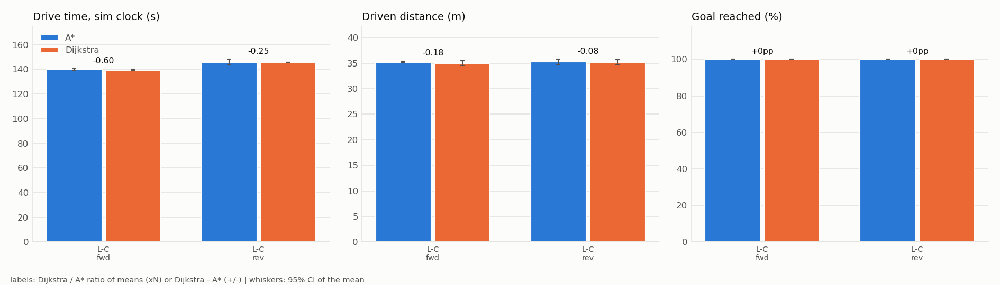

# 연구 1 결과 요약: A* vs Dijkstra

- 모드: **Gazebo 주행 — Nav2 (NavigateToPose, NavFn AStar / Dijkstra + DWB)**, 월드 `warehouse_large`, 기록 10행
- 원자료: experiments/r1/results/20261117-081621_nav2sim_warehouse_large/trials.csv
- 설정 버전: 70e232e5-nb4ca30-mbb536c
- 값: 평균 ± 95% 신뢰구간 반폭. 차이 = Dijkstra − A* (같은 시나리오·방향·반복끼리 짝지음)

## 1. 시나리오별 결과

| 시나리오 | 알고리즘 | n | 계획 성공 | 도착 성공 | 주행 시간 (s) | 주행 시간, sim (s) | 실제 주행 거리 (m) | 계획 경로 길이 (m) | 계획 횟수 | 복구 횟수 | 도착 오차 (m) | 최소 장애물 거리 (m) |
|---|---|---|---|---|---|---|---|---|---|---|---|---|
| L-C fwd 창고 끝에서 끝 | A* | 3 | 3/3 | 3/3 | 154.5 ± 4.2 | 140.0 ± 0.5 | 35.21 ± 0.18 | 35.764 ± 0.188 | 137.7 ± 1.4 | 0.00 ± 0.00 | 0.106 ± 0.189 | - |
| L-C fwd 창고 끝에서 끝 | Dijkstra | 2 | 2/2 | 2/2 | 155.9 ± 1.6 | 139.4 ± 0.6 | 34.99 ± 0.45 | 35.328 ± 0.590 | 135.5 ± 6.4 | 0.00 ± 0.00 | 0.165 ± 0.155 | - |
| L-C rev 창고 끝에서 끝 | A* | 3 | 3/3 | 3/3 | 159.6 ± 3.4 | 145.8 ± 2.4 | 35.24 ± 0.51 | 35.509 ± 0.007 | 143.0 ± 2.5 | 0.00 ± 0.00 | 0.170 ± 0.071 | - |
| L-C rev 창고 끝에서 끝 | Dijkstra | 2 | 2/2 | 2/2 | 159.1 ± 5.0 | 145.6 ± 0.0 | 35.16 ± 0.53 | 35.160 ± 0.010 | 141.5 ± 6.4 | 0.00 ± 0.00 | 0.162 ± 0.060 | - |

## 2. 짝 비교 (Dijkstra − A*)

| 시나리오 | 짝 수 | 주행 시간 (s) 차이 [95% CI] | 주행 시간, sim (s) 차이 [95% CI] | 실제 주행 거리 (m) 차이 [95% CI] | 계획 경로 길이 (m) 차이 [95% CI] |
|---|---|---|---|---|---|
| L-C fwd 창고 끝에서 끝 | 3 | +0.9 [-17.1, +18.9] | -0.6 [-3.1, +1.9] | -0.18 [-1.17, +0.81] | -0.458 [-1.882, +0.967] |
| L-C rev 창고 끝에서 끝 | 3 | -0.1 [-19.0, +18.8] | -0.3 [-12.3, +11.8] | -0.08 [-3.21, +3.05] | -0.349 [-0.370, -0.328] |

- 계획 경로 길이 차이 |D − A|: 평균 0.403 m, 최대 0.570 m, 1 cm 넘는 짝 4/4

## 그림

