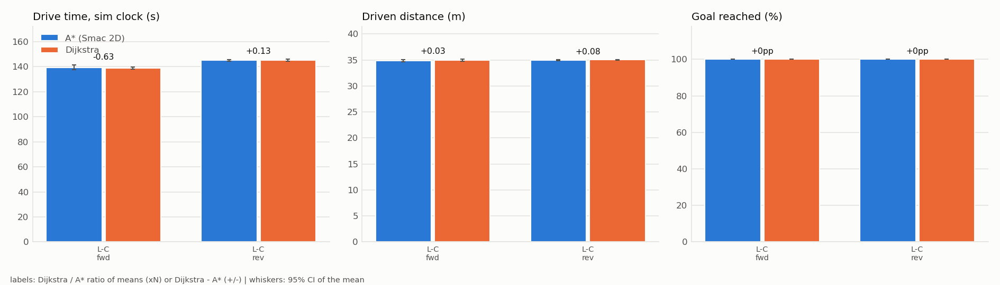

# 연구 1 결과 요약: A* vs Dijkstra

- 모드: **Gazebo 주행 — Nav2 (NavigateToPose, NavFn AStar / Dijkstra + DWB)**, 월드 `warehouse_large`, 기록 12행
- 원자료: experiments/r1/results/20261118-014155_nav2sim-smac2d_warehouse_large/trials.csv
- 설정 버전: 70e232e5-nb4ca30-mbb536c
- 값: 평균 ± 95% 신뢰구간 반폭. 차이 = Dijkstra − A* (같은 시나리오·방향·반복끼리 짝지음)

## 1. 시나리오별 결과

| 시나리오 | 알고리즘 | n | 계획 성공 | 도착 성공 | 주행 시간 (s) | 주행 시간, sim (s) | 실제 주행 거리 (m) | 계획 경로 길이 (m) | 계획 횟수 | 복구 횟수 | 도착 오차 (m) |
|---|---|---|---|---|---|---|---|---|---|---|---|
| L-C fwd 창고 끝에서 끝 | A* (Smac 2D) | 3 | 3/3 | 3/3 | 152.1 ± 4.0 | 139.5 ± 1.9 | 34.89 ± 0.21 | 35.435 ± 0.321 | 136.3 ± 1.4 | 0.33 ± 1.43 | 0.127 ± 0.122 |
| L-C fwd 창고 끝에서 끝 | Dijkstra | 3 | 3/3 | 3/3 | 151.3 ± 4.2 | 138.8 ± 0.7 | 34.93 ± 0.20 | 35.347 ± 0.140 | 135.7 ± 2.9 | 0.33 ± 1.43 | 0.213 ± 0.109 |
| L-C rev 창고 끝에서 끝 | A* (Smac 2D) | 3 | 3/3 | 3/3 | 159.9 ± 8.2 | 145.0 ± 0.7 | 34.93 ± 0.13 | 35.146 ± 0.103 | 141.3 ± 1.4 | 0.00 ± 0.00 | 0.214 ± 0.018 |
| L-C rev 창고 끝에서 끝 | Dijkstra | 3 | 3/3 | 3/3 | 160.5 ± 10.1 | 145.1 ± 0.8 | 35.02 ± 0.06 | 35.202 ± 0.090 | 142.0 ± 2.5 | 0.00 ± 0.00 | 0.183 ± 0.073 |

## 2. 짝 비교 (Dijkstra − A*)

| 시나리오 | 짝 수 | 주행 시간 (s) 차이 [95% CI] | 주행 시간, sim (s) 차이 [95% CI] | 실제 주행 거리 (m) 차이 [95% CI] | 계획 경로 길이 (m) 차이 [95% CI] |
|---|---|---|---|---|---|
| L-C fwd 창고 끝에서 끝 | 3 | -0.9 [-8.1, +6.4] | -0.6 [-2.5, +1.3] | +0.03 [-0.36, +0.43] | -0.088 [-0.443, +0.267] |
| L-C rev 창고 끝에서 끝 | 3 | +0.6 [-1.3, +2.5] | +0.1 [-0.7, +0.9] | +0.08 [-0.03, +0.19] | +0.055 [-0.005, +0.116] |

- 계획 경로 길이 차이 |D − A|: 평균 0.092 m, 최대 0.223 m, 1 cm 넘는 짝 6/6

## 그림

