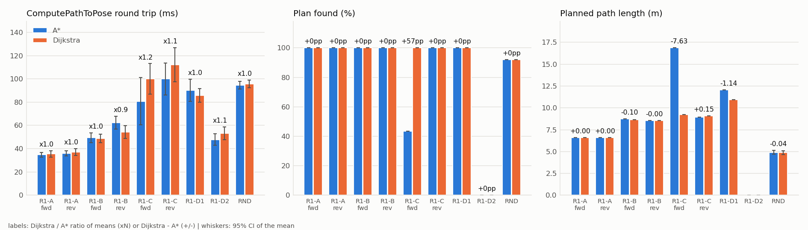

# 연구 1 결과 요약: A* vs Dijkstra

- 모드: **계획만 — Nav2 NavFn (ComputePathToPose, planner_id AStar / Dijkstra)**, 월드 `lecture_hall_real`, 기록 1680행
- 원자료: experiments/r1/results/20261118-021545_nav2plan_lecture_hall_real/trials.csv
- 설정 버전: 2aa5aa21-n5420e8-m5249d1
- 값: 평균 ± 95% 신뢰구간 반폭. 차이 = Dijkstra − A* (같은 시나리오·방향·반복끼리 짝지음)

## 1. 시나리오별 결과

| 시나리오 | 알고리즘 | n | 계획 성공 | 요청~응답 (ms) | 계획 경로 길이 (m) | 경로 점 수 | 최소 장애물 거리 (m) | 평균 장애물 거리 (m) | 꺾인 각도 합 (도) |
|---|---|---|---|---|---|---|---|---|---|
| R1-A fwd 개방 경로 | A* | 30 | 30/30 | 34.79 ± 1.97 | 6.600 ± 0.000 | 262 ± 0 | 0.850 ± 0.000 | 0.997 ± 0.000 | 0 ± 0 |
| R1-A fwd 개방 경로 | Dijkstra | 30 | 30/30 | 35.50 ± 2.62 | 6.600 ± 0.000 | 262 ± 0 | 0.850 ± 0.000 | 0.997 ± 0.000 | 0 ± 0 |
| R1-A rev 개방 경로 | A* | 30 | 30/30 | 36.04 ± 2.21 | 6.600 ± 0.000 | 263 ± 0 | 0.850 ± 0.000 | 0.997 ± 0.000 | 0 ± 0 |
| R1-A rev 개방 경로 | Dijkstra | 30 | 30/30 | 37.27 ± 2.93 | 6.600 ± 0.000 | 263 ± 0 | 0.850 ± 0.000 | 0.997 ± 0.000 | 0 ± 0 |
| R1-B fwd 장애물 우회 | A* | 30 | 30/30 | 49.46 ± 4.13 | 8.757 ± 0.000 | 346 ± 0 | 0.400 ± 0.000 | 0.549 ± 0.000 | 555 ± 0 |
| R1-B fwd 장애물 우회 | Dijkstra | 30 | 30/30 | 48.81 ± 3.78 | 8.656 ± 0.000 | 346 ± 0 | 0.400 ± 0.000 | 0.549 ± 0.000 | 540 ± 0 |
| R1-B rev 장애물 우회 | A* | 30 | 30/30 | 62.30 ± 5.48 | 8.532 ± 0.000 | 341 ± 0 | 0.400 ± 0.000 | 0.548 ± 0.000 | 487 ± 0 |
| R1-B rev 장애물 우회 | Dijkstra | 30 | 30/30 | 54.45 ± 5.54 | 8.529 ± 0.000 | 341 ± 0 | 0.400 ± 0.000 | 0.548 ± 0.000 | 527 ± 0 |
| R1-C fwd 좁은 통로·갈림길 | A* | 30 | 13/30 | 80.78 ± 20.31 | 16.874 ± 0.000 | 292 ± 127 | 0.381 ± 0.000 | 0.563 ± 0.000 | 964 ± 0 |
| R1-C fwd 좁은 통로·갈림길 | Dijkstra | 30 | 30/30 | 99.98 ± 13.13 | 9.241 ± 0.000 | 368 ± 0 | 0.350 ± 0.000 | 0.478 ± 0.000 | 562 ± 18 |
| R1-C rev 좁은 통로·갈림길 | A* | 30 | 30/30 | 99.91 ± 13.85 | 8.953 ± 0.000 | 356 ± 0 | 0.381 ± 0.000 | 0.455 ± 0.000 | 331 ± 4 |
| R1-C rev 좁은 통로·갈림길 | Dijkstra | 30 | 30/30 | 112.09 ± 14.60 | 9.104 ± 0.006 | 362 ± 0 | 0.350 ± 0.000 | 0.476 ± 0.000 | 511 ± 10 |
| R1-D1 경로 차단 (재계획) | A* | 30 | 30/30 | 90.17 ± 9.63 | 12.072 ± 0.006 | 482 ± 0 | 0.400 ± 0.000 | 0.550 ± 0.000 | 706 ± 14 |
| R1-D1 경로 차단 (재계획) | Dijkstra | 30 | 30/30 | 85.86 ± 5.93 | 10.935 ± 0.000 | 437 ± 0 | 0.400 ± 0.000 | 0.548 ± 0.000 | 545 ± 7 |
| R1-D2 경로 차단 (경로 없음) | A* | 30 | 0/30 | 47.83 ± 4.93 | - | 0 ± 0 | - | - | - |
| R1-D2 경로 차단 (경로 없음) | Dijkstra | 30 | 0/30 | 53.19 ± 5.51 | - | 0 ± 0 | - | - | - |
| RND 무작위 쌍 | A* | 600 | 552/600 | 94.52 ± 3.22 | 4.914 ± 0.232 | 177 ± 9 | 0.565 ± 0.016 | 0.872 ± 0.019 | 218 ± 21 |
| RND 무작위 쌍 | Dijkstra | 600 | 552/600 | 95.67 ± 3.28 | 4.873 ± 0.229 | 178 ± 9 | 0.566 ± 0.017 | 0.876 ± 0.019 | 189 ± 14 |

## 2. 짝 비교 (Dijkstra − A*)

| 시나리오 | 짝 수 | 요청~응답 (ms) 차이 [95% CI] | 계획 경로 길이 (m) 차이 [95% CI] | 최소 장애물 거리 (m) 차이 [95% CI] | 평균 장애물 거리 (m) 차이 [95% CI] | 꺾인 각도 합 (도) 차이 [95% CI] | 요청~응답 배율 (D/A) |
|---|---|---|---|---|---|---|---|
| R1-A fwd 개방 경로 | 30 | +0.71 [-2.31, +3.73] | +0.000 | +0.000 | +0.000 | +0 | ×1.02 |
| R1-A rev 개방 경로 | 30 | +1.23 [-1.81, +4.28] | +0.000 | +0.000 | +0.000 | +0 | ×1.03 |
| R1-B fwd 장애물 우회 | 30 | -0.65 [-6.26, +4.95] | -0.101 | +0.000 | -0.000 | -16 | ×0.99 |
| R1-B rev 장애물 우회 | 30 | -7.84 [-15.44, -0.25] | -0.003 | +0.000 | +0.000 | +40 | ×0.87 |
| R1-C fwd 좁은 통로·갈림길 | 30 | +19.20 [-2.73, +41.12] | -7.633 [-7.633, -7.633] | -0.031 | -0.086 [-0.086, -0.086] | -432 [-448, -417] | ×1.24 |
| R1-C rev 좁은 통로·갈림길 | 30 | +12.18 [-3.07, +27.44] | +0.151 [+0.145, +0.157] | -0.031 | +0.021 [+0.021, +0.021] | +180 [+165, +194] | ×1.12 |
| R1-D1 경로 차단 (재계획) | 30 | -4.31 [-16.46, +7.85] | -1.137 [-1.143, -1.131] | +0.000 | -0.001 | -161 [-181, -141] | ×0.95 |
| R1-D2 경로 차단 (경로 없음) | 30 | +5.36 [-0.68, +11.40] | - | - | - | - | ×1.11 |
| RND 무작위 쌍 | 600 | +1.15 [-0.66, +2.95] | -0.041 [-0.055, -0.027] | +0.001 [+0.000, +0.001] | +0.005 [+0.002, +0.008] | -29 [-41, -17] | ×1.01 |

- 계획 경로 길이 차이 |D − A|: 평균 0.231 m, 최대 7.634 m, 1 cm 넘는 짝 472/745

## 3. 실패 기록

| 시나리오 | 방향 | 반복 | 알고리즘 | 이유 |
|---|---|---|---|---|
| R1-C | fwd | 5 | A* | 계획 실패 (상태 6) |
| R1-C | fwd | 6 | A* | 계획 실패 (상태 6) |
| R1-C | fwd | 7 | A* | 계획 실패 (상태 6) |
| R1-C | fwd | 8 | A* | 계획 실패 (상태 6) |
| R1-C | fwd | 9 | A* | 계획 실패 (상태 6) |
| R1-C | fwd | 10 | A* | 계획 실패 (상태 6) |
| R1-C | fwd | 15 | A* | 계획 실패 (상태 6) |
| R1-C | fwd | 16 | A* | 계획 실패 (상태 6) |
| R1-C | fwd | 17 | A* | 계획 실패 (상태 6) |
| R1-C | fwd | 18 | A* | 계획 실패 (상태 6) |
| R1-C | fwd | 19 | A* | 계획 실패 (상태 6) |
| R1-C | fwd | 20 | A* | 계획 실패 (상태 6) |
| R1-C | fwd | 25 | A* | 계획 실패 (상태 6) |
| R1-C | fwd | 26 | A* | 계획 실패 (상태 6) |
| R1-C | fwd | 27 | A* | 계획 실패 (상태 6) |
| R1-C | fwd | 28 | A* | 계획 실패 (상태 6) |
| R1-C | fwd | 29 | A* | 계획 실패 (상태 6) |
| R1-D2 | fwd | 0 | A* | 계획 실패 (상태 6) |
| R1-D2 | fwd | 0 | Dijkstra | 계획 실패 (상태 6) |
| R1-D2 | fwd | 1 | Dijkstra | 계획 실패 (상태 6) |
| R1-D2 | fwd | 1 | A* | 계획 실패 (상태 6) |
| R1-D2 | fwd | 2 | A* | 계획 실패 (상태 6) |
| R1-D2 | fwd | 2 | Dijkstra | 계획 실패 (상태 6) |
| R1-D2 | fwd | 3 | Dijkstra | 계획 실패 (상태 6) |
| R1-D2 | fwd | 3 | A* | 계획 실패 (상태 6) |
| R1-D2 | fwd | 4 | A* | 계획 실패 (상태 6) |
| R1-D2 | fwd | 4 | Dijkstra | 계획 실패 (상태 6) |
| R1-D2 | fwd | 5 | Dijkstra | 계획 실패 (상태 6) |
| R1-D2 | fwd | 5 | A* | 계획 실패 (상태 6) |
| R1-D2 | fwd | 6 | A* | 계획 실패 (상태 6) |
| R1-D2 | fwd | 6 | Dijkstra | 계획 실패 (상태 6) |
| R1-D2 | fwd | 7 | Dijkstra | 계획 실패 (상태 6) |
| R1-D2 | fwd | 7 | A* | 계획 실패 (상태 6) |
| R1-D2 | fwd | 8 | A* | 계획 실패 (상태 6) |
| R1-D2 | fwd | 8 | Dijkstra | 계획 실패 (상태 6) |
| R1-D2 | fwd | 9 | Dijkstra | 계획 실패 (상태 6) |
| R1-D2 | fwd | 9 | A* | 계획 실패 (상태 6) |
| R1-D2 | fwd | 10 | A* | 계획 실패 (상태 6) |
| R1-D2 | fwd | 10 | Dijkstra | 계획 실패 (상태 6) |
| R1-D2 | fwd | 11 | Dijkstra | 계획 실패 (상태 6) |
| R1-D2 | fwd | 11 | A* | 계획 실패 (상태 6) |
| R1-D2 | fwd | 12 | A* | 계획 실패 (상태 6) |
| R1-D2 | fwd | 12 | Dijkstra | 계획 실패 (상태 6) |
| R1-D2 | fwd | 13 | Dijkstra | 계획 실패 (상태 6) |
| R1-D2 | fwd | 13 | A* | 계획 실패 (상태 6) |
| R1-D2 | fwd | 14 | A* | 계획 실패 (상태 6) |
| R1-D2 | fwd | 14 | Dijkstra | 계획 실패 (상태 6) |
| R1-D2 | fwd | 15 | Dijkstra | 계획 실패 (상태 6) |
| R1-D2 | fwd | 15 | A* | 계획 실패 (상태 6) |
| R1-D2 | fwd | 16 | A* | 계획 실패 (상태 6) |
| R1-D2 | fwd | 16 | Dijkstra | 계획 실패 (상태 6) |
| R1-D2 | fwd | 17 | Dijkstra | 계획 실패 (상태 6) |
| R1-D2 | fwd | 17 | A* | 계획 실패 (상태 6) |
| R1-D2 | fwd | 18 | A* | 계획 실패 (상태 6) |
| R1-D2 | fwd | 18 | Dijkstra | 계획 실패 (상태 6) |
| R1-D2 | fwd | 19 | Dijkstra | 계획 실패 (상태 6) |
| R1-D2 | fwd | 19 | A* | 계획 실패 (상태 6) |
| R1-D2 | fwd | 20 | A* | 계획 실패 (상태 6) |
| R1-D2 | fwd | 20 | Dijkstra | 계획 실패 (상태 6) |
| R1-D2 | fwd | 21 | Dijkstra | 계획 실패 (상태 6) |

## 그림

