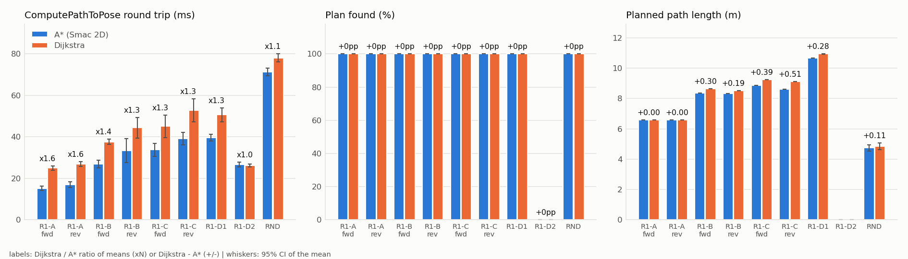

# 연구 1 결과 요약: A* vs Dijkstra

- 모드: **계획만 — Nav2 NavFn (ComputePathToPose, planner_id AStar / Dijkstra)**, 월드 `lecture_hall_real`, 기록 1680행
- 원자료: experiments/r1/results/20261118-022846_nav2plan-smac2d_lecture_hall_real/trials.csv
- 설정 버전: 2aa5aa21-n5420e8-m5249d1
- 값: 평균 ± 95% 신뢰구간 반폭. 차이 = Dijkstra − A* (같은 시나리오·방향·반복끼리 짝지음)

## 1. 시나리오별 결과

| 시나리오 | 알고리즘 | n | 계획 성공 | 요청~응답 (ms) | 계획 경로 길이 (m) | 경로 점 수 | 최소 장애물 거리 (m) | 평균 장애물 거리 (m) | 꺾인 각도 합 (도) |
|---|---|---|---|---|---|---|---|---|---|
| R1-A fwd 개방 경로 | A* (Smac 2D) | 30 | 30/30 | 15.22 ± 1.07 | 6.600 ± 0.000 | 133 ± 0 | 0.800 ± 0.000 | 1.042 ± 0.000 | 0 ± 0 |
| R1-A fwd 개방 경로 | Dijkstra | 30 | 30/30 | 24.97 ± 1.08 | 6.600 ± 0.000 | 262 ± 0 | 0.850 ± 0.000 | 0.997 ± 0.000 | 0 ± 0 |
| R1-A rev 개방 경로 | A* (Smac 2D) | 30 | 30/30 | 17.04 ± 1.36 | 6.600 ± 0.000 | 133 ± 0 | 0.800 ± 0.000 | 1.042 ± 0.000 | 0 ± 0 |
| R1-A rev 개방 경로 | Dijkstra | 30 | 30/30 | 26.86 ± 1.11 | 6.600 ± 0.000 | 263 ± 0 | 0.850 ± 0.000 | 0.997 ± 0.000 | 0 ± 0 |
| R1-B fwd 장애물 우회 | A* (Smac 2D) | 30 | 30/30 | 26.99 ± 1.82 | 8.359 ± 0.000 | 167 ± 0 | 0.400 ± 0.000 | 0.546 ± 0.000 | 264 ± 0 |
| R1-B fwd 장애물 우회 | Dijkstra | 30 | 30/30 | 37.65 ± 1.27 | 8.656 ± 0.000 | 346 ± 0 | 0.400 ± 0.000 | 0.549 ± 0.000 | 540 ± 0 |
| R1-B rev 장애물 우회 | A* (Smac 2D) | 30 | 30/30 | 33.36 ± 5.77 | 8.338 ± 0.000 | 167 ± 0 | 0.400 ± 0.000 | 0.543 ± 0.000 | 252 ± 0 |
| R1-B rev 장애물 우회 | Dijkstra | 30 | 30/30 | 44.40 ± 4.98 | 8.529 ± 0.000 | 341 ± 0 | 0.400 ± 0.000 | 0.548 ± 0.000 | 527 ± 0 |
| R1-C fwd 좁은 통로·갈림길 | A* (Smac 2D) | 30 | 30/30 | 33.76 ± 3.17 | 8.854 ± 0.000 | 177 ± 0 | 0.350 ± 0.000 | 0.478 ± 0.000 | 232 ± 1 |
| R1-C fwd 좁은 통로·갈림길 | Dijkstra | 30 | 30/30 | 45.08 ± 5.35 | 9.240 ± 0.000 | 368 ± 0 | 0.350 ± 0.000 | 0.478 ± 0.000 | 578 ± 18 |
| R1-C rev 좁은 통로·갈림길 | A* (Smac 2D) | 30 | 30/30 | 39.16 ± 2.95 | 8.601 ± 0.000 | 172 ± 0 | 0.350 ± 0.000 | 0.481 ± 0.000 | 221 ± 0 |
| R1-C rev 좁은 통로·갈림길 | Dijkstra | 30 | 30/30 | 52.85 ± 5.58 | 9.112 ± 0.004 | 363 ± 0 | 0.350 ± 0.000 | 0.476 ± 0.000 | 536 ± 11 |
| R1-D1 경로 차단 (재계획) | A* (Smac 2D) | 30 | 30/30 | 39.64 ± 1.70 | 10.661 ± 0.000 | 213 ± 0 | 0.400 ± 0.000 | 0.547 ± 0.000 | 269 ± 0 |
| R1-D1 경로 차단 (재계획) | Dijkstra | 30 | 30/30 | 50.66 ± 3.35 | 10.943 ± 0.004 | 437 ± 0 | 0.400 ± 0.000 | 0.548 ± 0.000 | 548 ± 6 |
| R1-D2 경로 차단 (경로 없음) | A* (Smac 2D) | 30 | 0/30 | 26.66 ± 1.19 | - | 0 ± 0 | - | - | - |
| R1-D2 경로 차단 (경로 없음) | Dijkstra | 30 | 0/30 | 26.28 ± 0.70 | - | 0 ± 0 | - | - | - |
| RND 무작위 쌍 | A* (Smac 2D) | 600 | 600/600 | 71.21 ± 1.84 | 4.750 ± 0.212 | 92 ± 4 | 0.570 ± 0.016 | 0.845 ± 0.018 | 99 ± 5 |
| RND 무작위 쌍 | Dijkstra | 600 | 600/600 | 78.11 ± 1.91 | 4.858 ± 0.219 | 193 ± 9 | 0.564 ± 0.016 | 0.871 ± 0.018 | 195 ± 14 |

## 2. 짝 비교 (Dijkstra − A*)

| 시나리오 | 짝 수 | 요청~응답 (ms) 차이 [95% CI] | 계획 경로 길이 (m) 차이 [95% CI] | 최소 장애물 거리 (m) 차이 [95% CI] | 평균 장애물 거리 (m) 차이 [95% CI] | 꺾인 각도 합 (도) 차이 [95% CI] | 요청~응답 배율 (D/A) |
|---|---|---|---|---|---|---|---|
| R1-A fwd 개방 경로 | 30 | +9.75 [+8.40, +11.10] | +0.000 | +0.050 [+0.050, +0.050] | -0.045 [-0.045, -0.045] | +0 | ×1.64 |
| R1-A rev 개방 경로 | 30 | +9.82 [+8.25, +11.39] | +0.000 | +0.050 [+0.050, +0.050] | -0.045 [-0.045, -0.045] | +0 | ×1.58 |
| R1-B fwd 장애물 우회 | 30 | +10.66 [+8.35, +12.96] | +0.297 [+0.297, +0.297] | +0.000 | +0.003 | +276 [+276, +276] | ×1.39 |
| R1-B rev 장애물 우회 | 30 | +11.04 [+5.36, +16.72] | +0.191 | +0.000 | +0.005 | +275 [+275, +275] | ×1.33 |
| R1-C fwd 좁은 통로·갈림길 | 30 | +11.33 [+4.64, +18.01] | +0.386 [+0.386, +0.387] | +0.000 | +0.000 [-0.000, +0.000] | +345 [+328, +363] | ×1.34 |
| R1-C rev 좁은 통로·갈림길 | 30 | +13.69 [+9.21, +18.16] | +0.511 [+0.508, +0.515] | +0.000 | -0.004 [-0.004, -0.004] | +315 [+305, +326] | ×1.35 |
| R1-D1 경로 차단 (재계획) | 30 | +11.03 [+7.43, +14.63] | +0.282 [+0.278, +0.287] | +0.000 | +0.001 | +280 [+273, +286] | ×1.28 |
| R1-D2 경로 차단 (경로 없음) | 30 | -0.38 [-1.85, +1.09] | - | - | - | - | ×0.99 |
| RND 무작위 쌍 | 600 | +6.90 [+5.88, +7.91] | +0.108 [+0.095, +0.120] | -0.005 [-0.007, -0.004] | +0.026 [+0.021, +0.032] | +96 [+86, +106] | ×1.10 |

- 계획 경로 길이 차이 |D − A|: 평균 0.168 m, 최대 0.521 m, 1 cm 넘는 짝 729/810

## 3. 실패 기록

| 시나리오 | 방향 | 반복 | 알고리즘 | 이유 |
|---|---|---|---|---|
| R1-D2 | fwd | 0 | A* (Smac 2D) | 계획 실패 (상태 6) |
| R1-D2 | fwd | 0 | Dijkstra | 계획 실패 (상태 6) |
| R1-D2 | fwd | 1 | Dijkstra | 계획 실패 (상태 6) |
| R1-D2 | fwd | 1 | A* (Smac 2D) | 계획 실패 (상태 6) |
| R1-D2 | fwd | 2 | A* (Smac 2D) | 계획 실패 (상태 6) |
| R1-D2 | fwd | 2 | Dijkstra | 계획 실패 (상태 6) |
| R1-D2 | fwd | 3 | Dijkstra | 계획 실패 (상태 6) |
| R1-D2 | fwd | 3 | A* (Smac 2D) | 계획 실패 (상태 6) |
| R1-D2 | fwd | 4 | A* (Smac 2D) | 계획 실패 (상태 6) |
| R1-D2 | fwd | 4 | Dijkstra | 계획 실패 (상태 6) |
| R1-D2 | fwd | 5 | Dijkstra | 계획 실패 (상태 6) |
| R1-D2 | fwd | 5 | A* (Smac 2D) | 계획 실패 (상태 6) |
| R1-D2 | fwd | 6 | A* (Smac 2D) | 계획 실패 (상태 6) |
| R1-D2 | fwd | 6 | Dijkstra | 계획 실패 (상태 6) |
| R1-D2 | fwd | 7 | Dijkstra | 계획 실패 (상태 6) |
| R1-D2 | fwd | 7 | A* (Smac 2D) | 계획 실패 (상태 6) |
| R1-D2 | fwd | 8 | A* (Smac 2D) | 계획 실패 (상태 6) |
| R1-D2 | fwd | 8 | Dijkstra | 계획 실패 (상태 6) |
| R1-D2 | fwd | 9 | Dijkstra | 계획 실패 (상태 6) |
| R1-D2 | fwd | 9 | A* (Smac 2D) | 계획 실패 (상태 6) |
| R1-D2 | fwd | 10 | A* (Smac 2D) | 계획 실패 (상태 6) |
| R1-D2 | fwd | 10 | Dijkstra | 계획 실패 (상태 6) |
| R1-D2 | fwd | 11 | Dijkstra | 계획 실패 (상태 6) |
| R1-D2 | fwd | 11 | A* (Smac 2D) | 계획 실패 (상태 6) |
| R1-D2 | fwd | 12 | A* (Smac 2D) | 계획 실패 (상태 6) |
| R1-D2 | fwd | 12 | Dijkstra | 계획 실패 (상태 6) |
| R1-D2 | fwd | 13 | Dijkstra | 계획 실패 (상태 6) |
| R1-D2 | fwd | 13 | A* (Smac 2D) | 계획 실패 (상태 6) |
| R1-D2 | fwd | 14 | A* (Smac 2D) | 계획 실패 (상태 6) |
| R1-D2 | fwd | 14 | Dijkstra | 계획 실패 (상태 6) |
| R1-D2 | fwd | 15 | Dijkstra | 계획 실패 (상태 6) |
| R1-D2 | fwd | 15 | A* (Smac 2D) | 계획 실패 (상태 6) |
| R1-D2 | fwd | 16 | A* (Smac 2D) | 계획 실패 (상태 6) |
| R1-D2 | fwd | 16 | Dijkstra | 계획 실패 (상태 6) |
| R1-D2 | fwd | 17 | Dijkstra | 계획 실패 (상태 6) |
| R1-D2 | fwd | 17 | A* (Smac 2D) | 계획 실패 (상태 6) |
| R1-D2 | fwd | 18 | A* (Smac 2D) | 계획 실패 (상태 6) |
| R1-D2 | fwd | 18 | Dijkstra | 계획 실패 (상태 6) |
| R1-D2 | fwd | 19 | Dijkstra | 계획 실패 (상태 6) |
| R1-D2 | fwd | 19 | A* (Smac 2D) | 계획 실패 (상태 6) |
| R1-D2 | fwd | 20 | A* (Smac 2D) | 계획 실패 (상태 6) |
| R1-D2 | fwd | 20 | Dijkstra | 계획 실패 (상태 6) |
| R1-D2 | fwd | 21 | Dijkstra | 계획 실패 (상태 6) |
| R1-D2 | fwd | 21 | A* (Smac 2D) | 계획 실패 (상태 6) |
| R1-D2 | fwd | 22 | A* (Smac 2D) | 계획 실패 (상태 6) |
| R1-D2 | fwd | 22 | Dijkstra | 계획 실패 (상태 6) |
| R1-D2 | fwd | 23 | Dijkstra | 계획 실패 (상태 6) |
| R1-D2 | fwd | 23 | A* (Smac 2D) | 계획 실패 (상태 6) |
| R1-D2 | fwd | 24 | A* (Smac 2D) | 계획 실패 (상태 6) |
| R1-D2 | fwd | 24 | Dijkstra | 계획 실패 (상태 6) |
| R1-D2 | fwd | 25 | Dijkstra | 계획 실패 (상태 6) |
| R1-D2 | fwd | 25 | A* (Smac 2D) | 계획 실패 (상태 6) |
| R1-D2 | fwd | 26 | A* (Smac 2D) | 계획 실패 (상태 6) |
| R1-D2 | fwd | 26 | Dijkstra | 계획 실패 (상태 6) |
| R1-D2 | fwd | 27 | Dijkstra | 계획 실패 (상태 6) |
| R1-D2 | fwd | 27 | A* (Smac 2D) | 계획 실패 (상태 6) |
| R1-D2 | fwd | 28 | A* (Smac 2D) | 계획 실패 (상태 6) |
| R1-D2 | fwd | 28 | Dijkstra | 계획 실패 (상태 6) |
| R1-D2 | fwd | 29 | Dijkstra | 계획 실패 (상태 6) |
| R1-D2 | fwd | 29 | A* (Smac 2D) | 계획 실패 (상태 6) |

## 그림

