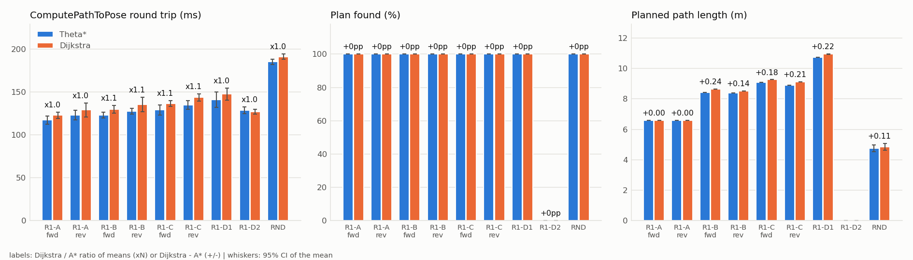

# 연구 1 결과 요약: A* vs Dijkstra

- 모드: **계획만 — Nav2 NavFn (ComputePathToPose, planner_id AStar / Dijkstra)**, 월드 `lecture_hall_real`, 기록 1680행
- 원자료: experiments/r1/results/20261118-023144_nav2plan-thetastar_lecture_hall_real/trials.csv
- 설정 버전: 2aa5aa21-n5420e8-m5249d1
- 값: 평균 ± 95% 신뢰구간 반폭. 차이 = Dijkstra − A* (같은 시나리오·방향·반복끼리 짝지음)

## 1. 시나리오별 결과

| 시나리오 | 알고리즘 | n | 계획 성공 | 요청~응답 (ms) | 계획 경로 길이 (m) | 경로 점 수 | 최소 장애물 거리 (m) | 평균 장애물 거리 (m) | 꺾인 각도 합 (도) |
|---|---|---|---|---|---|---|---|---|---|
| R1-A fwd 개방 경로 | Theta* | 30 | 30/30 | 117.17 ± 4.62 | 6.600 ± 0.000 | 133 ± 0 | 0.800 ± 0.000 | 1.042 ± 0.000 | 0 ± 0 |
| R1-A fwd 개방 경로 | Dijkstra | 30 | 30/30 | 122.84 ± 3.63 | 6.600 ± 0.000 | 262 ± 0 | 0.850 ± 0.000 | 0.997 ± 0.000 | 0 ± 0 |
| R1-A rev 개방 경로 | Theta* | 30 | 30/30 | 123.06 ± 5.64 | 6.600 ± 0.000 | 133 ± 0 | 0.800 ± 0.000 | 1.042 ± 0.000 | 0 ± 0 |
| R1-A rev 개방 경로 | Dijkstra | 30 | 30/30 | 129.02 ± 8.21 | 6.600 ± 0.000 | 263 ± 0 | 0.850 ± 0.000 | 0.997 ± 0.000 | 0 ± 0 |
| R1-B fwd 장애물 우회 | Theta* | 30 | 30/30 | 123.04 ± 3.43 | 8.416 ± 0.002 | 162 ± 0 | 0.350 ± 0.000 | 0.546 ± 0.000 | 378 ± 5 |
| R1-B fwd 장애물 우회 | Dijkstra | 30 | 30/30 | 129.65 ± 4.44 | 8.656 ± 0.000 | 346 ± 0 | 0.400 ± 0.000 | 0.550 ± 0.000 | 573 ± 4 |
| R1-B rev 장애물 우회 | Theta* | 30 | 30/30 | 127.54 ± 3.20 | 8.393 ± 0.000 | 162 ± 0 | 0.350 ± 0.000 | 0.541 ± 0.000 | 254 ± 0 |
| R1-B rev 장애물 우회 | Dijkstra | 30 | 30/30 | 135.10 ± 8.39 | 8.530 ± 0.000 | 341 ± 0 | 0.400 ± 0.000 | 0.548 ± 0.000 | 533 ± 3 |
| R1-C fwd 좁은 통로·갈림길 | Theta* | 30 | 30/30 | 128.97 ± 5.90 | 9.086 ± 0.008 | 175 ± 0 | 0.348 ± 0.003 | 0.476 ± 0.000 | 505 ± 9 |
| R1-C fwd 좁은 통로·갈림길 | Dijkstra | 30 | 30/30 | 136.29 ± 3.40 | 9.264 ± 0.001 | 369 ± 0 | 0.350 ± 0.000 | 0.476 ± 0.000 | 638 ± 24 |
| R1-C rev 좁은 통로·갈림길 | Theta* | 30 | 30/30 | 134.81 ± 5.24 | 8.913 ± 0.000 | 173 ± 0 | 0.335 ± 0.000 | 0.471 ± 0.000 | 346 ± 2 |
| R1-C rev 좁은 통로·갈림길 | Dijkstra | 30 | 30/30 | 143.47 ± 4.42 | 9.122 ± 0.004 | 363 ± 0 | 0.350 ± 0.000 | 0.475 ± 0.000 | 575 ± 4 |
| R1-D1 경로 차단 (재계획) | Theta* | 30 | 30/30 | 140.92 ± 8.87 | 10.724 ± 0.003 | 208 ± 0 | 0.350 ± 0.000 | 0.544 ± 0.000 | 407 ± 10 |
| R1-D1 경로 차단 (재계획) | Dijkstra | 30 | 30/30 | 147.40 ± 6.85 | 10.942 ± 0.004 | 437 ± 0 | 0.400 ± 0.000 | 0.548 ± 0.000 | 552 ± 7 |
| R1-D2 경로 차단 (경로 없음) | Theta* | 30 | 0/30 | 128.79 ± 3.93 | - | 0 ± 0 | - | - | - |
| R1-D2 경로 차단 (경로 없음) | Dijkstra | 30 | 0/30 | 126.95 ± 2.61 | - | 0 ± 0 | - | - | - |
| RND 무작위 쌍 | Theta* | 600 | 600/600 | 185.02 ± 3.15 | 4.751 ± 0.214 | 92 ± 4 | 0.571 ± 0.016 | 0.863 ± 0.018 | 106 ± 8 |
| RND 무작위 쌍 | Dijkstra | 600 | 600/600 | 191.04 ± 2.94 | 4.859 ± 0.219 | 193 ± 9 | 0.564 ± 0.016 | 0.871 ± 0.018 | 196 ± 14 |

## 2. 짝 비교 (Dijkstra − A*)

| 시나리오 | 짝 수 | 요청~응답 (ms) 차이 [95% CI] | 계획 경로 길이 (m) 차이 [95% CI] | 최소 장애물 거리 (m) 차이 [95% CI] | 평균 장애물 거리 (m) 차이 [95% CI] | 꺾인 각도 합 (도) 차이 [95% CI] | 요청~응답 배율 (D/A) |
|---|---|---|---|---|---|---|---|
| R1-A fwd 개방 경로 | 30 | +5.67 [+1.74, +9.60] | +0.000 | +0.050 [+0.050, +0.050] | -0.045 [-0.045, -0.045] | +0 | ×1.05 |
| R1-A rev 개방 경로 | 30 | +5.96 [-2.67, +14.59] | +0.000 | +0.050 [+0.050, +0.050] | -0.045 [-0.045, -0.045] | +0 | ×1.05 |
| R1-B fwd 장애물 우회 | 30 | +6.61 [+1.77, +11.45] | +0.240 [+0.238, +0.242] | +0.050 | +0.004 [+0.004, +0.004] | +194 [+188, +201] | ×1.05 |
| R1-B rev 장애물 우회 | 30 | +7.56 [+0.14, +14.97] | +0.137 | +0.050 | +0.007 [+0.007, +0.007] | +279 [+277, +282] | ×1.06 |
| R1-C fwd 좁은 통로·갈림길 | 30 | +7.32 [+1.01, +13.64] | +0.179 [+0.170, +0.187] | +0.002 [-0.001, +0.005] | +0.000 [-0.000, +0.001] | +133 [+105, +161] | ×1.06 |
| R1-C rev 좁은 통로·갈림길 | 30 | +8.66 [+1.80, +15.52] | +0.209 [+0.205, +0.213] | +0.015 | +0.005 [+0.004, +0.005] | +229 [+223, +235] | ×1.06 |
| R1-D1 경로 차단 (재계획) | 30 | +6.47 [-4.38, +17.33] | +0.217 [+0.211, +0.224] | +0.050 | +0.004 [+0.004, +0.004] | +145 [+130, +159] | ×1.05 |
| R1-D2 경로 차단 (경로 없음) | 30 | -1.84 [-6.92, +3.24] | - | - | - | - | ×0.99 |
| RND 무작위 쌍 | 600 | +6.03 [+3.43, +8.63] | +0.108 [+0.100, +0.116] | -0.006 [-0.008, -0.004] | +0.008 [+0.002, +0.013] | +90 [+82, +97] | ×1.03 |

- 계획 경로 길이 차이 |D − A|: 평균 0.122 m, 최대 0.442 m, 1 cm 넘는 짝 738/810

## 3. 실패 기록

| 시나리오 | 방향 | 반복 | 알고리즘 | 이유 |
|---|---|---|---|---|
| R1-D2 | fwd | 0 | Theta* | 계획 실패 (상태 6) |
| R1-D2 | fwd | 0 | Dijkstra | 계획 실패 (상태 6) |
| R1-D2 | fwd | 1 | Dijkstra | 계획 실패 (상태 6) |
| R1-D2 | fwd | 1 | Theta* | 계획 실패 (상태 6) |
| R1-D2 | fwd | 2 | Theta* | 계획 실패 (상태 6) |
| R1-D2 | fwd | 2 | Dijkstra | 계획 실패 (상태 6) |
| R1-D2 | fwd | 3 | Dijkstra | 계획 실패 (상태 6) |
| R1-D2 | fwd | 3 | Theta* | 계획 실패 (상태 6) |
| R1-D2 | fwd | 4 | Theta* | 계획 실패 (상태 6) |
| R1-D2 | fwd | 4 | Dijkstra | 계획 실패 (상태 6) |
| R1-D2 | fwd | 5 | Dijkstra | 계획 실패 (상태 6) |
| R1-D2 | fwd | 5 | Theta* | 계획 실패 (상태 6) |
| R1-D2 | fwd | 6 | Theta* | 계획 실패 (상태 6) |
| R1-D2 | fwd | 6 | Dijkstra | 계획 실패 (상태 6) |
| R1-D2 | fwd | 7 | Dijkstra | 계획 실패 (상태 6) |
| R1-D2 | fwd | 7 | Theta* | 계획 실패 (상태 6) |
| R1-D2 | fwd | 8 | Theta* | 계획 실패 (상태 6) |
| R1-D2 | fwd | 8 | Dijkstra | 계획 실패 (상태 6) |
| R1-D2 | fwd | 9 | Dijkstra | 계획 실패 (상태 6) |
| R1-D2 | fwd | 9 | Theta* | 계획 실패 (상태 6) |
| R1-D2 | fwd | 10 | Theta* | 계획 실패 (상태 6) |
| R1-D2 | fwd | 10 | Dijkstra | 계획 실패 (상태 6) |
| R1-D2 | fwd | 11 | Dijkstra | 계획 실패 (상태 6) |
| R1-D2 | fwd | 11 | Theta* | 계획 실패 (상태 6) |
| R1-D2 | fwd | 12 | Theta* | 계획 실패 (상태 6) |
| R1-D2 | fwd | 12 | Dijkstra | 계획 실패 (상태 6) |
| R1-D2 | fwd | 13 | Dijkstra | 계획 실패 (상태 6) |
| R1-D2 | fwd | 13 | Theta* | 계획 실패 (상태 6) |
| R1-D2 | fwd | 14 | Theta* | 계획 실패 (상태 6) |
| R1-D2 | fwd | 14 | Dijkstra | 계획 실패 (상태 6) |
| R1-D2 | fwd | 15 | Dijkstra | 계획 실패 (상태 6) |
| R1-D2 | fwd | 15 | Theta* | 계획 실패 (상태 6) |
| R1-D2 | fwd | 16 | Theta* | 계획 실패 (상태 6) |
| R1-D2 | fwd | 16 | Dijkstra | 계획 실패 (상태 6) |
| R1-D2 | fwd | 17 | Dijkstra | 계획 실패 (상태 6) |
| R1-D2 | fwd | 17 | Theta* | 계획 실패 (상태 6) |
| R1-D2 | fwd | 18 | Theta* | 계획 실패 (상태 6) |
| R1-D2 | fwd | 18 | Dijkstra | 계획 실패 (상태 6) |
| R1-D2 | fwd | 19 | Dijkstra | 계획 실패 (상태 6) |
| R1-D2 | fwd | 19 | Theta* | 계획 실패 (상태 6) |
| R1-D2 | fwd | 20 | Theta* | 계획 실패 (상태 6) |
| R1-D2 | fwd | 20 | Dijkstra | 계획 실패 (상태 6) |
| R1-D2 | fwd | 21 | Dijkstra | 계획 실패 (상태 6) |
| R1-D2 | fwd | 21 | Theta* | 계획 실패 (상태 6) |
| R1-D2 | fwd | 22 | Theta* | 계획 실패 (상태 6) |
| R1-D2 | fwd | 22 | Dijkstra | 계획 실패 (상태 6) |
| R1-D2 | fwd | 23 | Dijkstra | 계획 실패 (상태 6) |
| R1-D2 | fwd | 23 | Theta* | 계획 실패 (상태 6) |
| R1-D2 | fwd | 24 | Theta* | 계획 실패 (상태 6) |
| R1-D2 | fwd | 24 | Dijkstra | 계획 실패 (상태 6) |
| R1-D2 | fwd | 25 | Dijkstra | 계획 실패 (상태 6) |
| R1-D2 | fwd | 25 | Theta* | 계획 실패 (상태 6) |
| R1-D2 | fwd | 26 | Theta* | 계획 실패 (상태 6) |
| R1-D2 | fwd | 26 | Dijkstra | 계획 실패 (상태 6) |
| R1-D2 | fwd | 27 | Dijkstra | 계획 실패 (상태 6) |
| R1-D2 | fwd | 27 | Theta* | 계획 실패 (상태 6) |
| R1-D2 | fwd | 28 | Theta* | 계획 실패 (상태 6) |
| R1-D2 | fwd | 28 | Dijkstra | 계획 실패 (상태 6) |
| R1-D2 | fwd | 29 | Dijkstra | 계획 실패 (상태 6) |
| R1-D2 | fwd | 29 | Theta* | 계획 실패 (상태 6) |

## 그림

