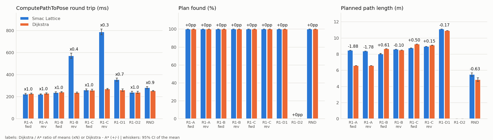

# 연구 1 결과 요약: A* vs Dijkstra

- 모드: **계획만 — Nav2 NavFn (ComputePathToPose, planner_id AStar / Dijkstra)**, 월드 `lecture_hall_real`, 기록 1680행
- 원자료: experiments/r1/results/20261118-023856_nav2plan-smaclattice_lecture_hall_real/trials.csv
- 설정 버전: 2aa5aa21-n5420e8-m5249d1
- 값: 평균 ± 95% 신뢰구간 반폭. 차이 = Dijkstra − A* (같은 시나리오·방향·반복끼리 짝지음)

## 1. 시나리오별 결과

| 시나리오 | 알고리즘 | n | 계획 성공 | 요청~응답 (ms) | 계획 경로 길이 (m) | 경로 점 수 | 최소 장애물 거리 (m) | 평균 장애물 거리 (m) | 꺾인 각도 합 (도) |
|---|---|---|---|---|---|---|---|---|---|
| R1-A fwd 개방 경로 | Smac Lattice | 30 | 30/30 | 225.00 ± 6.98 | 8.481 ± 0.000 | 152 ± 0 | 0.350 ± 0.000 | 1.126 ± 0.000 | 264 ± 0 |
| R1-A fwd 개방 경로 | Dijkstra | 30 | 30/30 | 228.19 ± 4.27 | 6.600 ± 0.000 | 262 ± 0 | 0.850 ± 0.000 | 0.997 ± 0.000 | 0 ± 0 |
| R1-A rev 개방 경로 | Smac Lattice | 30 | 30/30 | 222.65 ± 4.12 | 8.383 ± 0.000 | 153 ± 0 | 0.300 ± 0.000 | 1.012 ± 0.000 | 225 ± 0 |
| R1-A rev 개방 경로 | Dijkstra | 30 | 30/30 | 229.85 ± 5.71 | 6.600 ± 0.000 | 263 ± 0 | 0.850 ± 0.000 | 0.997 ± 0.000 | 0 ± 0 |
| R1-B fwd 장애물 우회 | Smac Lattice | 30 | 30/30 | 238.37 ± 7.11 | 8.052 ± 0.054 | 163 ± 2 | 0.269 ± 0.000 | 0.512 ± 0.005 | 204 ± 7 |
| R1-B fwd 장애물 우회 | Dijkstra | 30 | 30/30 | 242.22 ± 5.33 | 8.663 ± 0.000 | 346 ± 0 | 0.400 ± 0.000 | 0.549 ± 0.000 | 570 ± 2 |
| R1-B rev 장애물 우회 | Smac Lattice | 30 | 30/30 | 571.82 ± 23.95 | 8.626 ± 0.000 | 186 ± 0 | 0.335 ± 0.000 | 0.555 ± 0.000 | 242 ± 0 |
| R1-B rev 장애물 우회 | Dijkstra | 30 | 30/30 | 237.08 ± 6.30 | 8.530 ± 0.000 | 341 ± 0 | 0.400 ± 0.000 | 0.548 ± 0.000 | 526 ± 1 |
| R1-C fwd 좁은 통로·갈림길 | Smac Lattice | 30 | 30/30 | 261.96 ± 10.12 | 8.762 ± 0.024 | 160 ± 1 | 0.338 ± 0.007 | 0.433 ± 0.004 | 100 ± 8 |
| R1-C fwd 좁은 통로·갈림길 | Dijkstra | 30 | 30/30 | 259.89 ± 8.71 | 9.263 ± 0.002 | 369 ± 0 | 0.350 ± 0.000 | 0.476 ± 0.000 | 630 ± 24 |
| R1-C rev 좁은 통로·갈림길 | Smac Lattice | 30 | 30/30 | 787.44 ± 25.00 | 8.962 ± 0.010 | 215 ± 0 | 0.228 ± 0.009 | 0.449 ± 0.000 | 320 ± 2 |
| R1-C rev 좁은 통로·갈림길 | Dijkstra | 30 | 30/30 | 270.18 ± 6.44 | 9.115 ± 0.003 | 362 ± 0 | 0.350 ± 0.000 | 0.475 ± 0.000 | 560 ± 3 |
| R1-D1 경로 차단 (재계획) | Smac Lattice | 30 | 30/30 | 355.03 ± 13.33 | 11.107 ± 0.000 | 237 ± 0 | 0.269 ± 0.000 | 0.571 ± 0.000 | 318 ± 0 |
| R1-D1 경로 차단 (재계획) | Dijkstra | 30 | 30/30 | 260.48 ± 11.41 | 10.935 ± 0.000 | 437 ± 0 | 0.400 ± 0.000 | 0.549 ± 0.000 | 578 ± 0 |
| R1-D2 경로 차단 (경로 없음) | Smac Lattice | 30 | 0/30 | 241.15 ± 9.02 | - | 0 ± 0 | - | - | - |
| R1-D2 경로 차단 (경로 없음) | Dijkstra | 30 | 0/30 | 240.28 ± 10.24 | - | 0 ± 0 | - | - | - |
| RND 무작위 쌍 | Smac Lattice | 600 | 600/600 | 282.73 ± 8.35 | 5.485 ± 0.209 | 107 ± 4 | 0.496 ± 0.015 | 0.850 ± 0.018 | 187 ± 8 |
| RND 무작위 쌍 | Dijkstra | 600 | 600/600 | 253.98 ± 4.01 | 4.857 ± 0.219 | 193 ± 9 | 0.564 ± 0.016 | 0.871 ± 0.018 | 194 ± 14 |

## 2. 짝 비교 (Dijkstra − A*)

| 시나리오 | 짝 수 | 요청~응답 (ms) 차이 [95% CI] | 계획 경로 길이 (m) 차이 [95% CI] | 최소 장애물 거리 (m) 차이 [95% CI] | 평균 장애물 거리 (m) 차이 [95% CI] | 꺾인 각도 합 (도) 차이 [95% CI] | 요청~응답 배율 (D/A) |
|---|---|---|---|---|---|---|---|
| R1-A fwd 개방 경로 | 30 | +3.19 [-4.79, +11.16] | -1.881 | +0.500 | -0.129 [-0.129, -0.129] | -264 [-264, -264] | ×1.01 |
| R1-A rev 개방 경로 | 30 | +7.20 [-0.50, +14.89] | -1.783 [-1.783, -1.783] | +0.550 [+0.550, +0.550] | -0.016 | -225 [-225, -225] | ×1.03 |
| R1-B fwd 장애물 우회 | 30 | +3.85 [-5.61, +13.31] | +0.611 [+0.558, +0.665] | +0.131 | +0.037 [+0.032, +0.041] | +366 [+359, +374] | ×1.02 |
| R1-B rev 장애물 우회 | 30 | -334.73 [-358.89, -310.58] | -0.096 [-0.096, -0.096] | +0.065 [+0.065, +0.065] | -0.007 [-0.007, -0.007] | +284 [+283, +284] | ×0.41 |
| R1-C fwd 좁은 통로·갈림길 | 30 | -2.07 [-16.50, +12.36] | +0.501 [+0.477, +0.525] | +0.012 [+0.005, +0.019] | +0.043 [+0.040, +0.047] | +530 [+505, +555] | ×0.99 |
| R1-C rev 좁은 통로·갈림길 | 30 | -517.26 [-543.18, -491.34] | +0.153 [+0.142, +0.164] | +0.122 [+0.112, +0.131] | +0.026 [+0.025, +0.026] | +240 [+237, +243] | ×0.34 |
| R1-D1 경로 차단 (재계획) | 30 | -94.55 [-115.44, -73.65] | -0.173 | +0.131 | -0.022 | +260 [+260, +260] | ×0.73 |
| R1-D2 경로 차단 (경로 없음) | 30 | -0.87 [-17.94, +16.21] | - | - | - | - | ×1.00 |
| RND 무작위 쌍 | 600 | -28.75 [-36.36, -21.14] | -0.628 [-0.702, -0.554] | +0.068 [+0.059, +0.078] | +0.022 [+0.009, +0.034] | +7 [-8, +23] | ×0.90 |

- 계획 경로 길이 차이 |D − A|: 평균 0.750 m, 최대 4.102 m, 1 cm 넘는 짝 782/810

## 3. 실패 기록

| 시나리오 | 방향 | 반복 | 알고리즘 | 이유 |
|---|---|---|---|---|
| R1-D2 | fwd | 0 | Smac Lattice | 계획 실패 (상태 6) |
| R1-D2 | fwd | 0 | Dijkstra | 계획 실패 (상태 6) |
| R1-D2 | fwd | 1 | Dijkstra | 계획 실패 (상태 6) |
| R1-D2 | fwd | 1 | Smac Lattice | 계획 실패 (상태 6) |
| R1-D2 | fwd | 2 | Smac Lattice | 계획 실패 (상태 6) |
| R1-D2 | fwd | 2 | Dijkstra | 계획 실패 (상태 6) |
| R1-D2 | fwd | 3 | Dijkstra | 계획 실패 (상태 6) |
| R1-D2 | fwd | 3 | Smac Lattice | 계획 실패 (상태 6) |
| R1-D2 | fwd | 4 | Smac Lattice | 계획 실패 (상태 6) |
| R1-D2 | fwd | 4 | Dijkstra | 계획 실패 (상태 6) |
| R1-D2 | fwd | 5 | Dijkstra | 계획 실패 (상태 6) |
| R1-D2 | fwd | 5 | Smac Lattice | 계획 실패 (상태 6) |
| R1-D2 | fwd | 6 | Smac Lattice | 계획 실패 (상태 6) |
| R1-D2 | fwd | 6 | Dijkstra | 계획 실패 (상태 6) |
| R1-D2 | fwd | 7 | Dijkstra | 계획 실패 (상태 6) |
| R1-D2 | fwd | 7 | Smac Lattice | 계획 실패 (상태 6) |
| R1-D2 | fwd | 8 | Smac Lattice | 계획 실패 (상태 6) |
| R1-D2 | fwd | 8 | Dijkstra | 계획 실패 (상태 6) |
| R1-D2 | fwd | 9 | Dijkstra | 계획 실패 (상태 6) |
| R1-D2 | fwd | 9 | Smac Lattice | 계획 실패 (상태 6) |
| R1-D2 | fwd | 10 | Smac Lattice | 계획 실패 (상태 6) |
| R1-D2 | fwd | 10 | Dijkstra | 계획 실패 (상태 6) |
| R1-D2 | fwd | 11 | Dijkstra | 계획 실패 (상태 6) |
| R1-D2 | fwd | 11 | Smac Lattice | 계획 실패 (상태 6) |
| R1-D2 | fwd | 12 | Smac Lattice | 계획 실패 (상태 6) |
| R1-D2 | fwd | 12 | Dijkstra | 계획 실패 (상태 6) |
| R1-D2 | fwd | 13 | Dijkstra | 계획 실패 (상태 6) |
| R1-D2 | fwd | 13 | Smac Lattice | 계획 실패 (상태 6) |
| R1-D2 | fwd | 14 | Smac Lattice | 계획 실패 (상태 6) |
| R1-D2 | fwd | 14 | Dijkstra | 계획 실패 (상태 6) |
| R1-D2 | fwd | 15 | Dijkstra | 계획 실패 (상태 6) |
| R1-D2 | fwd | 15 | Smac Lattice | 계획 실패 (상태 6) |
| R1-D2 | fwd | 16 | Smac Lattice | 계획 실패 (상태 6) |
| R1-D2 | fwd | 16 | Dijkstra | 계획 실패 (상태 6) |
| R1-D2 | fwd | 17 | Dijkstra | 계획 실패 (상태 6) |
| R1-D2 | fwd | 17 | Smac Lattice | 계획 실패 (상태 6) |
| R1-D2 | fwd | 18 | Smac Lattice | 계획 실패 (상태 6) |
| R1-D2 | fwd | 18 | Dijkstra | 계획 실패 (상태 6) |
| R1-D2 | fwd | 19 | Dijkstra | 계획 실패 (상태 6) |
| R1-D2 | fwd | 19 | Smac Lattice | 계획 실패 (상태 6) |
| R1-D2 | fwd | 20 | Smac Lattice | 계획 실패 (상태 6) |
| R1-D2 | fwd | 20 | Dijkstra | 계획 실패 (상태 6) |
| R1-D2 | fwd | 21 | Dijkstra | 계획 실패 (상태 6) |
| R1-D2 | fwd | 21 | Smac Lattice | 계획 실패 (상태 6) |
| R1-D2 | fwd | 22 | Smac Lattice | 계획 실패 (상태 6) |
| R1-D2 | fwd | 22 | Dijkstra | 계획 실패 (상태 6) |
| R1-D2 | fwd | 23 | Dijkstra | 계획 실패 (상태 6) |
| R1-D2 | fwd | 23 | Smac Lattice | 계획 실패 (상태 6) |
| R1-D2 | fwd | 24 | Smac Lattice | 계획 실패 (상태 6) |
| R1-D2 | fwd | 24 | Dijkstra | 계획 실패 (상태 6) |
| R1-D2 | fwd | 25 | Dijkstra | 계획 실패 (상태 6) |
| R1-D2 | fwd | 25 | Smac Lattice | 계획 실패 (상태 6) |
| R1-D2 | fwd | 26 | Smac Lattice | 계획 실패 (상태 6) |
| R1-D2 | fwd | 26 | Dijkstra | 계획 실패 (상태 6) |
| R1-D2 | fwd | 27 | Dijkstra | 계획 실패 (상태 6) |
| R1-D2 | fwd | 27 | Smac Lattice | 계획 실패 (상태 6) |
| R1-D2 | fwd | 28 | Smac Lattice | 계획 실패 (상태 6) |
| R1-D2 | fwd | 28 | Dijkstra | 계획 실패 (상태 6) |
| R1-D2 | fwd | 29 | Dijkstra | 계획 실패 (상태 6) |
| R1-D2 | fwd | 29 | Smac Lattice | 계획 실패 (상태 6) |

## 그림

