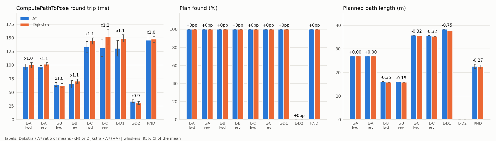

# 연구 1 결과 요약: A* vs Dijkstra

- 모드: **계획만 — Nav2 NavFn (ComputePathToPose, planner_id AStar / Dijkstra)**, 월드 `warehouse_large`, 기록 1680행
- 원자료: experiments/r1/results/20261118-025201_nav2plan_warehouse_large/trials.csv
- 설정 버전: 2aa5aa21+dirty-n5d0c15-mbb536c
- 값: 평균 ± 95% 신뢰구간 반폭. 차이 = Dijkstra − A* (같은 시나리오·방향·반복끼리 짝지음)

## 1. 시나리오별 결과

| 시나리오 | 알고리즘 | n | 계획 성공 | 요청~응답 (ms) | 계획 경로 길이 (m) | 경로 점 수 | 최소 장애물 거리 (m) | 평균 장애물 거리 (m) | 꺾인 각도 합 (도) |
|---|---|---|---|---|---|---|---|---|---|
| L-A fwd 개방 경로 (하역장 26 m) | A* | 30 | 30/30 | 96.67 ± 5.50 | 27.000 ± 0.000 | 1078 ± 0 | 1.450 ± 0.000 | 2.275 ± 0.000 | 0 ± 0 |
| L-A fwd 개방 경로 (하역장 26 m) | Dijkstra | 30 | 30/30 | 100.05 ± 4.97 | 27.000 ± 0.000 | 1079 ± 0 | 1.450 ± 0.000 | 2.274 ± 0.000 | 0 ± 0 |
| L-A rev 개방 경로 (하역장 26 m) | A* | 30 | 30/30 | 96.46 ± 2.78 | 27.000 ± 0.000 | 1079 ± 0 | 1.450 ± 0.000 | 2.274 ± 0.000 | 0 ± 0 |
| L-A rev 개방 경로 (하역장 26 m) | Dijkstra | 30 | 30/30 | 101.39 ± 3.29 | 27.000 ± 0.000 | 1080 ± 0 | 1.450 ± 0.000 | 2.273 ± 0.000 | 0 ± 0 |
| L-B fwd 랙 우회 | A* | 30 | 30/30 | 64.48 ± 3.58 | 16.234 ± 0.000 | 632 ± 0 | 0.522 ± 0.000 | 0.647 ± 0.000 | 885 ± 0 |
| L-B fwd 랙 우회 | Dijkstra | 30 | 30/30 | 62.77 ± 3.34 | 15.888 ± 0.000 | 637 ± 0 | 0.538 ± 0.000 | 0.668 ± 0.000 | 322 ± 0 |
| L-B rev 랙 우회 | A* | 30 | 30/30 | 65.04 ± 7.14 | 16.004 ± 0.000 | 633 ± 0 | 0.510 ± 0.000 | 0.671 ± 0.000 | 502 ± 0 |
| L-B rev 랙 우회 | Dijkstra | 30 | 30/30 | 70.50 ± 3.96 | 15.852 ± 0.000 | 634 ± 0 | 0.538 ± 0.000 | 0.670 ± 0.000 | 218 ± 0 |
| L-C fwd 창고 끝에서 끝 | A* | 30 | 30/30 | 133.41 ± 9.69 | 35.827 ± 0.000 | 1418 ± 0 | 0.531 ± 0.000 | 0.895 ± 0.000 | 823 ± 0 |
| L-C fwd 창고 끝에서 끝 | Dijkstra | 30 | 30/30 | 144.14 ± 5.82 | 35.503 ± 0.000 | 1417 ± 0 | 0.538 ± 0.000 | 0.920 ± 0.000 | 442 ± 0 |
| L-C rev 창고 끝에서 끝 | A* | 30 | 30/30 | 131.45 ± 16.11 | 35.740 ± 0.000 | 1426 ± 0 | 0.538 ± 0.000 | 0.898 ± 0.000 | 635 ± 0 |
| L-C rev 창고 끝에서 끝 | Dijkstra | 30 | 30/30 | 152.13 ± 13.46 | 35.422 ± 0.000 | 1416 ± 0 | 0.538 ± 0.000 | 0.915 ± 0.000 | 360 ± 0 |
| L-D1 경로 차단 (재계획) | A* | 30 | 30/30 | 130.94 ± 14.37 | 38.324 ± 0.000 | 1464 ± 0 | 0.559 ± 0.000 | 1.132 ± 0.000 | 1866 ± 0 |
| L-D1 경로 차단 (재계획) | Dijkstra | 30 | 30/30 | 149.15 ± 6.73 | 37.570 ± 0.000 | 1500 ± 0 | 0.559 ± 0.000 | 1.339 ± 0.000 | 482 ± 0 |
| L-D2 경로 차단 (경로 없음) | A* | 30 | 0/30 | 33.88 ± 2.78 | - | 0 ± 0 | - | - | - |
| L-D2 경로 차단 (경로 없음) | Dijkstra | 30 | 0/30 | 30.52 ± 2.60 | - | 0 ± 0 | - | - | - |
| RND 무작위 쌍 | A* | 600 | 600/600 | 145.77 ± 5.50 | 22.643 ± 0.848 | 895 ± 34 | 0.555 ± 0.021 | 0.996 ± 0.026 | 586 ± 44 |
| RND 무작위 쌍 | Dijkstra | 600 | 600/600 | 147.43 ± 5.46 | 22.377 ± 0.839 | 894 ± 34 | 0.560 ± 0.021 | 1.023 ± 0.025 | 335 ± 16 |

## 2. 짝 비교 (Dijkstra − A*)

| 시나리오 | 짝 수 | 요청~응답 (ms) 차이 [95% CI] | 계획 경로 길이 (m) 차이 [95% CI] | 최소 장애물 거리 (m) 차이 [95% CI] | 평균 장애물 거리 (m) 차이 [95% CI] | 꺾인 각도 합 (도) 차이 [95% CI] | 요청~응답 배율 (D/A) |
|---|---|---|---|---|---|---|---|
| L-A fwd 개방 경로 (하역장 26 m) | 30 | +3.38 [-2.45, +9.22] | +0.000 | +0.000 | -0.001 | +0 | ×1.04 |
| L-A rev 개방 경로 (하역장 26 m) | 30 | +4.92 [+0.58, +9.27] | +0.000 | +0.000 | -0.001 | +0 | ×1.05 |
| L-B fwd 랙 우회 | 30 | -1.71 [-7.45, +4.03] | -0.346 | +0.016 | +0.021 | -563 | ×0.97 |
| L-B rev 랙 우회 | 30 | +5.46 [-1.16, +12.07] | -0.152 | +0.029 | -0.001 | -284 | ×1.08 |
| L-C fwd 창고 끝에서 끝 | 30 | +10.73 [-1.43, +22.90] | -0.324 | +0.007 | +0.025 | -381 | ×1.08 |
| L-C rev 창고 끝에서 끝 | 30 | +20.68 [-3.11, +44.47] | -0.317 | +0.000 | +0.017 | -276 [-276, -276] | ×1.16 |
| L-D1 경로 차단 (재계획) | 30 | +18.21 [-0.17, +36.58] | -0.754 | +0.000 | +0.206 | -1385 [-1385, -1385] | ×1.14 |
| L-D2 경로 차단 (경로 없음) | 30 | -3.37 [-6.86, +0.13] | - | - | - | - | ×0.90 |
| RND 무작위 쌍 | 600 | +1.66 [-3.07, +6.39] | -0.266 [-0.303, -0.230] | +0.005 [+0.003, +0.007] | +0.027 [+0.020, +0.035] | -252 [-290, -213] | ×1.01 |

- 계획 경로 길이 차이 |D − A|: 평균 0.279 m, 최대 4.621 m, 1 cm 넘는 짝 699/810

## 3. 실패 기록

| 시나리오 | 방향 | 반복 | 알고리즘 | 이유 |
|---|---|---|---|---|
| L-D2 | fwd | 0 | A* | 계획 실패 (상태 6) |
| L-D2 | fwd | 0 | Dijkstra | 계획 실패 (상태 6) |
| L-D2 | fwd | 1 | Dijkstra | 계획 실패 (상태 6) |
| L-D2 | fwd | 1 | A* | 계획 실패 (상태 6) |
| L-D2 | fwd | 2 | A* | 계획 실패 (상태 6) |
| L-D2 | fwd | 2 | Dijkstra | 계획 실패 (상태 6) |
| L-D2 | fwd | 3 | Dijkstra | 계획 실패 (상태 6) |
| L-D2 | fwd | 3 | A* | 계획 실패 (상태 6) |
| L-D2 | fwd | 4 | A* | 계획 실패 (상태 6) |
| L-D2 | fwd | 4 | Dijkstra | 계획 실패 (상태 6) |
| L-D2 | fwd | 5 | Dijkstra | 계획 실패 (상태 6) |
| L-D2 | fwd | 5 | A* | 계획 실패 (상태 6) |
| L-D2 | fwd | 6 | A* | 계획 실패 (상태 6) |
| L-D2 | fwd | 6 | Dijkstra | 계획 실패 (상태 6) |
| L-D2 | fwd | 7 | Dijkstra | 계획 실패 (상태 6) |
| L-D2 | fwd | 7 | A* | 계획 실패 (상태 6) |
| L-D2 | fwd | 8 | A* | 계획 실패 (상태 6) |
| L-D2 | fwd | 8 | Dijkstra | 계획 실패 (상태 6) |
| L-D2 | fwd | 9 | Dijkstra | 계획 실패 (상태 6) |
| L-D2 | fwd | 9 | A* | 계획 실패 (상태 6) |
| L-D2 | fwd | 10 | A* | 계획 실패 (상태 6) |
| L-D2 | fwd | 10 | Dijkstra | 계획 실패 (상태 6) |
| L-D2 | fwd | 11 | Dijkstra | 계획 실패 (상태 6) |
| L-D2 | fwd | 11 | A* | 계획 실패 (상태 6) |
| L-D2 | fwd | 12 | A* | 계획 실패 (상태 6) |
| L-D2 | fwd | 12 | Dijkstra | 계획 실패 (상태 6) |
| L-D2 | fwd | 13 | Dijkstra | 계획 실패 (상태 6) |
| L-D2 | fwd | 13 | A* | 계획 실패 (상태 6) |
| L-D2 | fwd | 14 | A* | 계획 실패 (상태 6) |
| L-D2 | fwd | 14 | Dijkstra | 계획 실패 (상태 6) |
| L-D2 | fwd | 15 | Dijkstra | 계획 실패 (상태 6) |
| L-D2 | fwd | 15 | A* | 계획 실패 (상태 6) |
| L-D2 | fwd | 16 | A* | 계획 실패 (상태 6) |
| L-D2 | fwd | 16 | Dijkstra | 계획 실패 (상태 6) |
| L-D2 | fwd | 17 | Dijkstra | 계획 실패 (상태 6) |
| L-D2 | fwd | 17 | A* | 계획 실패 (상태 6) |
| L-D2 | fwd | 18 | A* | 계획 실패 (상태 6) |
| L-D2 | fwd | 18 | Dijkstra | 계획 실패 (상태 6) |
| L-D2 | fwd | 19 | Dijkstra | 계획 실패 (상태 6) |
| L-D2 | fwd | 19 | A* | 계획 실패 (상태 6) |
| L-D2 | fwd | 20 | A* | 계획 실패 (상태 6) |
| L-D2 | fwd | 20 | Dijkstra | 계획 실패 (상태 6) |
| L-D2 | fwd | 21 | Dijkstra | 계획 실패 (상태 6) |
| L-D2 | fwd | 21 | A* | 계획 실패 (상태 6) |
| L-D2 | fwd | 22 | A* | 계획 실패 (상태 6) |
| L-D2 | fwd | 22 | Dijkstra | 계획 실패 (상태 6) |
| L-D2 | fwd | 23 | Dijkstra | 계획 실패 (상태 6) |
| L-D2 | fwd | 23 | A* | 계획 실패 (상태 6) |
| L-D2 | fwd | 24 | A* | 계획 실패 (상태 6) |
| L-D2 | fwd | 24 | Dijkstra | 계획 실패 (상태 6) |
| L-D2 | fwd | 25 | Dijkstra | 계획 실패 (상태 6) |
| L-D2 | fwd | 25 | A* | 계획 실패 (상태 6) |
| L-D2 | fwd | 26 | A* | 계획 실패 (상태 6) |
| L-D2 | fwd | 26 | Dijkstra | 계획 실패 (상태 6) |
| L-D2 | fwd | 27 | Dijkstra | 계획 실패 (상태 6) |
| L-D2 | fwd | 27 | A* | 계획 실패 (상태 6) |
| L-D2 | fwd | 28 | A* | 계획 실패 (상태 6) |
| L-D2 | fwd | 28 | Dijkstra | 계획 실패 (상태 6) |
| L-D2 | fwd | 29 | Dijkstra | 계획 실패 (상태 6) |
| L-D2 | fwd | 29 | A* | 계획 실패 (상태 6) |

## 그림

