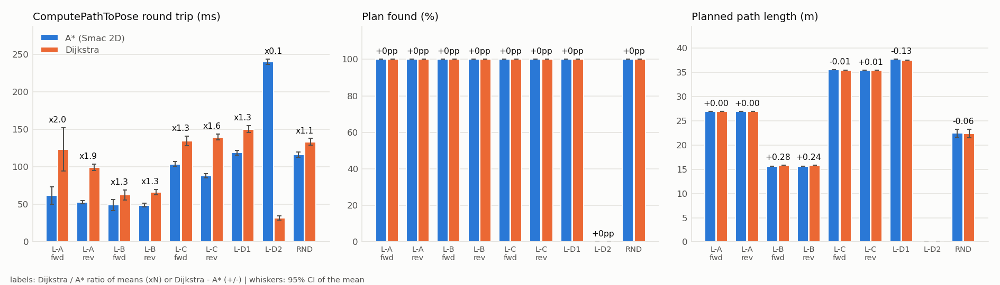

# 연구 1 결과 요약: A* vs Dijkstra

- 모드: **계획만 — Nav2 NavFn (ComputePathToPose, planner_id AStar / Dijkstra)**, 월드 `warehouse_large`, 기록 1680행
- 원자료: experiments/r1/results/20261118-025759_nav2plan-smac2d_warehouse_large/trials.csv
- 설정 버전: 2aa5aa21+dirty-n5d0c15-mbb536c
- 값: 평균 ± 95% 신뢰구간 반폭. 차이 = Dijkstra − A* (같은 시나리오·방향·반복끼리 짝지음)

## 1. 시나리오별 결과

| 시나리오 | 알고리즘 | n | 계획 성공 | 요청~응답 (ms) | 계획 경로 길이 (m) | 경로 점 수 | 최소 장애물 거리 (m) | 평균 장애물 거리 (m) | 꺾인 각도 합 (도) |
|---|---|---|---|---|---|---|---|---|---|
| L-A fwd 개방 경로 (하역장 26 m) | A* (Smac 2D) | 30 | 30/30 | 61.89 ± 11.82 | 27.000 ± 0.000 | 541 ± 0 | 1.400 ± 0.000 | 2.276 ± 0.000 | 0 ± 0 |
| L-A fwd 개방 경로 (하역장 26 m) | Dijkstra | 30 | 30/30 | 123.30 ± 28.92 | 27.000 ± 0.000 | 1079 ± 0 | 1.450 ± 0.000 | 2.274 ± 0.000 | 0 ± 0 |
| L-A rev 개방 경로 (하역장 26 m) | A* (Smac 2D) | 30 | 30/30 | 53.26 ± 2.16 | 27.000 ± 0.000 | 541 ± 0 | 1.400 ± 0.000 | 2.276 ± 0.000 | 0 ± 0 |
| L-A rev 개방 경로 (하역장 26 m) | Dijkstra | 30 | 30/30 | 99.29 ± 4.01 | 27.000 ± 0.000 | 1080 ± 0 | 1.450 ± 0.000 | 2.273 ± 0.000 | 0 ± 0 |
| L-B fwd 랙 우회 | A* (Smac 2D) | 30 | 30/30 | 49.35 ± 7.45 | 15.612 ± 0.000 | 310 ± 0 | 0.495 ± 0.000 | 0.621 ± 0.000 | 228 ± 0 |
| L-B fwd 랙 우회 | Dijkstra | 30 | 30/30 | 62.72 ± 6.76 | 15.888 ± 0.000 | 637 ± 0 | 0.538 ± 0.000 | 0.668 ± 0.000 | 322 ± 0 |
| L-B rev 랙 우회 | A* (Smac 2D) | 30 | 30/30 | 49.01 ± 2.23 | 15.613 ± 0.000 | 310 ± 0 | 0.495 ± 0.000 | 0.620 ± 0.000 | 221 ± 0 |
| L-B rev 랙 우회 | Dijkstra | 30 | 30/30 | 66.04 ± 3.56 | 15.852 ± 0.000 | 634 ± 0 | 0.538 ± 0.000 | 0.670 ± 0.000 | 218 ± 0 |
| L-C fwd 창고 끝에서 끝 | A* (Smac 2D) | 30 | 30/30 | 103.78 ± 3.02 | 35.516 ± 0.000 | 651 ± 0 | 0.495 ± 0.000 | 0.827 ± 0.000 | 338 ± 0 |
| L-C fwd 창고 끝에서 끝 | Dijkstra | 30 | 30/30 | 134.50 ± 6.33 | 35.503 ± 0.000 | 1417 ± 0 | 0.538 ± 0.000 | 0.920 ± 0.000 | 442 ± 0 |
| L-C rev 창고 끝에서 끝 | A* (Smac 2D) | 30 | 30/30 | 88.00 ± 2.76 | 35.411 ± 0.000 | 651 ± 0 | 0.495 ± 0.000 | 0.828 ± 0.000 | 423 ± 0 |
| L-C rev 창고 끝에서 끝 | Dijkstra | 30 | 30/30 | 139.75 ± 4.17 | 35.422 ± 0.000 | 1416 ± 0 | 0.538 ± 0.000 | 0.915 ± 0.000 | 360 ± 0 |
| L-D1 경로 차단 (재계획) | A* (Smac 2D) | 30 | 30/30 | 118.80 ± 3.19 | 37.704 ± 0.000 | 707 ± 0 | 0.522 ± 0.000 | 1.000 ± 0.000 | 328 ± 0 |
| L-D1 경로 차단 (재계획) | Dijkstra | 30 | 30/30 | 150.25 ± 4.77 | 37.570 ± 0.000 | 1500 ± 0 | 0.559 ± 0.000 | 1.339 ± 0.000 | 482 ± 0 |
| L-D2 경로 차단 (경로 없음) | A* (Smac 2D) | 30 | 0/30 | 239.73 ± 3.46 | - | 0 ± 0 | - | - | - |
| L-D2 경로 차단 (경로 없음) | Dijkstra | 30 | 0/30 | 31.89 ± 3.14 | - | 0 ± 0 | - | - | - |
| RND 무작위 쌍 | A* (Smac 2D) | 600 | 600/600 | 116.25 ± 3.80 | 22.434 ± 0.850 | 422 ± 16 | 0.553 ± 0.021 | 0.929 ± 0.029 | 254 ± 12 |
| RND 무작위 쌍 | Dijkstra | 600 | 600/600 | 133.41 ± 4.27 | 22.377 ± 0.839 | 894 ± 34 | 0.560 ± 0.021 | 1.023 ± 0.025 | 335 ± 16 |

## 2. 짝 비교 (Dijkstra − A*)

| 시나리오 | 짝 수 | 요청~응답 (ms) 차이 [95% CI] | 계획 경로 길이 (m) 차이 [95% CI] | 최소 장애물 거리 (m) 차이 [95% CI] | 평균 장애물 거리 (m) 차이 [95% CI] | 꺾인 각도 합 (도) 차이 [95% CI] | 요청~응답 배율 (D/A) |
|---|---|---|---|---|---|---|---|
| L-A fwd 개방 경로 (하역장 26 m) | 30 | +61.41 [+39.89, +82.93] | +0.000 | +0.050 | -0.002 | +0 | ×1.99 |
| L-A rev 개방 경로 (하역장 26 m) | 30 | +46.03 [+42.00, +50.05] | +0.000 | +0.050 | -0.003 | +0 | ×1.86 |
| L-B fwd 랙 우회 | 30 | +13.37 [+9.28, +17.46] | +0.276 | +0.043 [+0.043, +0.043] | +0.047 | +94 [+94, +94] | ×1.27 |
| L-B rev 랙 우회 | 30 | +17.03 [+12.79, +21.28] | +0.239 | +0.043 [+0.043, +0.043] | +0.050 | -3 | ×1.35 |
| L-C fwd 창고 끝에서 끝 | 30 | +30.71 [+23.62, +37.81] | -0.014 | +0.043 [+0.043, +0.043] | +0.093 [+0.093, +0.093] | +104 [+104, +104] | ×1.30 |
| L-C rev 창고 끝에서 끝 | 30 | +51.75 [+47.02, +56.49] | +0.012 | +0.043 [+0.043, +0.043] | +0.086 [+0.086, +0.086] | -64 [-64, -64] | ×1.59 |
| L-D1 경로 차단 (재계획) | 30 | +31.45 [+25.42, +37.48] | -0.134 | +0.037 [+0.037, +0.037] | +0.338 [+0.338, +0.338] | +153 [+153, +153] | ×1.26 |
| L-D2 경로 차단 (경로 없음) | 30 | -207.85 [-212.61, -203.08] | - | - | - | - | ×0.13 |
| RND 무작위 쌍 | 600 | +17.16 [+13.49, +20.83] | -0.057 [-0.087, -0.027] | +0.007 [-0.001, +0.015] | +0.094 [+0.083, +0.106] | +80 [+71, +89] | ×1.15 |

- 계획 경로 길이 차이 |D − A|: 평균 0.213 m, 최대 1.403 m, 1 cm 넘는 짝 729/810

## 3. 실패 기록

| 시나리오 | 방향 | 반복 | 알고리즘 | 이유 |
|---|---|---|---|---|
| L-D2 | fwd | 0 | A* (Smac 2D) | 계획 실패 (상태 6) |
| L-D2 | fwd | 0 | Dijkstra | 계획 실패 (상태 6) |
| L-D2 | fwd | 1 | Dijkstra | 계획 실패 (상태 6) |
| L-D2 | fwd | 1 | A* (Smac 2D) | 계획 실패 (상태 6) |
| L-D2 | fwd | 2 | A* (Smac 2D) | 계획 실패 (상태 6) |
| L-D2 | fwd | 2 | Dijkstra | 계획 실패 (상태 6) |
| L-D2 | fwd | 3 | Dijkstra | 계획 실패 (상태 6) |
| L-D2 | fwd | 3 | A* (Smac 2D) | 계획 실패 (상태 6) |
| L-D2 | fwd | 4 | A* (Smac 2D) | 계획 실패 (상태 6) |
| L-D2 | fwd | 4 | Dijkstra | 계획 실패 (상태 6) |
| L-D2 | fwd | 5 | Dijkstra | 계획 실패 (상태 6) |
| L-D2 | fwd | 5 | A* (Smac 2D) | 계획 실패 (상태 6) |
| L-D2 | fwd | 6 | A* (Smac 2D) | 계획 실패 (상태 6) |
| L-D2 | fwd | 6 | Dijkstra | 계획 실패 (상태 6) |
| L-D2 | fwd | 7 | Dijkstra | 계획 실패 (상태 6) |
| L-D2 | fwd | 7 | A* (Smac 2D) | 계획 실패 (상태 6) |
| L-D2 | fwd | 8 | A* (Smac 2D) | 계획 실패 (상태 6) |
| L-D2 | fwd | 8 | Dijkstra | 계획 실패 (상태 6) |
| L-D2 | fwd | 9 | Dijkstra | 계획 실패 (상태 6) |
| L-D2 | fwd | 9 | A* (Smac 2D) | 계획 실패 (상태 6) |
| L-D2 | fwd | 10 | A* (Smac 2D) | 계획 실패 (상태 6) |
| L-D2 | fwd | 10 | Dijkstra | 계획 실패 (상태 6) |
| L-D2 | fwd | 11 | Dijkstra | 계획 실패 (상태 6) |
| L-D2 | fwd | 11 | A* (Smac 2D) | 계획 실패 (상태 6) |
| L-D2 | fwd | 12 | A* (Smac 2D) | 계획 실패 (상태 6) |
| L-D2 | fwd | 12 | Dijkstra | 계획 실패 (상태 6) |
| L-D2 | fwd | 13 | Dijkstra | 계획 실패 (상태 6) |
| L-D2 | fwd | 13 | A* (Smac 2D) | 계획 실패 (상태 6) |
| L-D2 | fwd | 14 | A* (Smac 2D) | 계획 실패 (상태 6) |
| L-D2 | fwd | 14 | Dijkstra | 계획 실패 (상태 6) |
| L-D2 | fwd | 15 | Dijkstra | 계획 실패 (상태 6) |
| L-D2 | fwd | 15 | A* (Smac 2D) | 계획 실패 (상태 6) |
| L-D2 | fwd | 16 | A* (Smac 2D) | 계획 실패 (상태 6) |
| L-D2 | fwd | 16 | Dijkstra | 계획 실패 (상태 6) |
| L-D2 | fwd | 17 | Dijkstra | 계획 실패 (상태 6) |
| L-D2 | fwd | 17 | A* (Smac 2D) | 계획 실패 (상태 6) |
| L-D2 | fwd | 18 | A* (Smac 2D) | 계획 실패 (상태 6) |
| L-D2 | fwd | 18 | Dijkstra | 계획 실패 (상태 6) |
| L-D2 | fwd | 19 | Dijkstra | 계획 실패 (상태 6) |
| L-D2 | fwd | 19 | A* (Smac 2D) | 계획 실패 (상태 6) |
| L-D2 | fwd | 20 | A* (Smac 2D) | 계획 실패 (상태 6) |
| L-D2 | fwd | 20 | Dijkstra | 계획 실패 (상태 6) |
| L-D2 | fwd | 21 | Dijkstra | 계획 실패 (상태 6) |
| L-D2 | fwd | 21 | A* (Smac 2D) | 계획 실패 (상태 6) |
| L-D2 | fwd | 22 | A* (Smac 2D) | 계획 실패 (상태 6) |
| L-D2 | fwd | 22 | Dijkstra | 계획 실패 (상태 6) |
| L-D2 | fwd | 23 | Dijkstra | 계획 실패 (상태 6) |
| L-D2 | fwd | 23 | A* (Smac 2D) | 계획 실패 (상태 6) |
| L-D2 | fwd | 24 | A* (Smac 2D) | 계획 실패 (상태 6) |
| L-D2 | fwd | 24 | Dijkstra | 계획 실패 (상태 6) |
| L-D2 | fwd | 25 | Dijkstra | 계획 실패 (상태 6) |
| L-D2 | fwd | 25 | A* (Smac 2D) | 계획 실패 (상태 6) |
| L-D2 | fwd | 26 | A* (Smac 2D) | 계획 실패 (상태 6) |
| L-D2 | fwd | 26 | Dijkstra | 계획 실패 (상태 6) |
| L-D2 | fwd | 27 | Dijkstra | 계획 실패 (상태 6) |
| L-D2 | fwd | 27 | A* (Smac 2D) | 계획 실패 (상태 6) |
| L-D2 | fwd | 28 | A* (Smac 2D) | 계획 실패 (상태 6) |
| L-D2 | fwd | 28 | Dijkstra | 계획 실패 (상태 6) |
| L-D2 | fwd | 29 | Dijkstra | 계획 실패 (상태 6) |
| L-D2 | fwd | 29 | A* (Smac 2D) | 계획 실패 (상태 6) |

## 그림

