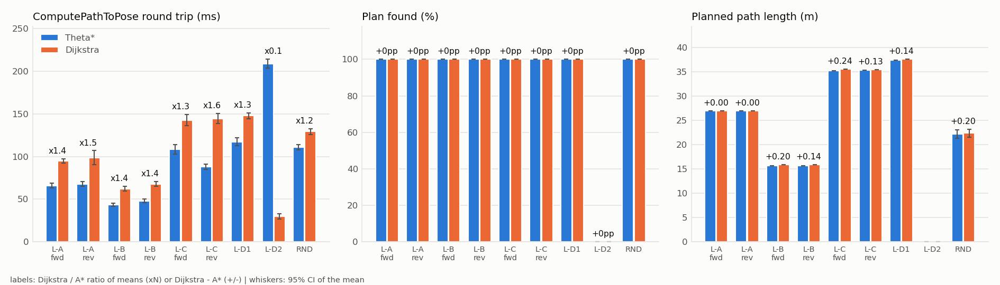

# 연구 1 결과 요약: A* vs Dijkstra

- 모드: **계획만 — Nav2 NavFn (ComputePathToPose, planner_id AStar / Dijkstra)**, 월드 `warehouse_large`, 기록 1680행
- 원자료: experiments/r1/results/20261118-030325_nav2plan-thetastar_warehouse_large/trials.csv
- 설정 버전: 2aa5aa21+dirty-n5d0c15-mbb536c
- 값: 평균 ± 95% 신뢰구간 반폭. 차이 = Dijkstra − A* (같은 시나리오·방향·반복끼리 짝지음)

## 1. 시나리오별 결과

| 시나리오 | 알고리즘 | n | 계획 성공 | 요청~응답 (ms) | 계획 경로 길이 (m) | 경로 점 수 | 최소 장애물 거리 (m) | 평균 장애물 거리 (m) | 꺾인 각도 합 (도) |
|---|---|---|---|---|---|---|---|---|---|
| L-A fwd 개방 경로 (하역장 26 m) | Theta* | 30 | 30/30 | 66.02 ± 2.76 | 27.000 ± 0.000 | 540 ± 0 | 1.400 ± 0.000 | 2.274 ± 0.000 | 0 ± 0 |
| L-A fwd 개방 경로 (하역장 26 m) | Dijkstra | 30 | 30/30 | 94.84 ± 2.40 | 27.000 ± 0.000 | 1079 ± 0 | 1.450 ± 0.000 | 2.274 ± 0.000 | 0 ± 0 |
| L-A rev 개방 경로 (하역장 26 m) | Theta* | 30 | 30/30 | 67.70 ± 2.72 | 27.000 ± 0.000 | 541 ± 0 | 1.400 ± 0.000 | 2.276 ± 0.000 | 0 ± 0 |
| L-A rev 개방 경로 (하역장 26 m) | Dijkstra | 30 | 30/30 | 98.73 ± 8.11 | 27.000 ± 0.000 | 1080 ± 0 | 1.450 ± 0.000 | 2.273 ± 0.000 | 0 ± 0 |
| L-B fwd 랙 우회 | Theta* | 30 | 30/30 | 43.77 ± 1.89 | 15.683 ± 0.000 | 310 ± 0 | 0.515 ± 0.000 | 0.665 ± 0.000 | 176 ± 0 |
| L-B fwd 랙 우회 | Dijkstra | 30 | 30/30 | 62.30 ± 2.62 | 15.888 ± 0.000 | 637 ± 0 | 0.538 ± 0.000 | 0.668 ± 0.000 | 322 ± 0 |
| L-B rev 랙 우회 | Theta* | 30 | 30/30 | 48.02 ± 2.14 | 15.709 ± 0.000 | 310 ± 0 | 0.522 ± 0.000 | 0.649 ± 0.000 | 195 ± 0 |
| L-B rev 랙 우회 | Dijkstra | 30 | 30/30 | 67.91 ± 2.62 | 15.852 ± 0.000 | 634 ± 0 | 0.538 ± 0.000 | 0.670 ± 0.000 | 218 ± 0 |
| L-C fwd 창고 끝에서 끝 | Theta* | 30 | 30/30 | 108.49 ± 5.61 | 35.262 ± 0.000 | 657 ± 0 | 0.515 ± 0.000 | 0.852 ± 0.000 | 395 ± 0 |
| L-C fwd 창고 끝에서 끝 | Dijkstra | 30 | 30/30 | 142.51 ± 6.55 | 35.503 ± 0.000 | 1417 ± 0 | 0.538 ± 0.000 | 0.920 ± 0.000 | 442 ± 0 |
| L-C rev 창고 끝에서 끝 | Theta* | 30 | 30/30 | 87.82 ± 3.16 | 35.297 ± 0.000 | 657 ± 0 | 0.522 ± 0.000 | 0.815 ± 0.000 | 486 ± 0 |
| L-C rev 창고 끝에서 끝 | Dijkstra | 30 | 30/30 | 144.52 ± 5.64 | 35.422 ± 0.000 | 1416 ± 0 | 0.538 ± 0.000 | 0.915 ± 0.000 | 360 ± 0 |
| L-D1 경로 차단 (재계획) | Theta* | 30 | 30/30 | 117.23 ± 4.71 | 37.426 ± 0.000 | 725 ± 0 | 0.538 ± 0.000 | 1.083 ± 0.000 | 380 ± 0 |
| L-D1 경로 차단 (재계획) | Dijkstra | 30 | 30/30 | 147.79 ± 3.35 | 37.570 ± 0.000 | 1500 ± 0 | 0.559 ± 0.000 | 1.339 ± 0.000 | 482 ± 0 |
| L-D2 경로 차단 (경로 없음) | Theta* | 30 | 0/30 | 208.56 ± 5.29 | - | 0 ± 0 | - | - | - |
| L-D2 경로 차단 (경로 없음) | Dijkstra | 30 | 0/30 | 29.96 ± 3.03 | - | 0 ± 0 | - | - | - |
| RND 무작위 쌍 | Theta* | 600 | 600/600 | 110.72 ± 3.16 | 22.174 ± 0.833 | 430 ± 16 | 0.547 ± 0.021 | 1.002 ± 0.026 | 264 ± 12 |
| RND 무작위 쌍 | Dijkstra | 600 | 600/600 | 129.29 ± 3.48 | 22.377 ± 0.839 | 894 ± 34 | 0.560 ± 0.021 | 1.023 ± 0.025 | 335 ± 16 |

## 2. 짝 비교 (Dijkstra − A*)

| 시나리오 | 짝 수 | 요청~응답 (ms) 차이 [95% CI] | 계획 경로 길이 (m) 차이 [95% CI] | 최소 장애물 거리 (m) 차이 [95% CI] | 평균 장애물 거리 (m) 차이 [95% CI] | 꺾인 각도 합 (도) 차이 [95% CI] | 요청~응답 배율 (D/A) |
|---|---|---|---|---|---|---|---|
| L-A fwd 개방 경로 (하역장 26 m) | 30 | +28.82 [+25.18, +32.47] | +0.000 | +0.050 | +0.000 | +0 | ×1.44 |
| L-A rev 개방 경로 (하역장 26 m) | 30 | +31.03 [+22.46, +39.61] | +0.000 | +0.050 | -0.003 | +0 | ×1.46 |
| L-B fwd 랙 우회 | 30 | +18.53 [+15.09, +21.97] | +0.205 | +0.024 | +0.003 | +145 | ×1.42 |
| L-B rev 랙 우회 | 30 | +19.89 [+16.00, +23.77] | +0.143 | +0.016 | +0.021 | +23 [+23, +23] | ×1.41 |
| L-C fwd 창고 끝에서 끝 | 30 | +34.02 [+27.03, +41.01] | +0.240 | +0.024 | +0.068 | +47 [+47, +47] | ×1.31 |
| L-C rev 창고 끝에서 끝 | 30 | +56.70 [+49.84, +63.56] | +0.126 | +0.016 | +0.100 [+0.100, +0.100] | -127 [-127, -127] | ×1.65 |
| L-D1 경로 차단 (재계획) | 30 | +30.56 [+24.68, +36.44] | +0.144 | +0.021 | +0.256 [+0.256, +0.256] | +102 [+102, +102] | ×1.26 |
| L-D2 경로 차단 (경로 없음) | 30 | -178.60 [-185.08, -172.12] | - | - | - | - | ×0.14 |
| RND 무작위 쌍 | 600 | +18.57 [+15.72, +21.42] | +0.203 [+0.186, +0.221] | +0.013 [+0.008, +0.019] | +0.021 [+0.013, +0.029] | +70 [+60, +80] | ×1.17 |

- 계획 경로 길이 차이 |D − A|: 평균 0.185 m, 최대 1.275 m, 1 cm 넘는 짝 735/810

## 3. 실패 기록

| 시나리오 | 방향 | 반복 | 알고리즘 | 이유 |
|---|---|---|---|---|
| L-D2 | fwd | 0 | Theta* | 계획 실패 (상태 6) |
| L-D2 | fwd | 0 | Dijkstra | 계획 실패 (상태 6) |
| L-D2 | fwd | 1 | Dijkstra | 계획 실패 (상태 6) |
| L-D2 | fwd | 1 | Theta* | 계획 실패 (상태 6) |
| L-D2 | fwd | 2 | Theta* | 계획 실패 (상태 6) |
| L-D2 | fwd | 2 | Dijkstra | 계획 실패 (상태 6) |
| L-D2 | fwd | 3 | Dijkstra | 계획 실패 (상태 6) |
| L-D2 | fwd | 3 | Theta* | 계획 실패 (상태 6) |
| L-D2 | fwd | 4 | Theta* | 계획 실패 (상태 6) |
| L-D2 | fwd | 4 | Dijkstra | 계획 실패 (상태 6) |
| L-D2 | fwd | 5 | Dijkstra | 계획 실패 (상태 6) |
| L-D2 | fwd | 5 | Theta* | 계획 실패 (상태 6) |
| L-D2 | fwd | 6 | Theta* | 계획 실패 (상태 6) |
| L-D2 | fwd | 6 | Dijkstra | 계획 실패 (상태 6) |
| L-D2 | fwd | 7 | Dijkstra | 계획 실패 (상태 6) |
| L-D2 | fwd | 7 | Theta* | 계획 실패 (상태 6) |
| L-D2 | fwd | 8 | Theta* | 계획 실패 (상태 6) |
| L-D2 | fwd | 8 | Dijkstra | 계획 실패 (상태 6) |
| L-D2 | fwd | 9 | Dijkstra | 계획 실패 (상태 6) |
| L-D2 | fwd | 9 | Theta* | 계획 실패 (상태 6) |
| L-D2 | fwd | 10 | Theta* | 계획 실패 (상태 6) |
| L-D2 | fwd | 10 | Dijkstra | 계획 실패 (상태 6) |
| L-D2 | fwd | 11 | Dijkstra | 계획 실패 (상태 6) |
| L-D2 | fwd | 11 | Theta* | 계획 실패 (상태 6) |
| L-D2 | fwd | 12 | Theta* | 계획 실패 (상태 6) |
| L-D2 | fwd | 12 | Dijkstra | 계획 실패 (상태 6) |
| L-D2 | fwd | 13 | Dijkstra | 계획 실패 (상태 6) |
| L-D2 | fwd | 13 | Theta* | 계획 실패 (상태 6) |
| L-D2 | fwd | 14 | Theta* | 계획 실패 (상태 6) |
| L-D2 | fwd | 14 | Dijkstra | 계획 실패 (상태 6) |
| L-D2 | fwd | 15 | Dijkstra | 계획 실패 (상태 6) |
| L-D2 | fwd | 15 | Theta* | 계획 실패 (상태 6) |
| L-D2 | fwd | 16 | Theta* | 계획 실패 (상태 6) |
| L-D2 | fwd | 16 | Dijkstra | 계획 실패 (상태 6) |
| L-D2 | fwd | 17 | Dijkstra | 계획 실패 (상태 6) |
| L-D2 | fwd | 17 | Theta* | 계획 실패 (상태 6) |
| L-D2 | fwd | 18 | Theta* | 계획 실패 (상태 6) |
| L-D2 | fwd | 18 | Dijkstra | 계획 실패 (상태 6) |
| L-D2 | fwd | 19 | Dijkstra | 계획 실패 (상태 6) |
| L-D2 | fwd | 19 | Theta* | 계획 실패 (상태 6) |
| L-D2 | fwd | 20 | Theta* | 계획 실패 (상태 6) |
| L-D2 | fwd | 20 | Dijkstra | 계획 실패 (상태 6) |
| L-D2 | fwd | 21 | Dijkstra | 계획 실패 (상태 6) |
| L-D2 | fwd | 21 | Theta* | 계획 실패 (상태 6) |
| L-D2 | fwd | 22 | Theta* | 계획 실패 (상태 6) |
| L-D2 | fwd | 22 | Dijkstra | 계획 실패 (상태 6) |
| L-D2 | fwd | 23 | Dijkstra | 계획 실패 (상태 6) |
| L-D2 | fwd | 23 | Theta* | 계획 실패 (상태 6) |
| L-D2 | fwd | 24 | Theta* | 계획 실패 (상태 6) |
| L-D2 | fwd | 24 | Dijkstra | 계획 실패 (상태 6) |
| L-D2 | fwd | 25 | Dijkstra | 계획 실패 (상태 6) |
| L-D2 | fwd | 25 | Theta* | 계획 실패 (상태 6) |
| L-D2 | fwd | 26 | Theta* | 계획 실패 (상태 6) |
| L-D2 | fwd | 26 | Dijkstra | 계획 실패 (상태 6) |
| L-D2 | fwd | 27 | Dijkstra | 계획 실패 (상태 6) |
| L-D2 | fwd | 27 | Theta* | 계획 실패 (상태 6) |
| L-D2 | fwd | 28 | Theta* | 계획 실패 (상태 6) |
| L-D2 | fwd | 28 | Dijkstra | 계획 실패 (상태 6) |
| L-D2 | fwd | 29 | Dijkstra | 계획 실패 (상태 6) |
| L-D2 | fwd | 29 | Theta* | 계획 실패 (상태 6) |

## 그림

