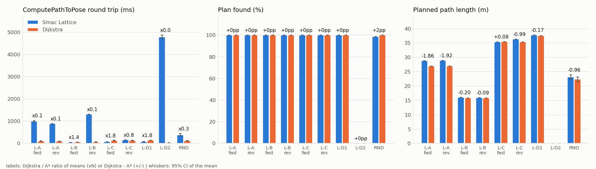

# 연구 1 결과 요약: A* vs Dijkstra

- 모드: **계획만 — Nav2 NavFn (ComputePathToPose, planner_id AStar / Dijkstra)**, 월드 `warehouse_large`, 기록 1680행
- 원자료: experiments/r1/results/20261118-030845_nav2plan-smaclattice_warehouse_large/trials.csv
- 설정 버전: bc597986-n5d0c15-mbb536c
- 값: 평균 ± 95% 신뢰구간 반폭. 차이 = Dijkstra − A* (같은 시나리오·방향·반복끼리 짝지음)

## 1. 시나리오별 결과

| 시나리오 | 알고리즘 | n | 계획 성공 | 요청~응답 (ms) | 계획 경로 길이 (m) | 경로 점 수 | 최소 장애물 거리 (m) | 평균 장애물 거리 (m) | 꺾인 각도 합 (도) |
|---|---|---|---|---|---|---|---|---|---|
| L-A fwd 개방 경로 (하역장 26 m) | Smac Lattice | 30 | 30/30 | 1008.01 ± 32.36 | 28.859 ± 0.000 | 555 ± 0 | 0.950 ± 0.000 | 2.248 ± 0.000 | 244 ± 0 |
| L-A fwd 개방 경로 (하역장 26 m) | Dijkstra | 30 | 30/30 | 109.95 ± 11.91 | 27.000 ± 0.000 | 1079 ± 0 | 1.450 ± 0.000 | 2.274 ± 0.000 | 0 ± 0 |
| L-A rev 개방 경로 (하역장 26 m) | Smac Lattice | 30 | 30/30 | 890.68 ± 4.34 | 28.918 ± 0.000 | 556 ± 0 | 0.850 ± 0.000 | 2.222 ± 0.000 | 234 ± 0 |
| L-A rev 개방 경로 (하역장 26 m) | Dijkstra | 30 | 30/30 | 100.84 ± 3.58 | 27.000 ± 0.000 | 1080 ± 0 | 1.450 ± 0.000 | 2.273 ± 0.000 | 0 ± 0 |
| L-B fwd 랙 우회 | Smac Lattice | 30 | 30/30 | 45.38 ± 1.37 | 16.084 ± 0.000 | 311 ± 0 | 0.250 ± 0.000 | 0.624 ± 0.000 | 348 ± 0 |
| L-B fwd 랙 우회 | Dijkstra | 30 | 30/30 | 64.57 ± 3.28 | 15.888 ± 0.000 | 637 ± 0 | 0.538 ± 0.000 | 0.668 ± 0.000 | 322 ± 0 |
| L-B rev 랙 우회 | Smac Lattice | 30 | 30/30 | 1315.93 ± 5.63 | 15.937 ± 0.000 | 329 ± 0 | 0.531 ± 0.000 | 0.669 ± 0.000 | 288 ± 0 |
| L-B rev 랙 우회 | Dijkstra | 30 | 30/30 | 67.94 ± 3.47 | 15.852 ± 0.000 | 634 ± 0 | 0.538 ± 0.000 | 0.670 ± 0.000 | 218 ± 0 |
| L-C fwd 창고 끝에서 끝 | Smac Lattice | 30 | 30/30 | 77.18 ± 3.19 | 35.418 ± 0.000 | 684 ± 0 | 0.531 ± 0.000 | 0.914 ± 0.000 | 330 ± 0 |
| L-C fwd 창고 끝에서 끝 | Dijkstra | 30 | 30/30 | 137.24 ± 2.94 | 35.503 ± 0.000 | 1417 ± 0 | 0.538 ± 0.000 | 0.920 ± 0.000 | 442 ± 0 |
| L-C rev 창고 끝에서 끝 | Smac Lattice | 30 | 30/30 | 160.95 ± 4.16 | 36.412 ± 0.000 | 714 ± 0 | 0.531 ± 0.000 | 0.916 ± 0.000 | 525 ± 0 |
| L-C rev 창고 끝에서 끝 | Dijkstra | 30 | 30/30 | 136.47 ± 6.03 | 35.422 ± 0.000 | 1416 ± 0 | 0.538 ± 0.000 | 0.915 ± 0.000 | 360 ± 0 |
| L-D1 경로 차단 (재계획) | Smac Lattice | 30 | 30/30 | 81.85 ± 4.74 | 37.745 ± 0.000 | 718 ± 0 | 0.538 ± 0.000 | 1.139 ± 0.000 | 228 ± 0 |
| L-D1 경로 차단 (재계획) | Dijkstra | 30 | 30/30 | 147.35 ± 3.32 | 37.570 ± 0.000 | 1500 ± 0 | 0.559 ± 0.000 | 1.339 ± 0.000 | 482 ± 0 |
| L-D2 경로 차단 (경로 없음) | Smac Lattice | 30 | 0/30 | 4796.68 ± 75.87 | - | 0 ± 0 | - | - | - |
| L-D2 경로 차단 (경로 없음) | Dijkstra | 30 | 0/30 | 35.65 ± 3.39 | - | 0 ± 0 | - | - | - |
| RND 무작위 쌍 | Smac Lattice | 600 | 591/600 | 385.30 ± 52.84 | 23.117 ± 0.833 | 436 ± 16 | 0.495 ± 0.020 | 0.975 ± 0.026 | 325 ± 12 |
| RND 무작위 쌍 | Dijkstra | 600 | 600/600 | 124.33 ± 3.39 | 22.377 ± 0.839 | 894 ± 34 | 0.560 ± 0.021 | 1.023 ± 0.025 | 335 ± 16 |

## 2. 짝 비교 (Dijkstra − A*)

| 시나리오 | 짝 수 | 요청~응답 (ms) 차이 [95% CI] | 계획 경로 길이 (m) 차이 [95% CI] | 최소 장애물 거리 (m) 차이 [95% CI] | 평균 장애물 거리 (m) 차이 [95% CI] | 꺾인 각도 합 (도) 차이 [95% CI] | 요청~응답 배율 (D/A) |
|---|---|---|---|---|---|---|---|
| L-A fwd 개방 경로 (하역장 26 m) | 30 | -898.06 [-925.66, -870.47] | -1.859 | +0.500 | +0.026 | -244 [-244, -244] | ×0.11 |
| L-A rev 개방 경로 (하역장 26 m) | 30 | -789.84 [-795.65, -784.04] | -1.918 [-1.918, -1.918] | +0.600 [+0.600, +0.600] | +0.051 | -234 [-234, -234] | ×0.11 |
| L-B fwd 랙 우회 | 30 | +19.19 [+15.84, +22.54] | -0.196 | +0.288 [+0.288, +0.288] | +0.044 [+0.044, +0.044] | -26 | ×1.42 |
| L-B rev 랙 우회 | 30 | -1248.00 [-1255.47, -1240.52] | -0.085 | +0.007 | +0.000 | -70 [-70, -70] | ×0.05 |
| L-C fwd 창고 끝에서 끝 | 30 | +60.06 [+55.60, +64.51] | +0.085 | +0.007 | +0.006 | +112 [+112, +112] | ×1.78 |
| L-C rev 창고 끝에서 끝 | 30 | -24.48 [-31.77, -17.19] | -0.990 | +0.007 | -0.002 | -166 [-166, -166] | ×0.85 |
| L-D1 경로 차단 (재계획) | 30 | +65.51 [+59.28, +71.74] | -0.175 | +0.021 | +0.199 [+0.199, +0.199] | +254 [+254, +254] | ×1.80 |
| L-D2 경로 차단 (경로 없음) | 30 | -4761.03 [-4836.82, -4685.24] | - | - | - | - | ×0.01 |
| RND 무작위 쌍 | 600 | -260.97 [-313.52, -208.42] | -0.961 [-1.053, -0.870] | +0.066 [+0.056, +0.076] | +0.050 [+0.035, +0.064] | +7 [-7, +22] | ×0.32 |

- 계획 경로 길이 차이 |D − A|: 평균 0.956 m, 최대 4.056 m, 1 cm 넘는 짝 789/801

## 3. 실패 기록

| 시나리오 | 방향 | 반복 | 알고리즘 | 이유 |
|---|---|---|---|---|
| L-D2 | fwd | 0 | Smac Lattice | 계획 실패 (상태 6) |
| L-D2 | fwd | 0 | Dijkstra | 계획 실패 (상태 6) |
| L-D2 | fwd | 1 | Dijkstra | 계획 실패 (상태 6) |
| L-D2 | fwd | 1 | Smac Lattice | 계획 실패 (상태 6) |
| L-D2 | fwd | 2 | Smac Lattice | 계획 실패 (상태 6) |
| L-D2 | fwd | 2 | Dijkstra | 계획 실패 (상태 6) |
| L-D2 | fwd | 3 | Dijkstra | 계획 실패 (상태 6) |
| L-D2 | fwd | 3 | Smac Lattice | 계획 실패 (상태 6) |
| L-D2 | fwd | 4 | Smac Lattice | 계획 실패 (상태 6) |
| L-D2 | fwd | 4 | Dijkstra | 계획 실패 (상태 6) |
| L-D2 | fwd | 5 | Dijkstra | 계획 실패 (상태 6) |
| L-D2 | fwd | 5 | Smac Lattice | 계획 실패 (상태 6) |
| L-D2 | fwd | 6 | Smac Lattice | 계획 실패 (상태 6) |
| L-D2 | fwd | 6 | Dijkstra | 계획 실패 (상태 6) |
| L-D2 | fwd | 7 | Dijkstra | 계획 실패 (상태 6) |
| L-D2 | fwd | 7 | Smac Lattice | 계획 실패 (상태 6) |
| L-D2 | fwd | 8 | Smac Lattice | 계획 실패 (상태 6) |
| L-D2 | fwd | 8 | Dijkstra | 계획 실패 (상태 6) |
| L-D2 | fwd | 9 | Dijkstra | 계획 실패 (상태 6) |
| L-D2 | fwd | 9 | Smac Lattice | 계획 실패 (상태 6) |
| L-D2 | fwd | 10 | Smac Lattice | 계획 실패 (상태 6) |
| L-D2 | fwd | 10 | Dijkstra | 계획 실패 (상태 6) |
| L-D2 | fwd | 11 | Dijkstra | 계획 실패 (상태 6) |
| L-D2 | fwd | 11 | Smac Lattice | 계획 실패 (상태 6) |
| L-D2 | fwd | 12 | Smac Lattice | 계획 실패 (상태 6) |
| L-D2 | fwd | 12 | Dijkstra | 계획 실패 (상태 6) |
| L-D2 | fwd | 13 | Dijkstra | 계획 실패 (상태 6) |
| L-D2 | fwd | 13 | Smac Lattice | 계획 실패 (상태 6) |
| L-D2 | fwd | 14 | Smac Lattice | 계획 실패 (상태 6) |
| L-D2 | fwd | 14 | Dijkstra | 계획 실패 (상태 6) |
| L-D2 | fwd | 15 | Dijkstra | 계획 실패 (상태 6) |
| L-D2 | fwd | 15 | Smac Lattice | 계획 실패 (상태 6) |
| L-D2 | fwd | 16 | Smac Lattice | 계획 실패 (상태 6) |
| L-D2 | fwd | 16 | Dijkstra | 계획 실패 (상태 6) |
| L-D2 | fwd | 17 | Dijkstra | 계획 실패 (상태 6) |
| L-D2 | fwd | 17 | Smac Lattice | 계획 실패 (상태 6) |
| L-D2 | fwd | 18 | Smac Lattice | 계획 실패 (상태 6) |
| L-D2 | fwd | 18 | Dijkstra | 계획 실패 (상태 6) |
| L-D2 | fwd | 19 | Dijkstra | 계획 실패 (상태 6) |
| L-D2 | fwd | 19 | Smac Lattice | 계획 실패 (상태 6) |
| L-D2 | fwd | 20 | Smac Lattice | 계획 실패 (상태 6) |
| L-D2 | fwd | 20 | Dijkstra | 계획 실패 (상태 6) |
| L-D2 | fwd | 21 | Dijkstra | 계획 실패 (상태 6) |
| L-D2 | fwd | 21 | Smac Lattice | 계획 실패 (상태 6) |
| L-D2 | fwd | 22 | Smac Lattice | 계획 실패 (상태 6) |
| L-D2 | fwd | 22 | Dijkstra | 계획 실패 (상태 6) |
| L-D2 | fwd | 23 | Dijkstra | 계획 실패 (상태 6) |
| L-D2 | fwd | 23 | Smac Lattice | 계획 실패 (상태 6) |
| L-D2 | fwd | 24 | Smac Lattice | 계획 실패 (상태 6) |
| L-D2 | fwd | 24 | Dijkstra | 계획 실패 (상태 6) |
| L-D2 | fwd | 25 | Dijkstra | 계획 실패 (상태 6) |
| L-D2 | fwd | 25 | Smac Lattice | 계획 실패 (상태 6) |
| L-D2 | fwd | 26 | Smac Lattice | 계획 실패 (상태 6) |
| L-D2 | fwd | 26 | Dijkstra | 계획 실패 (상태 6) |
| L-D2 | fwd | 27 | Dijkstra | 계획 실패 (상태 6) |
| L-D2 | fwd | 27 | Smac Lattice | 계획 실패 (상태 6) |
| L-D2 | fwd | 28 | Smac Lattice | 계획 실패 (상태 6) |
| L-D2 | fwd | 28 | Dijkstra | 계획 실패 (상태 6) |
| L-D2 | fwd | 29 | Dijkstra | 계획 실패 (상태 6) |
| L-D2 | fwd | 29 | Smac Lattice | 계획 실패 (상태 6) |

## 그림

