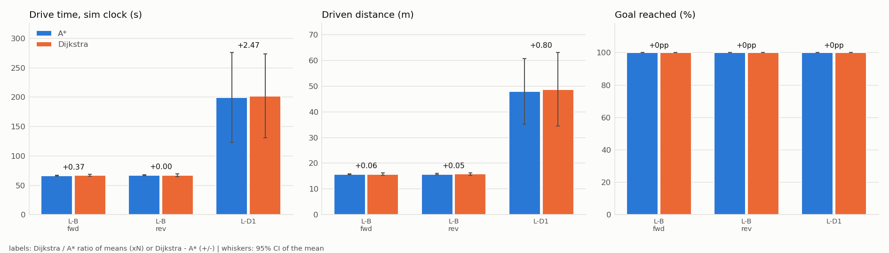

# 연구 1 결과 요약: A* vs Dijkstra

- 모드: **Gazebo 주행 — Nav2 (NavigateToPose, NavFn AStar / Dijkstra + DWB)**, 월드 `warehouse_large`, 기록 18행
- 원자료: experiments/r1/results/20261118-032748_nav2sim_warehouse_large/trials.csv
- 설정 버전: 1bab57dd-n5d0c15-mbb536c
- 값: 평균 ± 95% 신뢰구간 반폭. 차이 = Dijkstra − A* (같은 시나리오·방향·반복끼리 짝지음)

## 1. 시나리오별 결과

| 시나리오 | 알고리즘 | n | 계획 성공 | 도착 성공 | 주행 시간 (s) | 주행 시간, sim (s) | 실제 주행 거리 (m) | 계획 경로 길이 (m) | 계획 횟수 | 복구 횟수 | 도착 오차 (m) | 최소 장애물 거리 (m) |
|---|---|---|---|---|---|---|---|---|---|---|---|---|
| L-B fwd 랙 우회 | A* | 3 | 3/3 | 3/3 | 72.5 ± 4.8 | 66.7 ± 0.7 | 15.73 ± 0.21 | 15.971 ± 0.144 | 65.3 ± 2.9 | 0.00 ± 0.00 | 0.135 ± 0.052 | 0.589 ± 0.024 |
| L-B fwd 랙 우회 | Dijkstra | 3 | 3/3 | 3/3 | 72.6 ± 1.8 | 67.1 ± 1.7 | 15.79 ± 0.41 | 15.816 ± 0.139 | 66.0 ± 2.5 | 0.00 ± 0.00 | 0.097 ± 0.121 | 0.561 ± 0.047 |
| L-B rev 랙 우회 | A* | 3 | 3/3 | 3/3 | 72.8 ± 1.4 | 67.4 ± 1.0 | 15.76 ± 0.29 | 15.861 ± 0.284 | 66.7 ± 1.4 | 0.00 ± 0.00 | 0.144 ± 0.159 | 0.562 ± 0.050 |
| L-B rev 랙 우회 | Dijkstra | 3 | 3/3 | 3/3 | 72.9 ± 2.4 | 67.4 ± 2.4 | 15.81 ± 0.50 | 15.760 ± 0.301 | 66.3 ± 2.9 | 0.00 ± 0.00 | 0.140 ± 0.161 | 0.550 ± 0.000 |
| L-D1 경로 차단 (재계획) | A* | 3 | 3/3 | 3/3 | 217.4 ± 81.0 | 199.6 ± 76.2 | 47.92 ± 12.65 | 35.340 ± 0.072 | 196.0 ± 71.9 | 0.00 ± 0.00 | 0.304 ± 0.027 | 0.535 ± 0.013 |
| L-D1 경로 차단 (재계획) | Dijkstra | 3 | 3/3 | 3/3 | 219.8 ± 74.2 | 202.1 ± 71.2 | 48.72 ± 14.24 | 35.362 ± 0.171 | 195.3 ± 67.5 | 0.00 ± 0.00 | 0.301 ± 0.010 | 0.552 ± 0.029 |

## 2. 짝 비교 (Dijkstra − A*)

| 시나리오 | 짝 수 | 주행 시간 (s) 차이 [95% CI] | 주행 시간, sim (s) 차이 [95% CI] | 실제 주행 거리 (m) 차이 [95% CI] | 계획 경로 길이 (m) 차이 [95% CI] |
|---|---|---|---|---|---|
| L-B fwd 랙 우회 | 3 | +0.1 [-3.1, +3.3] | +0.4 [-1.4, +2.2] | +0.06 [-0.38, +0.51] | -0.155 [-0.218, -0.092] |
| L-B rev 랙 우회 | 3 | +0.0 [-3.7, +3.8] | -0.0 [-3.4, +3.4] | +0.05 [-0.38, +0.48] | -0.101 [-0.239, +0.036] |
| L-D1 경로 차단 (재계획) | 3 | +2.4 [-15.6, +20.4] | +2.5 [-14.8, +19.8] | +0.80 [-2.63, +4.22] | +0.022 [-0.194, +0.237] |

- 계획 경로 길이 차이 |D − A|: 평균 0.104 m, 최대 0.180 m, 1 cm 넘는 짝 8/9

## 그림

