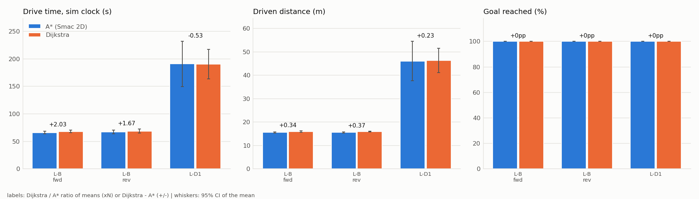

# 연구 1 결과 요약: A* vs Dijkstra

- 모드: **Gazebo 주행 — Nav2 (NavigateToPose, NavFn AStar / Dijkstra + DWB)**, 월드 `warehouse_large`, 기록 18행
- 원자료: experiments/r1/results/20261118-042416_nav2sim-smac2d_warehouse_large/trials.csv
- 설정 버전: fb9dff8f-n5d0c15-mbb536c
- 값: 평균 ± 95% 신뢰구간 반폭. 차이 = Dijkstra − A* (같은 시나리오·방향·반복끼리 짝지음)

## 1. 시나리오별 결과

| 시나리오 | 알고리즘 | n | 계획 성공 | 도착 성공 | 주행 시간 (s) | 주행 시간, sim (s) | 실제 주행 거리 (m) | 계획 경로 길이 (m) | 계획 횟수 | 복구 횟수 | 도착 오차 (m) | 최소 장애물 거리 (m) |
|---|---|---|---|---|---|---|---|---|---|---|---|---|
| L-B fwd 랙 우회 | A* (Smac 2D) | 3 | 3/3 | 3/3 | 71.9 ± 2.1 | 66.1 ± 2.1 | 15.60 ± 0.24 | 15.383 ± 0.066 | 64.7 ± 2.9 | 0.00 ± 0.00 | 0.099 ± 0.084 | 0.497 ± 0.007 |
| L-B fwd 랙 우회 | Dijkstra | 3 | 3/3 | 3/3 | 73.6 ± 2.4 | 68.2 ± 2.3 | 15.94 ± 0.28 | 15.796 ± 0.147 | 67.3 ± 2.9 | 0.00 ± 0.00 | 0.045 ± 0.079 | 0.583 ± 0.072 |
| L-B rev 랙 우회 | A* (Smac 2D) | 3 | 3/3 | 3/3 | 72.9 ± 3.4 | 67.2 ± 3.3 | 15.57 ± 0.20 | 15.389 ± 0.071 | 66.3 ± 3.8 | 0.00 ± 0.00 | 0.125 ± 0.191 | 0.494 ± 0.004 |
| L-B rev 랙 우회 | Dijkstra | 3 | 3/3 | 3/3 | 75.2 ± 5.3 | 68.9 ± 3.5 | 15.93 ± 0.19 | 15.774 ± 0.095 | 68.0 ± 4.3 | 0.00 ± 0.00 | 0.125 ± 0.152 | 0.567 ± 0.072 |
| L-D1 경로 차단 (재계획) | A* (Smac 2D) | 3 | 3/3 | 3/3 | 207.4 ± 40.4 | 190.7 ± 41.0 | 46.09 ± 8.38 | 35.041 ± 0.158 | 186.3 ± 38.2 | 0.00 ± 0.00 | 0.269 ± 0.024 | 0.493 ± 0.054 |
| L-D1 경로 차단 (재계획) | Dijkstra | 3 | 3/3 | 3/3 | 206.2 ± 27.6 | 190.2 ± 26.8 | 46.32 ± 5.21 | 35.311 ± 0.218 | 184.0 ± 25.9 | 0.00 ± 0.00 | 0.304 ± 0.012 | 0.534 ± 0.010 |

## 2. 짝 비교 (Dijkstra − A*)

| 시나리오 | 짝 수 | 주행 시간 (s) 차이 [95% CI] | 주행 시간, sim (s) 차이 [95% CI] | 실제 주행 거리 (m) 차이 [95% CI] | 계획 경로 길이 (m) 차이 [95% CI] |
|---|---|---|---|---|---|
| L-B fwd 랙 우회 | 3 | +1.7 [+1.3, +2.1] | +2.0 [-0.5, +4.5] | +0.34 [+0.16, +0.52] | +0.413 [+0.201, +0.625] |
| L-B rev 랙 우회 | 3 | +2.3 [-3.9, +8.5] | +1.7 [-0.4, +3.8] | +0.37 [-0.02, +0.75] | +0.385 [+0.362, +0.408] |
| L-D1 경로 차단 (재계획) | 3 | -1.2 [-15.3, +12.9] | -0.5 [-16.4, +15.4] | +0.23 [-2.95, +3.41] | +0.271 [+0.207, +0.335] |

- 계획 경로 길이 차이 |D − A|: 평균 0.356 m, 최대 0.504 m, 1 cm 넘는 짝 9/9

## 그림

